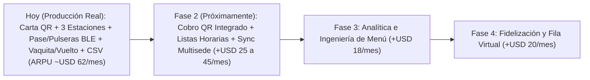

# Modelo de Negocios Integral: SaleListo

**Plataforma en la nube de pedidos autogestionados en mesa, ruteo inteligente en hasta 3 estaciones (`Cocina`, `Barra` y `Mostrador`), y coordinación de salón 100% sin celulares en mano (Estación de Mozos fija en el pase + opción de Pulseras Vibradoras Xiaomi Band por Bluetooth BLE) para gastronomía en Argentina y América Latina.**  
**Sitio oficial en vivo:** [`https://salelisto.com`](https://salelisto.com) · **Demo interactiva:** [`https://salelisto.com/demo.html`](https://salelisto.com/demo.html) · **Contacto:** `(+54)1138436571` · `simon@salelisto.com` · `ventas@salelisto.com`

---

## Resumen Ejecutivo

**SaleListo** es una plataforma web operativa en la nube diseñada para resolver el principal lucro cesante de restaurantes, bares, cervecerías, cafeterías y polos gastronómicos: **el tiempo muerto en la mesa y la fricción operativa entre el comensal, el mozo, la cocina, la barra y el mostrador**.

A diferencia de los menús digitales estáticos en PDF (que obligan a hacer zoom, quedan desactualizados ante la inflación y no permiten comprar) y a diferencia de los pesados sistemas de facturación heredados (pensados de la caja hacia adentro y no para la dinámica viva del salón), SaleListo digitaliza de punta a punta la experiencia en la mesa sin exigir descargas de aplicaciones ni registros previos, y **sin obligar a los mozos a caminar mirando un celular frente a los clientes**:

1. **Acceso instantáneo directo con la cámara y QR de token fijo seguro**: Cada mesa cuenta con un código QR vectorial único e inalterable (no correlativo y protegido contra enumeración en modo producción). El cliente escanea directo con la cámara de su celular sin bajar apps ni crear cuentas, visualiza la carta actualizada al segundo con fotos reales y filtros dietarios (*Sin TACC, Veggie, Vegano, Picante, Sin alcohol*), personaliza su pedido con aclaraciones, repite rondas en un toque y solicita la cuenta con **Calculadora "Vaquita"** (división entre `N` personas) y declaración de con cuánto abona en efectivo para recibir el vuelto exacto en un único viaje.
2. **Diseño modular del salón y gestión anti-inflación con vista previa**: El local arma su plano operativo con bloques pre-configurados (*Interior, Terraza, Exterior/Vereda, Barra, Sector 1, Sector 2, Patio y Salón VIP*), administra disponibilidad de platos agotados (*86*) en vivo tanto desde el Panel como desde Cocina, y aplica **ajustes masivos porcentuales de precios por inflación** con vista previa antes/después y botón de deshacer en segundos, sin reimprimir un solo código QR.
3. **Separación automática en hasta 3 estaciones reales en simultáneo (`Cocina`, `Barra` y `Mostrador`)**: Apenas el cliente envía su pedido, el sistema divide y rutea automáticamente los platos calientes hacia **Cocina**, las bebidas/coctelería/café hacia **Barra** y las piezas de sushi, fuegos exteriores o vitrina de pastelería hacia **Mostrador**, eliminando comandas de papel extraviadas y cuellos de botella.
4. **Orquestación inteligente y potenciación 100% pro-equipo**: En el mismo instante en que entra un pedido, SaleListo asigna un mozo responsable mediante esquema híbrido (pre-asignado por sector/bloque o balanceado automáticamente hacia el mozo disponible con menor carga activa). Si un mozo finaliza su turno o rota en plena hora pico, **sus mesas activas se reasignan de forma automática** entre el plantel disponible para que ninguna mesa quede desatendida.
5. **Coordinación 100% sin celulares en el salón (Estación de Mozos fija de serie + Kit opcional de Pulseras Vibradoras Bluetooth BLE)**:
   * **Incluida de serie desde el Plan Base (`Estación de Mozos fija /pase.html`)**: una única tablet o pantalla horizontal ubicada en el mostrador del pase o la barra, filtrable por sector (`?bloque=...`), dividida en columnas en vivo por cada mozo activo y legible a 3 o 4 metros. Con esta modalidad **los teléfonos personales del plantel pueden quedar guardados bajo llave en el locker o en caja durante todo el turno**. Muestra al instante qué platos retirar en Cocina, qué tragos retirar en Barra, qué piezas retirar en Mostrador, qué mesas llaman (con confirmación directa en 1 toque) y qué cuentas cobrar indicando medio de pago (*Efectivo con vuelto exacto calculado, Tarjeta, QR o Transferencia*) y propina. Costo de hardware **USD 0** para SaleListo.
   * **Adicional pago compatible con los 3 planes (`Kit Pulseras Vibradoras Xiaomi Smart Band`)**: ideal para patios cerveceros, terrazas por escalera, veredas amplias o plantas altas. Por física **Bluetooth Low Energy (BLE)**, el teléfono del camarero va **guardado y con pantalla bloqueada en su bolsillo** (a corta distancia de la muñeca para garantizar enlace BLE ininterrumpido en todo el predio, sin sacarlo ni mirarlo jamás en el salón) y el mozo siente la vibración en su muñeca leyendo en medio segundo avisos ultracompactos como `🍸 T2 · Retirar Barra` o `💳 M8 · Efectivo c/$50.000` (10 a 14 días de autonomía real, resistencia al agua 5 ATM y 15 g de peso).

El modelo comercial se basa en una **suscripción SaaS B2B mensual escalonada sin comisiones sobre la venta del salón y sin contrato de permanencia mínima**, complementada por ingresos iniciales (*upfront*) con margen positivo y cero capital propio inmovilizado (**puesta en marcha llave en mano en 48 horas** con kits físicos de códigos QR en acrílico/PVC y **Kits de Pulseras Vibradoras SaleListo configuradas**), y apalancada en una única promesa canónica de conversión: **Piloto sin riesgo de 14 días (2 fines de semana completos) en 1 sector crítico del local, activado llave en mano en 48 horas**.

---

## 1. Propuesta de Valor Cuantificable para el Dueño Gastronómico

El dueño o encargado gastronómico no compra software por novedad tecnológica; invierte cuando percibe un impacto directo y medible en **más facturación por turno, menores pérdidas operativas y menor desgaste de su equipo en horas pico**. SaleListo ataca cuatro palancas directas del estado de resultados del restaurante.

### 1.1. Aumento en la Rotación de Mesas (+15% a +22% en horarios pico)

En el servicio tradicional de salón existen tres tiempos muertos improductivos que alargan artificialmente la ocupación de una mesa cuando el local tiene fila en la puerta:

| Etapa del ciclo de mesa | Servicio tradicional | Con SaleListo | Tiempo recuperado |
| :--- | :---: | :---: | :---: |
| Sentarse, esperar carta física y que tomen el primer pedido | 10 a 14 min | **2 a 4 min** | **8 a 10 min** |
| Despacho interno del pedido hacia Cocina, Barra y Mostrador | 3 a 5 min | **Instantáneo (0 min)** | **3 a 5 min** |
| Pedir la cuenta, dividir ("vaquita"), definir pago/vuelto y cobrar | 10 a 15 min (4 viajes) | **3 a 5 min (1 solo viaje)** | **7 a 10 min** |
| **Tiempo muerto total eliminado por sesión de mesa** | **23 a 34 min** | **5 a 9 min** | **18 a 25 min ahorrados** |

* **Impacto real en capacidad instalada**: En un despacho nocturno de viernes o sábado (franja fuerte de 20:00 a 00:30, equivalente a 270 minutos operativos), reducir la estadía promedio de una mesa de **90 minutos a 72 minutos** permite pasar de **3,0 rotaciones a 3,75 rotaciones por mesa en la misma noche (+25% de capacidad de facturación en horas pico)**, sin pagar un peso adicional de alquiler, expensas ni habilitación municipal.

### 1.2. Incremento del Ticket Promedio (+12% a +18% por segundas rondas y compras visuales)

El mayor ingreso perdido de una cervecería, bar o restaurante ocurre después del plato principal: el cliente termina su primera bebida, mira alrededor para pedir otra pinta, una copa de vino, un postre o un café, no logra cruzar mirada con el mozo porque el salón está desbordado y desiste.

* **Segundas y terceras rondas en 1 toque (+20% a +30% en despacho de Barra)**: Con el QR fijo en la mesa (y botón directo **`🔄 Repetir`** sobre rondas anteriores), pedir otra vuelta toma menos de 10 segundos y entra directo a Barra. El aviso se enciende al instante en la columna del mozo en la **Estación del Pase** (o le vibra en la muñeca en su **pulsera Xiaomi Band** con el teléfono bloqueado en el bolsillo) recién cuando la bebida ya está servida lista para llevar, sin ningún camarero mirando un celular en medio del salón.
* **Venta visual con fotografías reales y filtros dietarios (+15% a +25% en entradas y postres)**: A diferencia de una lista de texto impresa, ver la fotografía real de unas rabas, un combinado de sushi o un volcán de chocolate etiquetado como *"Popular"* o *"Sin TACC"* dispara la compra impulsiva antes y después del plato fuerte.

### 1.3. Reducción Drástica de Errores de Comanda y Mermas (-85% a -95%)

En la operación tradicional, el pedido atraviesa una cadena de "teléfono descompuesto": el cliente habla en un salón ruidoso, el mozo anota apurado en una libreta, camina hasta una terminal compartida para cargarlo o entrega un papel manchado en cocina.

* En gastronomía urbana, los platos y bebidas rehechos por errores de punto de cocción, ingredientes omitidos (*"pedí sin cebolla"*, *"era sin TACC"*, *"bebida sin hielo"*) o ítems cargados a la mesa equivocada representan habitualmente entre el **1,5% y el 3,0% del Costo de Mercadería Vendida (CMV) mensual** en insumos directos descartados y atenciones de cortesía.
* Con SaleListo, **el propio comensal selecciona sus ítems y redacta sus aclaraciones exactas**, el servidor valida precios en SQLite sin posibilidad de manipulación, y cada estación (**Cocina**, **Barra** y **Mostrador**) visualiza únicamente lo que debe preparar. Además, si un plato o barril se agota en mitad del servicio, el propio cocinero o el encargado lo pausa en 1 toque (**botón rápido `🚫 Agotados`** en `cocina.html` o en el Panel) y desaparece al instante de todos los teléfonos del salón.

### 1.4. Fluidez Pro-Equipo en Horas Pico y Cero Celulares en el Salón (+30% a +40% de capacidad por turno)

Los sectores alejados de la caja y la cocina (*Terraza, Patio, Vereda/Exterior o Salón VIP en planta alta*) suelen sufrir cuellos de botella los viernes y sábados, generando estrés en el plantel, rotación de personal y recargos operativos de emergencia, mientras que en restaurantes de estética cuidada los dueños rechazan de plano ver camareros caminando con un celular en la mano:

* **Enfoque 100% pro-equipo (aliado del jefe de salón y de los mozos, nunca recorte de plantel)**: Sin SaleListo, el camarero gasta cerca del **60% de su energía física en traslados mecánicos improductivos**: llevar cartas, preguntar si ya eligieron, asomarse a cocina a consultar si salió la mesa T3, preguntar cómo pagan, hacer cuentas grupales y volver a caja por cambio o posnet.
* Con SaleListo, el balanceador híbrido reparte equitativamente las mesas o respeta los sectores asignados y elimina por completo las pantallas personales en el salón mediante dos modalidades físicamente precisas:
  1. **Estación de Mozos fija en el pase (`/pase.html`), incluida de serie en todos los planes**: una única tablet o pantalla horizontal en el mostrador de despacho o barra (con bloqueo automático de suspensión de pantalla *Screen Wake Lock* y filtro opcional por sector `?bloque=...`) organiza columnas en vivo por cada mozo activo, legibles a 3 o 4 metros. **Los celulares personales de los mozos quedan guardados en el locker o en caja**. Al pasar por el mostrador, cada camarero ve qué retirar en Cocina, Barra o Mostrador, confirma cada atención en un único toque o retira el cobro exacto con propina y vuelto calculado.
  2. **Kit Pulseras Vibradoras (Xiaomi Smart Band por Bluetooth BLE), adicional compatible con los 3 planes**: cuando el local cuenta con patio profundo, doble vereda o terraza por escalera, cada mozo lleva su teléfono **guardado y con pantalla bloqueada en el bolsillo** (manteniendo enlace Bluetooth BLE estable a centímetros de su muñeca, pero **sin sacarlo jamás en el salón**) y recibe el pulso háptico directo en la pulsera (`🍸 T2 · Retirar Barra`, `💳 M8 · Efectivo c/$50k`) **únicamente cuando hay valor real que aportar**, manteniendo ambas manos libres para bandejas y la vista puesta en la hospitalidad.
* **Resultado para el equipo**: el mismo plantel estable absorbe con serenidad, presencia impecable y mejores propinas los picos intensos de viernes y sábado sin desborde ni recargos de urgencia, y cuando un mozo corta su turno, el sistema **reasigna automáticamente sus mesas abiertas** sin dejar mesas huérfanas.

### 1.5. Caso Numérico de Retorno sobre la Inversión (ROI) para un Restaurante Tipo (25 Mesas)

Tomemos como referencia un restaurante o cervecería promedio en zona urbana de Argentina con **25 mesas (100 cubiertos)**, operando 26 días al mes (~1.300 sesiones mensuales de mesa con ticket medio de ~ARS 42.400), una facturación mensual base de **ARS 55.125.000** (equivalente a **USD 35.000/mes**, tomando la cotización del **Dólar Oficial Venta Banco Nación de `1 USD = ARS 1.575`**, pizarra oficial Compra ARS 1.525 / Venta ARS 1.575) y un Costo de Mercadería Vendida (CMV) del **33%** (**ARS 18.191.250/mes** = **USD 11.550/mes**, dejando un margen de contribución del **67%**):

| Palanca de valor medible con SaleListo | Impacto conservador estimado | Facturación / Ahorro bruto mensual (ARS) | Contribución marginal neta dueño (ARS / USD) |
| :--- | :--- | :---: | :---: |
| **1. Mayor rotación en turnos pico** *(solo vie/sáb noche, +12% en horas pico = +3,5% venta total, al 67% margen)* | +3,5% ventas totales | + ARS 1.929.375 | + ARS 1.292.681 *(USD 821)* |
| **2. Suba de ticket promedio** *(segundas rondas y postres en 35% de las mesas = +5,0% venta total, al 67% margen)* | +5,0% ventas totales | + ARS 2.756.250 | + ARS 1.846.688 *(USD 1.173)* |
| **3. Reducción de errores de comanda y descartes** *(30 platos/bebidas rehechos menos al mes x ARS 7.875 [USD 5] de insumo directo; ~1,30% del CMV)* | Ahorro exacto de insumos | + ARS 236.250 | + ARS 236.250 *(USD 150)* |
| **4. Capacidad de absorber picos de viernes/sábado sin desborde ni recargos operativos** *(7 guardias/recargos de pico absorbidos con fluidez x ARS 59.850 [USD 38])* | Fluidez de turno pro-equipo | + ARS 418.950 | + ARS 418.950 *(USD 266)* |
| **Beneficio económico mensual generado** | | **+ ARS 5.340.825 / mes** | **+ ARS 3.794.569 / mes *(+ USD 2.410/mes)*** |
| **Costo mensual Plan Salón de SaleListo** | Tarifa plana sin comisión | *- ARS 102.375 / mes* | *- ARS 102.375 / mes *(- USD 65/mes)*** |
| **Ganancia neta limpia mensual para el local** | **Retorno: 37x bruto (36x neto)** | | **+ ARS 3.692.194 / mes *(+ USD 2.345/mes)*** |

*(Nota aritmética: la columna de contribución neta cierra al peso y al dólar exacto: `1.292.681 + 1.846.688 + 236.250 + 418.950 = ARS 3.794.569` menos `ARS 102.375` = **`+ ARS 3.692.194/mes`**; y en moneda dura `821 + 1.173 + 150 + 266 = USD 2.410` menos `USD 65` = **`+ USD 2.345/mes`**).*

> **Conclusión comercial defendible ante cualquier dueño**: El abono mensual de SaleListo representa **menos del 0,20% de tu venta (0,19% exacto): se paga solo con 3 a 4 mesas extra o ~25 pintas adicionales en todo el mes** (menos de 1 pinta por día operativo, considerando una mesa promedio de ~ARS 42.400 que deja ~ARS 28.400 de margen limpio, o una pinta artesanal que aporta ~ARS 4.100 de margen neto). Todo el resto es ganancia limpia directa para el restaurante.

---

## 2. Esquema de Monetización y Planes de Precios (Argentina y LATAM)

### 2.1. Principio Rector: Suscripción Plana 0% Comisión y Sin Permanencia Mínima

El empresario gastronómico argentino y latinoamericano arrastra un fuerte desgaste con las plataformas de delivery que retienen entre el **18% y el 30% + IVA** de cada pedido y con contratos rígidos difíciles de rescindir. Por eso, el corazón comercial de SaleListo combina:
* **Suscripción SaaS mensual fija y escalonada con 0% de comisión** sobre las ventas generadas en el salón.
* **Facturación local en Pesos Argentinos (ARS)** sin cláusula de permanencia mínima ni penalidad de baja.
* **Actualización trimestral previsible**, manteniendo fijo el abono en ARS durante cada trimestre y topeando el ajuste trimestral por el menor índice entre **IPC (INDEC)** y variación del **Dólar Oficial Venta BNA** (o congelamiento anual con **2 meses bonificados**).

> *Nota monetaria*: Todos los valores se expresan en **USD de referencia comercial** y su equivalente en **Pesos Argentinos (ARS)** tomando el **Dólar Oficial Venta del Banco de la Nación Argentina (BNA) en `1 USD = ARS 1.575`** (Compra ARS 1.525 / Venta ARS 1.575; valores netos antes de impuestos).

### 2.2. Matriz de Planes SaaS Mensuales (100% Funcionalidades Reales + Transparencia de Roadmap)

| Característica | Plan Barra / Café *(Base)* | Plan Salón / Bistró *(Más elegido)* | Plan Gran Salón / Multisede *(Pro)* |
| :--- | :---: | :---: | :---: |
| **Perfil ideal de cliente** | Cafeterías de especialidad, bares chicos, heladerías, locales al paso | Restaurantes, bistrós, pizzerías y cervecerías con salón + vereda/terraza | Grandes patios cerveceros, rooftops, parrilladas (+30 mesas) y grupos |
| **Precio mensual (USD ref.)** | **USD 35 / mes** | **USD 65 / mes** | **USD 110 / mes** *(por sucursal)* |
| **Precio mensual ref. Argentina** | **ARS 55.125 / mes** | **ARS 102.375 / mes** | **ARS 173.250 / mes** |
| **Precio anual (2 meses bonificados)** | USD 350 / año *(USD 29,2/mes)* | USD 650 / año *(USD 54,2/mes)* | USD 1.100 / año *(USD 91,7/mes)* |
| **Capacidad de mesas con QR fijo** | Hasta **12 mesas** | Hasta **30 mesas** | **Mesas ilimitadas** |
| **Sectores / Bloques del salón** | Hasta **2 bloques** *(ej. Interior + Vereda)* | Hasta **5 bloques** *(Interior, Terraza, Vereda, Barra, VIP)* | **Bloques ilimitados** por planta o zona |
| **Carta con fotos, tags y agotados (86)** | Ilimitada en vivo *(desde Panel y Cocina)* | Ilimitada en vivo *(desde Panel y Cocina)* | Ilimitada en vivo *(desde Panel y Cocina)* |
| **Ajuste masivo % anti-inflación** | Incluido *(con vista previa y deshacer)* | Incluido *(con vista previa y deshacer)* | Incluido *(con vista previa y deshacer)* |
| **Ruteo en 3 estaciones reales** | **Incluido** *(`Cocina`, `Barra` y `Mostrador`)* | **Incluido** *(`Cocina`, `Barra` y `Mostrador` en simultáneo)* | **Incluido** *(pantallas KDS ilimitadas en las 3 estaciones)* |
| **Estación de Mozos fija (`/pase.html`)** | **Incluida de serie** *(1 pantalla en pase/barra, celulares en locker)* | **Incluida de serie** *(pantallas ilimitadas + filtro por bloque `?bloque=`)* | **Incluida de serie** *(múltiples estaciones de pase por planta o sector)* |
| **Mozos activos y Modo Pulsera BLE** | Hasta **3 mozos** *(Pase fijo + **Modo Pulsera BLE** compatible)* | **Mozos ilimitados** + balanceo híbrido, reasignación y **Modo Pulsera BLE** | **Mozos ilimitados** + coordinación multi-sector y **Modo Pulsera BLE** |
| **Kit Pulseras Vibradoras (Xiaomi Band)** | Adicional opcional *(Pack 3: USD 145 / indiv.: USD 48)* | Adicional opcional *(Pack 3: USD 145 / Pack 5: USD 230)* | Adicional opcional *(Packs 3 o 5 + individuales a USD 48)* |
| **Cuenta "Vaquita", vuelto y arqueo** | División *Vaquita* + vuelto exacto + resumen diario | Arqueo completo por turno (corte `06:00 AM`), propinas y **CSV Excel** | Arqueo histórico filtrable por rango de fechas, propinas por mozo y CSV |
| **Nivel de soporte** | Lun a Sáb horario comercial (WhatsApp) | **Soporte prioritario gastronómico** (incluye vie/sáb hasta las 00:00 hs) | Ejecutivo de cuenta dedicado + capacitación continua a personal nuevo |
| **Acceso prioritario Roadmap Fase 2** | Opcional cuando se libere | Acceso a cobro QR opcional cuando se libere | **Incluido *(Roadmap Fase 2 / Próximamente)*:** listas horarias (*Happy Hour*), sincronización multisede y cobro QR integrado |

* **Transparencia comercial absoluta (Cero Vapourware)**: Todo lo listado en las filas operativas superiores funciona hoy en producción al 100% (incluidas las **3 estaciones `Cocina` / `Barra` / `Mostrador`**, la **Calculadora "Vaquita"**, el **cálculo de vuelto en efectivo**, el **filtro de Pase por bloque** y la **exportación CSV contable**). Las funciones evolutivas de **`Listas horarias (Happy Hour / Ejecutivo)`**, **`Sincronización multisede`** y **`Cobro QR integrado en mesa`** se informan con total honestidad bajo etiqueta **Roadmap Fase 2 / Próximamente**.
* **Compatibilidad universal del Modo Pulsera Bluetooth BLE**: Cualquier local (incluso en **Plan Barra / Café**) puede adquirir el Kit de Pulseras Xiaomi Smart Band o vincular pulseras propias. El mozo lleva el celular **guardado y bloqueado en su bolsillo** (nunca en un locker alejado, respetando el alcance físico de 8 a 10 metros de Bluetooth BLE) y jamás saca el teléfono en el salón.
* **Descuento corporativo multisede**: A partir de la 3.ª sucursal de un mismo grupo gastronómico o franquicia, se aplica un **15% de bonificación recurrente** sobre el Plan Gran Salón (**USD 93,50 / mes por local**, equivalente a **ARS 147.263 / mes**).

### 2.3. Fee de Implementación, Onboarding en 48 Horas y Kits Iniciales Llave en Mano (Ingresos Upfront)

En el rubro gastronómico, el mayor enemigo de la activación es esperar que el dueño cargue 80 platos en su tiempo libre, busque una imprenta o configure dispositivos por su cuenta. Convertimos esa fricción en un **servicio llave en mano activado en 48 horas** (apoyado en nuestra planilla modelo [`plantilla_carga_carta.csv`](./plantilla_carga_carta.csv)) que deja al restaurante facturando sin esfuerzo y financia nuestro Costo de Adquisición (CAC) sin inmovilizar capital:

1. **Onboarding Digital Express (48 horas)**: **USD 40 pago único** *(ARS 63.000)*.
   * Relevo rápido sobre `plantilla_carga_carta.csv` o carta actual del local, carga completa inicial del menú (categorías, descripciones, precios, ruteo en las 3 estaciones `Cocina`/`Barra`/`Mostrador`, etiquetas dietarias y optimización de fotos existentes), configuración del plano de bloques/mesas, puesta a punto de la **Estación de Mozos fija (`/pase.html`)** en el mostrador/barra, entrega de archivos QR vectoriales listos para gráfica desde `/qr.html` y sesión práctica de puesta en marcha de 30 minutos con el encargado antes de abrir el turno.
   * *Palanca comercial*: Bonificable al 50% o 100% para destrabar cierres en el acto cuando el local adhiere a débito automático en Plan Salón o Plan Gran Salón.
2. **Kit Físico QR Llave en Mano ("Listo para Operar en Salón y Vereda en 48 h")**: **USD 95 a USD 160 pago único** *(ARS 149.625 a ARS 252.000 según cantidad de mesas: pack 15 mesas USD 95 / pack 30 mesas USD 135 / pack 50 mesas USD 160)*.
   * Incluye todo el Onboarding Digital Express **más** la fabricación y entrega en el local de **portamenús acrílicos tipo tent-card (`10x15 cm`) o placas rígidas de PVC bicapa / stickers industriales UV (`8x8 cm`) con adhesivo 3M** (resistentes al sol directo en vereda, lluvia, derrames de cerveza y limpieza diaria con alcohol).
   * Cada pieza lleva impreso el logo del restaurante, el código identificatorio de la mesa (*ej. Terraza T4*), el QR de token fijo seguro y una instrucción clara de conversión (*"Escaneá con tu cámara: mirá fotos, pedí directo y llamá al mozo"*), junto con capacitación práctica al plantel de mozos y cocina antes del servicio.
   * **Economía del Kit Físico QR**: Costo directo de producción gráfica/acrílica y envío estimado en USD 50 a USD 85 por kit, generando un **margen bruto inmediato de USD 45 a USD 75** que reduce drásticamente el tiempo de recupero del CAC.
3. **Kit Pulseras Vibradoras SaleListo (Xiaomi Smart Band configuradas por Bluetooth BLE)**:
   * Pensado para locales con patios cerveceros, jardines, veredas amplias o terrazas por escalera (disponible como adicional en cualquiera de los 3 planes).
   * Por alcance físico Bluetooth BLE, el teléfono del camarero va **guardado y con pantalla bloqueada en el bolsillo** recibiendo alertas Web Push cifradas en segundo plano, y el mozo siente la vibración directa en su muñeca leyendo en medio segundo avisos ultracompactos como `🍸 T2 · Retirar Barra` o `💳 M8 · Efectivo c/$50k`, sin sacar jamás el celular frente al comensal.
   * **Hardware probado para ritmo gastronómico**: batería real de **10 a 14 días** de autonomía continua (cero recargas a mitad del servicio), resistentes al agua y salpicaduras de barra (5 ATM) y ultralivianas (**15 g** de peso).
   * **Precios upfront con margen comercial positivo y cero capital propio inmovilizado** (se entregan configuradas contra el cobro inicial al activar el kit, incluyendo vinculación en Modo Pulsera y test de vibración en vivo):
     - **Pack 3 Pulseras Configuradas**: **USD 145 pago único** *(ARS 228.375; costo directo estimado USD 95, **margen bruto USD 50**)*.
     - **Pack 5 Pulseras Configuradas**: **USD 230 pago único** *(ARS 362.250; costo directo estimado USD 155, **margen bruto USD 75**)*.
     - **Pulsera adicional individual**: **USD 48 pago único** *(ARS 75.600)*.

### 2.4. Evaluación Estratégica: ¿Suscripción Fija vs. Comisión Opcional?

| Modalidad | Cuándo aplicarla | Estructura recomendada |
| :--- | :--- | :--- |
| **Suscripción SaaS fija (90% de la cartera)** | Restaurantes, bares y cafés con operación anual estable | Planes de USD 35 / USD 65 / USD 110 mensuales con **0% de comisión** sobre platos y bebidas. Máxima aceptación comercial y retención. |
| **Esquema Variable Estacional ("Temporada / Eventos")** | Paradores de playa (Costa Atlántica, Punta del Este), centros de invierno (Bariloche, Las Leñas), patios de verano o ferias gastronómicas que abren 3 a 4 meses intensivos y reducen operación el resto del año | Base mínima de mantenimiento cloud en meses cerrados (**USD 15/mes**) y durante meses activos una comisión opcional del **1,2% sobre ventas procesadas por QR**, con un piso de USD 40/mes y un **tope máximo (*cap*) de USD 140/mes** para que el dueño nunca sienta penalizado su éxito. |
| **Take-Rate Fintech sobre Cobro QR Integrado *(Roadmap Fase 2)*** | Upsell opcional futuro cuando el cliente pague la cuenta desde el mismo QR del celular sin esperar terminal física | Comisión transaccional transparente del **0,6% al 0,9%** por pago digital conciliado en mesa (o acuerdo de *revenue-share* con el procesador de pagos / adquirente). |

### 2.5. Localización de Precios para Expansión en LATAM

La arquitectura multi-moneda comercial permite adaptar la lista de precios al poder adquisitivo y ticket gastronómico promedio de cada plaza latinoamericana:

* **Cono Sur de ticket alto en dólares (Uruguay y Chile)**: Ticket promedio por comensal elevado (USD 20 a USD 35) y altísimo costo salarial de salón. Planes posicionados en **USD 45 (Barra/Café) / USD 79 (Salón) / USD 129 (Gran Salón)** mensuales.
* **Mercados de gran escala y volumen (México, Colombia y Perú)**: Enormes polos gastronómicos (CDMX, Guadalajara, Monterrey, Bogotá, Medellín, Lima) con fuerte cultura de servicio en mesa y propina. Planes competitivos facturados en moneda local equivalentes a **USD 35 / USD 65 / USD 110** mensuales, priorizando volumen y alianzas con distribuidores regionales.
* **Argentina y Paraguay**: Precios competitivos de penetración rápida (**USD 35 / USD 65 / USD 110** equivalentes en moneda local), apalancando como diferencial único el **ajuste masivo porcentual de precios con vista previa**, el corte de turno gastronómico a las `06:00 AM ART` y la operación 100% sin celulares en el salón.

---

## 3. Estructura de Costos y Unit Economics

Una ventaja estructural decisiva de SaleListo frente a competidores sobrecargados de microservicios costosos es su **ingeniería liviana de altísima eficiencia**: motor transaccional sobre SQLite en modo WAL (*Write-Ahead Logging*) con disco persistente, sincronización instantánea mediante *Server-Sent Events (SSE)* segregados por rol (`admin`, `demo_admin`, `staff`, `client`), despacho propio de notificaciones **Web Push cifradas en segundo plano (RFC 8291 / VAPID RFC 8292 en Python puro, USD 0 en pasarelas de terceros)** y generación autónoma de códigos QR vectoriales SVG sin depender de APIs externas pagas.

### 3.1. Costo Cloud y de Servicio por Restaurante Activo (COGS Mensual)

Analizamos el costo variable directo mensual de mantener operativo un restaurante promedio (25 mesas, ~3.500 sesiones o pedidos mensuales entre Cocina, Barra y Mostrador, y 120 fotografías de carta optimizadas):

1. **Cómputo, disco persistente y memoria en servidor cloud (HTTPS + aislamiento por base)**:
   * Consumo real por local activo: ~20 MB de RAM y fracción mínima de vCPU incluso en picos de viernes/sábado por la noche. Un nodo cloud dedicado de alta disponibilidad (4 vCPU, 8 GB RAM, volumen NVMe persistente, costo ~USD 28/mes) aloja con holgura entre **60 y 80 restaurantes activos**, arrojando un costo de cómputo de **USD 0,40 a USD 0,50 / mes por restaurante**.
2. **Almacenamiento, backups diarios automatizados y transferencia (CDN)**:
   * Base de datos transaccional (~15-30 MB anuales por local) + carpeta de fotos optimizadas (~40 MB por local) + retención de copias de seguridad diarias durante 30 días en almacenamiento redundante + CDN con caché y SSL automático: **USD 0,45 a USD 0,70 / mes por restaurante**.
3. **Monitoreo (`/api/health`), logs transaccionales y mensajería operativa del sistema**:
   * Alertas de salud de servidores y notificaciones administrativas: **USD 0,30 / mes por restaurante**.
   * **Subtotal Costo Cloud Puro por Restaurante Activo**: **~USD 1,15 a USD 1,50 / mes** *(aprox. ARS 2.363 / mes)*.
4. **Soporte Técnico / Customer Success prorrateado (COGS Humano de Retención)**:
   * Gracias al autoadministrador intuitivo (ajustes masivos de precios con botón deshacer, apagado 86 de platos agotados y QR fijo sin reimpresión), las consultas recurrentes son muy bajas. Un especialista de soporte y acompañamiento gastronómico (costo empresa ~USD 900/mes) atiende una cartera de **200 restaurantes activos**, representando **USD 4,50 / mes por restaurante**.

* **COGS Total Mensual (Cloud + Soporte Directo)**: **USD 6,00 / mes por restaurante activo** *(ARS 9.450 / mes)*.

### 3.2. Unit Economics en Estado Estable

Calculamos los indicadores unitarios sobre el mix esperado de cartera comercial (**25% Plan Barra a USD 35**, **60% Plan Salón a USD 65** y **15% Plan Gran Salón a USD 110**):

| Métrica Unitaria | Valor en USD | Equivalente ref. ARS (`1 USD = 1.575`) | Notas y supuestos operativos |
| :--- | :---: | :---: | :--- |
| **ARPU (Ingreso recurrente promedio mensual)** | **USD 62,25 / mes** | **ARS 98.044 / mes** | `0,25*35 + 0,60*65 + 0,15*110 = USD 62,25` exactos |
| **COGS mensual (Cloud + Soporte directo)** | **USD 6,00 / mes** | **ARS 9.450 / mes** | USD 1,50 infraestructura + USD 4,50 atención |
| **Margen Bruto Mensual en dólares / pesos** | **USD 56,25 / mes** | **ARS 88.594 / mes** | Contribución neta mensual por cada local activo |
| **Margen Bruto Porcentual (% Gross Margin)** | **90,4%** | **90,4%** | Nivel de excelencia SaaS (`56,25 / 62,25 = 90,36%`) |
| **CAC Bruto (Costo de Adquisición de Cliente)** | **USD 150,00** | **ARS 236.250** | Mix: comisión closer comercial (USD 65) + prospección/ads/viáticos (USD 50) + horas de onboarding 48 h (USD 35) |
| **Margen neto upfront Kits / Onboarding** | **+ USD 35,00** | **+ ARS 55.125** | Base conservadora (kits QR + onboardings); suma **+USD 50 a +USD 75 extra** al incluir Kit Pulseras Xiaomi Band |
| **CAC Neto Efectivo (descontando margen upfront)** | **USD 115,00** | **ARS 181.125** | Capital neto real a recuperar por cada alta bruta |
| **Churn mensual estimado (Tasa de baja)** | **3,5% mensual** | **3,5% mensual** | ~2,3% mortalidad natural de locales gastronómicos + ~1,2% rotación voluntaria |
| **Vida media esperada del cliente (1 / Churn)** | **28,6 meses** | **28,6 meses** | ~2,4 años de permanencia promedio por alto arraigo operativo |
| **LTV (Lifetime Value sobre Margen Bruto)** | **USD 1.607** | **ARS 2.531.250** | `USD 56,25 / 0,035 = USD 1.607,14` |
| **Relación LTV / CAC Bruto** | **10,7x** | **10,7x** | **14,0x sobre CAC Neto** (saludable en SaaS B2B desde 3,0x) |
| **Payback Period (Recupero del CAC)** | **2,7 meses** *(Bruto)* / **2,0 meses** *(Neto)* | **2 a 3 meses** | Permite financiar la expansión con el propio flujo operativo |

#### Sensibilidad de LTV según Escenarios de Retención (Churn)

* **Escenario Conservador (Churn 4,5% mensual = 22,2 meses de vida)**: LTV = **USD 1.250** *(ARS 1.968.750)* | Ratio LTV/CAC Bruto = **8,3x** | Recupero = **2,7 meses**.
* **Escenario Base (Churn 3,5% mensual = 28,6 meses de vida)**: LTV = **USD 1.607** *(ARS 2.531.250)* | Ratio LTV/CAC Bruto = **10,7x** | Recupero = **2,7 meses**.
* **Escenario Expansión Fase 2 (Churn 2,5% mensual + Upsell Pagos/Analítica llevando ARPU a USD 80)**: LTV = **USD 2.880** *(ARS 4.536.000)* | Ratio LTV/CAC Bruto = **19,2x**.

### 3.3. Escalones de Costos Fijos Operativos (OPEX) y Punto de Equilibrio (Break-Even)

Diseñamos cuatro escalones explícitos de estructura fija que acompañan cada tramo de cartera activa (alineados 1 a 1 con la tabla de proyección de la Sección 3.4) para evitar sobredimensionar gastos antes de validar tracción:

#### Etapa 1A: Operación Lean Inicial (0 a 34 restaurantes activos · Venta liderada por fundador)
* **Infraestructura base fija** (entornos cloud con disco persistente, respaldos, dominios y correo corporativo): **USD 80 / mes**.
* **Comercialización en calle, kits acrílicos/pulseras de demostración y pauta hiperlocal**: **USD 320 / mes**.
* **Gastos administrativos, impositivos ante ARCA (ex AFIP), contables y pasarela de cobro recurrente**: **USD 220 / mes**.
* **Asistencia part-time de carga de menús (48 h) y artes finales QR**: **USD 280 / mes**.
* **OPEX Fijo Total Etapa 1A**: **USD 900 / mes** *(ARS 1.417.500 / mes)*.
* **Break-Even Operativo Etapa 1A (antes de CAC de expansión)**: `USD 900 / USD 56,25` = **16 restaurantes activos pagos**.

#### Etapa 1B: Transición Operativa (35 a 70 restaurantes activos · 1.er Especialista Full-Time de Onboarding/CS)
* **Infraestructura cloud redundante y herramientas de automatización comercial**: **USD 150 / mes**.
* **1 Especialista Full-Time de Onboarding (48 h), Kits Físicos y Customer Success**: **USD 850 / mes**.
* **Generación de demanda (Meta Ads geolocalizados, muestras y movilidad en polos)**: **USD 550 / mes**.
* **Administración, legal, contabilidad e impuestos fijos**: **USD 350 / mes**.
* **OPEX Fijo Total Etapa 1B**: **USD 1.900 / mes** *(ARS 2.992.500 / mes)*.
* **Break-Even Operativo Etapa 1B (antes de CAC de expansión)**: `USD 1.900 / USD 56,25` = **34 restaurantes activos pagos**.

#### Etapa 2: Escalado Comercial Estructurado (71 a 180 restaurantes activos · Equipo Comercial + CS Dedicados)
* **Infraestructura multi-nodo de alta disponibilidad y CRM**: **USD 220 / mes**.
* **1 Ejecutivo Comercial Gastronómico (fijo base + viáticos; comisiones variables ya imputadas en CAC)**: **USD 850 / mes**.
* **1 Especialista Full-Time de Onboarding, Kits Físicos y Customer Success**: **USD 850 / mes**.
* **Inversión mensual en generación de demanda (Meta Ads, alianzas gráficas y eventos)**: **USD 500 / mes**.
* **Administración, legal, contabilidad e impuestos fijos**: **USD 350 / mes**.
* **OPEX Fijo Total Etapa 2**: **USD 2.770 / mes** *(ARS 4.362.750 / mes)*.
* **Break-Even Operativo Etapa 2 (antes de CAC de expansión)**: `USD 2.770 / USD 56,25` = **50 restaurantes activos pagos** (`49,24` exactos).

#### Etapa 3: Consolidación Multiciudad (181 a 300 restaurantes activos · CABA/GBA + Polos del Interior)
* **Infraestructura distribuida HA, observabilidad y herramientas corporativas**: **USD 450 / mes**.
* **2 Ejecutivos Comerciales Gastronómicos (bases fijas + movilidad)**: **USD 1.700 / mes**.
* **2 Especialistas Full-Time de Onboarding 48 h y Customer Success**: **USD 1.650 / mes**.
* **Demanda multiciudad (CABA, Córdoba, Rosario, Mendoza) y alianzas de canal**: **USD 600 / mes**.
* **Administración, legal, contabilidad e impuestos**: **USD 400 / mes**.
* **OPEX Fijo Total Etapa 3**: **USD 4.800 / mes** *(ARS 7.560.000 / mes)*.
* **Break-Even Operativo Etapa 3 (antes de CAC de expansión)**: `USD 4.800 / USD 56,25` = **86 restaurantes activos pagos** (`85,33` exactos).

### 3.4. Proyección Económica de Hitos de Escala (Cierre Exacto `Margen Bruto - OPEX - CAC`)

| Hito de cartera activa | MRR (Facturación recurrente mensual) | ARR (Anualizado) | Margen Bruto Mensual (90,4%) | Escalón OPEX Fijo + CAC Neto de altas brutas | Resultado Operativo Neto Mensual (`MB - OPEX - CAC`) |
| :--- | :---: | :---: | :---: | :---: | :---: |
| **20 locales** *(Mes 3-4 · Etapa 1A)* | USD 1.245 *(ARS 1,96 M)* | USD 14.940 | USD 1.125 | USD 900 + USD 345 *(3 altas brutas/mes)* | **- USD 120 / mes** *(- ARS 189 mil; **+USD 225/mes** antes de CAC)* |
| **50 locales** *(Mes 9-11 · Etapa 1B)* | USD 3.113 *(ARS 4,90 M)* | USD 37.350 | USD 2.813 | USD 1.900 + USD 690 *(6 altas brutas/mes)* | **+ USD 223 / mes** *(+ ARS 351 mil libres/mes)* |
| **120 locales** *(Mes 16-18 · Etapa 2)* | USD 7.470 *(ARS 11,77 M)* | USD 89.640 | USD 6.750 | USD 2.770 + USD 1.380 *(12 altas brutas/mes)* | **+ USD 2.600 / mes** *(+ ARS 4,10 M libres/mes)* |
| **250 locales** *(Mes 24-28 · Etapa 3)* | USD 15.563 *(ARS 24,51 M)* | USD 186.750 | USD 14.063 | USD 4.800 + USD 2.300 *(20 altas brutas/mes)* | **+ USD 6.963 / mes** *(+ ARS 10,97 M libres/mes)* |

> **Nota explícita de auditoría financiera (Altas Brutas vs. Reposición de Churn `3,5%` y Redondeo)**:
> 1. **Cierre aritmético al dólar exacto**: En las cuatro filas se cumple estrictamente `Margen Bruto - OPEX Fijo - CAC Neto = Resultado Operativo Neto` (`1.125 - 900 - 345 = -120`; `2.813 - 1.900 - 690 = +223`; `6.750 - 2.770 - 1.380 = +2.600`; `14.063 - 4.800 - 2.300 = +6.963`). En los hitos de `50` y `250` locales, los valores exactos con centavos son `MRR USD 3.112,50 / MB USD 2.812,50 / Neto +USD 222,50` y `MRR USD 15.562,50 / MB USD 14.062,50 / Neto +USD 6.962,50`, redondeados de forma consistente hacia arriba al entero (`USD 0,50 -> +1`).
> 2. **Imputación completa de CAC sobre Altas Brutas (incluyendo reposición de Churn `3,5%`)**: El costo `CAC Neto = USD 115` se contabiliza sobre **todas las altas brutas del mes** (tanto las que reponen bajas como las que expanden la cartera):
>    * En **20 locales**: `3 altas brutas/mes` cubren `0,70 bajas/mes` de churn (`20 * 3,5%`) y suman **`+2,30 locales netos/mes`**. Antes de invertir en esas 3 altas nuevas, la cartera ya genera un superávit operativo recurrente de **`+ USD 225/mes`** (`USD 1.125 - USD 900`), requiriendo apenas `USD 120/mes` de inversión neta para financiar su expansión.
>    * En **50 locales**: `6 altas brutas/mes` cubren `1,75 bajas/mes` (`50 * 3,5%`) y expanden la base en **`+4,25 locales netos/mes`**, dejando ya caja positiva limpia (`+ USD 223/mes`) después de pagar toda la adquisición.
>    * En **120 locales**: `12 altas brutas/mes` reponen `4,20 bajas/mes` y suman **`+7,80 locales netos/mes`**.
>    * En **250 locales**: `20 altas brutas/mes` reponen `8,75 bajas/mes` y suman **`+11,25 locales netos/mes`**.

---

## 4. Estrategia de Entrada al Mercado (Go-To-Market) y Expansión

Venderle a dueños gastronómicos exige entender su ritmo diario: nunca atenderán un llamado frío un viernes a las 21:00 hs, pero son sumamente receptivos los **martes, miércoles y jueves entre las 10:30 y las 12:00 hs o entre las 16:30 y las 18:30 hs** (los valles entre el turno mediodía y el turno noche), especialmente cuando pueden tocar y probar una demostración real en su propia mesa en menos de 10 minutos.

### 4.1. Desembarco por Densidad en Polos Gastronómicos ("Mancha de Aceite")

En vez de vender a locales aislados en distintas provincias desde el primer día, la captura inicial concentra el 100% de la energía comercial en **corredores gastronómicos de alta densidad peatonal** (circuitos de 15 cuadras en Palermo, Chacarita, Villa Crespo, Colegiales, Belgrano, San Telmo, Vicente López, Olivos y San Isidro; luego Güemes en Córdoba, Pichincha en Rosario y calle Arístides en Mendoza).

* **Por qué funciona**:
  1. Un vendedor camina y visita 12 locales calificados en una sola tarde con costo logístico casi nulo y lleva en la mano **un display acrílico real con un QR activo conectado a la nube** y **una Xiaomi Smart Band de muestra en la muñeca**.
  2. El dueño escanea con la cámara de su propio celular, hace un pedido mixto de prueba y ve en vivo cómo impacta separado entre **Cocina, Barra y Mostrador**, se enciende la columna del camarero en la **Estación de Mozos fija (`/pase.html`)** y vibra al instante la **pulsera inteligente** con el teléfono guardado y bloqueado en el bolsillo. **La demostración física en 90 segundos vence cualquier presentación teórica.**
  3. Cuando 3 o 4 cervecerías o bistrós de la misma zona adoptan SaleListo, se activa la prueba social inmediata: los dueños vecinos, encargados y mozos que rotan entre locales preguntan por el sistema.

### 4.2. Oferta Canónica de Entrada sin Fricción: "Piloto de 14 Días (2 Fines de Semana) en 1 Sector, Activado en 48 Horas"

Cambiar de golpe toda la operatoria de un restaurante genera temor en el dueño. Para eliminar ese bloqueo por completo, unificamos toda nuestra comunicación, piezas de marketing y acuerdos comerciales en **una única promesa canónica de entrada** (formalizada en [`acuerdo_piloto_14_dias.md`](./acuerdo_piloto_14_dias.md) y [`SaleListo_Acuerdo_Piloto_14d.pdf`](./SaleListo_Acuerdo_Piloto_14d.pdf)):

1. **Piloto sin Riesgo de 14 Días (2 Fines de Semana Completos) en 1 Sector Crítico, puesto en marcha llave en mano en 48 horas**:
   * Le proponemos al dueño: *"No toquemos tu salón principal hoy. Dejame activar SaleListo sin cargo durante 14 días (2 fines de semana completos) únicamente en tus 6 a 10 mesas de Vereda, Patio o Terraza, que son las que más caminatas le exigen a tu equipo cuando se llena"*.
   * Relevamos su carta con [`plantilla_carga_carta.csv`](./plantilla_carga_carta.csv) (o desde las fotos/PDF de su menú actual) y **en 48 horas entregamos el sector funcionando llave en mano**: carta cargada con sus 3 estaciones (`Cocina`, `Barra`, `Mostrador`), Estación de Pase lista para abrir en barra/mostrador, QRs de prueba resistentes (más comodato opcional de pulseras Xiaomi Smart Band si el patio o terraza lo amerita) e inducción práctica de 30 minutos con el turno antes de abrir.
   * Al cabo de los **2 fines de semana completos (Día 14)**, revisamos juntos el arqueo real de sesiones cerradas: al comprobar cuántas segundas rondas sumó la terraza/vereda y cuánto bajaron las corridas sin sacar un solo celular en el salón, el paso al **Plan Salón pago para todo el local supera el 65% de conversión** (y si decide no continuar, retiramos los elementos en préstamo sin costo ni ataduras).
2. **Entrada Directa en Salón Completo con Primer Mes Bonificado**:
   * Para aperturas gastronómicas, reformas o locales que desean arrancar directamente en todas sus mesas, al abonar su **Kit Físico Acrílico Llave en Mano** reciben el **primer mes de suscripción 100% bonificado**, saliendo a pista llave en mano en **48 horas** sin doble desembolso inicial.

### 4.3. Motor de Referidos entre Dueños, Encargados y Chefs ("Círculo Gastronómico")

La gastronomía se mueve por recomendación entre pares. Formalizamos un programa simple y automático:

* **Beneficio Dueño a Dueño ("1x1 Recurrente")**: Por cada colega gastronómico referido que active su suscripción paga, el restaurante referente recibe **1 mes completo 100% bonificado** en su próxima factura (acumulable sin tope: si recomienda 4 colegas en el año, ahorra un tercio de su abono anual) y el local referido obtiene **Onboarding Digital de 48 h sin cargo + 50% de bonificación en su primer mes pago**.
* **Incentivo para Jefes de Salón, Bartenders y Consultores Gastronómicos**: Los consultores que asesoran aperturas, armados de carta o capacitaciones de barra reciben una comisión directa de referencia equivalente al **100% del primer mes de abono** por cada local implementado que cumpla 60 días activo (o un **12% recurrente durante 12 meses** para agencias y estudios de arquitectura/branding gastronómico).

### 4.4. Alianzas Estratégicas de Canal (B2B2B)

Multiplicamos la distribución apalancando actores que ya tienen la confianza del dueño gastronómico:

1. **Bodegas, cervecerías artesanales, distribuidoras de bebidas y marcas de aperitivos**:
   * *El acuerdo ganar-ganar*: Las marcas de bebidas invierten presupuestos permanentes de *Trade Marketing* en servilleteros, pizarras y cartas para empujar rotación de sus etiquetas. Les ofrecemos producir **kits de portamenús acrílicos co-brandeados** donde la marca de bebida financia el 100% del costo físico del kit QR para sus 30 o 50 bares clientes, a cambio de presencia visual elegante en el acrílico y espacio destacado en sugerencias/maridajes del menú interactivo. **Para el restaurante el hardware entra gratis; para nosotros el CAC tiende a cero.**
2. **Gráficas, talleres de corte láser acrílico e imprentas gastronómicas**:
   * Cada vez que un local va a una gráfica cansado de gastar dinero en reimprimir cartas por inflación, la imprenta le ofrece fabricar por única vez los **displays acrílicos o grabados en madera/PVC con los códigos QR vectoriales `.svg` exportados desde `/qr.html`**, cobrando su trabajo físico con excelente margen y ganando una comisión por derivarnos el alta del software.
3. **Instaladores de redes, soporte técnico gastronómico y sistemas de facturación fiscal**:
   * Técnicos independientes que mantienen comanderas térmicas, balanzas y puntos de venta visitan decenas de locales por mes y actúan como canal revendedor certificado. Con sistemas de facturación contable / **ARCA (ex AFIP)** como Maxirest, Fudo o Bistrosoft, impulsamos convivencia armónica: ellos emiten el comprobante fiscal consolidado en caja y administran compras/proveedores; SaleListo resuelve la experiencia viva en la mesa, las 3 estaciones de preparación, la Estación de Pase y las pulseras Bluetooth BLE de los mozos.

### 4.5. Hoja de Ruta de Evolución Fase 2-4 (Expansión del ARPU y Retención)

Una vez instalado SaleListo como el sistema nervioso del salón y dueño del punto de contacto en cada mesa (el QR fijo), nuestra hoja de ruta evolutiva desbloquea nuevas capas de valor y monetización sobre la base instalada:

1. **Roadmap Fase 2 *(Próximamente)*: Cobro QR Integrado en Mesa, Listas Horarias (*Happy Hour*) y Sincronización Multisede**:
   * Conector nativo con **Mercado Pago, MODO y QR interoperable** (habilitando también prepago opcional para mesas de vereda nocturna), programación automática de precios/cartas por franja horaria (*Menú Ejecutivo 12 a 16 hs / Happy Hour 18 a 20:30 hs*) y actualización centralizada de catálogo para cadenas.
2. **Roadmap Fase 3: Módulo de Ingeniería de Menú y Analítica Inteligente (+USD 18 / mes)**:
   * Cruce de visualizaciones de carta vs. pedidos efectivos, detección de platos "Estrella" vs. platos "Clavo", tiempos medios reales de preparación por estación y métricas comparativas de turno.
3. **Roadmap Fase 4: Lista de Espera con QR en Puerta y Fidelización Automática (+USD 20 / mes)**:
   * Atril con QR en recepción para anotarse a la fila virtual viendo la carta y pre-armando el pedido mientras aguardan mesa libre, más beneficios automáticos para levantar días valle (lunes a miércoles).

---

## 5. Mapa Completo de 12 Objeciones Reales de Salón y Argumentario Porteño

### Filosofía Central: Potenciar al Mozo y al Jefe de Salón, Nunca Reemplazarlos

El fracaso de muchas propuestas digitales en gastronomía nació de un error conceptual grave: intentar venderle al dueño que *"con un QR podés achicar personal"*. En Argentina y América Latina salir a comer o tomar algo es un ritual social donde la calidez humana define si el cliente vuelve, y el encargado de salón es quien decide si una herramienta vive o muere en el turno.

**Nuestro posicionamiento es exactamente el opuesto**:
> *"SaleListo no reemplaza al mozo ni recorta equipo; le quita de encima las corridas vacías, las cuentas a mano y la persecución del posnet o del cambio, para que tu plantel absorba los viernes y sábados sin desbordarse, atienda con una sonrisa y gane más propina en cada turno."*

A continuación se detalla el manual práctico frente a las **12 objeciones reales de calle en Buenos Aires**, listo para reuniones con dueños, socios operativos y jefes de salón.

---

### Objeción 1: *"¿Mis mozos tienen que estar con el celular en la mano? No quiero que parezca que están mirando WhatsApp en el salón."*

* **Por qué la dice el dueño**: En bistrós, restaurantes modernos y salones cuidados, ver a un camarero mirando una pantalla personal da imagen de desatención.
* **Respuesta contundente (física exacta de las dos modalidades)**:
  > *"Coincido al 100%, y por eso SaleListo opera con **cero celulares en la mano** bajo dos esquemas claros según la arquitectura de tu local:*
  > *1. **Estación de Mozos fija (`/pase.html`), incluida sin cargo adicional desde el Plan Base**: ponés una sola tablet o pantalla horizontal en el mostrador del pase o la barra, dividida en columnas por cada mozo activo y legible a 3 o 4 metros. Con esta modalidad **los teléfonos personales de tus mozos quedan guardados bajo llave en el locker o en caja durante todo el turno**.*
  > *2. **Kit Pulseras Vibradoras SaleListo (Xiaomi Smart Band por Bluetooth BLE), compatible con los 3 planes**: si tenés patio profundo, doble vereda o terraza por escalera, el mozo lleva su teléfono **guardado y con pantalla bloqueada en el bolsillo** (a centímetros de la muñeca para que el enlace Bluetooth BLE no se corte jamás, pero sin sacarlo ni mirarlo nunca frente al cliente) y siente la vibración en su pulsera leyendo en medio segundo `🍸 T2 · Retirar Barra` o `💳 M8 · Efectivo c/$50k`. Quince gramos de peso, resistente al agua y 10 a 14 días de batería."*

---

### Objeción 2: *"¿Qué pasa si alguien escanea o manda pedidos falsos desde la casa, o si una mesa en la vereda pide y se levanta sin pagar ('paga Dios')?"*

* **Por qué la dice el dueño**: En veredas porteñas transitadas (Palermo, Chacarita, San Telmo, Belgrano) teme bromas remotas o pérdidas por mesas exteriores sin control visual.
* **Respuesta operativa concreta**:
  > *"Está resuelto en dos capas concretas. Primero, contra pedidos falsos remotos: las URLs de SaleListo **no usan números correlativos adivinables** como `?mesa=4`, sino tokens criptográficos únicos por mesa (`?t=...`) con el listado de QRs bloqueado con PIN en producción; nadie desde afuera puede inventar una URL, y si algún día querés rotar el token de una mesa puntual lo regenerás en un clic. Segundo, para las mesas de **Vereda**: en `pase.html` filtrás el bloque `?bloque=vereda` con mozo titular asignado; cuando entra el primer pedido de una mesa nueva en vereda, el mozo valida visualmente la mesa al acercar el servicio o la primera bebida (manteniendo presencia humana real que disuade cualquier intento de irse sin pagar) y en cualquier momento puede anular en un toque una comanda sospechosa antes de marcharla. Además, en nuestro **Roadmap Fase 2 (Próximamente)** sumamos modo opcional de prepago QR exclusivo para el bloque Vereda nocturna."*

---

### Objeción 3: *"Acá vienen grupos grandes de amigos que tardan media hora haciendo 'vaquita' con la calculadora o pagan mitad efectivo pidiendo cambio de $50.000."*

* **Por qué la dice el dueño/encargado**: Sabe que el cuello de botella real en Argentina es la división grupal de la cuenta y las idas y vueltas con billetes grandes.
* **Respuesta demostrativa en vivo**:
  > *"Lo resolvimos exactamente para la mesa argentina. Cuando piden la cuenta desde el QR, el modal incluye la **Calculadora 'Vaquita'** (`÷ Dividir entre [-][N][+] personas`), que les muestra en grande cuánto pone cada uno con la propina ya sumada sin que tengan que sacar cuentas. Y si eligen **Efectivo**, el sistema les deja tocar rápido con cuánto abonan (`Importe justo`, `$20.000`, `$50.000` o el monto que escriban) y calcula el vuelto en el acto. En la Estación del Pase y en la pulsera aparece destacado `💵 Abona con $50.000 -> Llevar $15.800 de vuelto`, y esa tarjeta queda fija en pantalla hasta cerrar la mesa para que tu mozo vaya a la mesa **una sola vez** con el cambio exacto en la mano."*

---

### Objeción 4: *"Ya pago Maxirest / Fudo / Bistrosoft para facturar con ARCA y llevar stock; no quiero cambiar mi caja ni cargar todo doble."*

* **Por qué la dice el dueño**: Teme desarmar su facturación fiscal ante **ARCA (ex AFIP)** o generarle doble trabajo al cajero.
* **Respuesta de convivencia inmediata**:
  > *"No tenés que dar de baja Maxirest, Fudo ni Bistrosoft, ni tocar tu facturador fiscal ante ARCA. Esos sistemas son muy buenos de la caja hacia adentro, pero en el salón te cobran adicionales caros por licencia o comandera móvil. SaleListo convive al lado como tu **motor rápido de salón, Cocina, Barra, Mostrador y Pase**: absorbe todas las rondas intermedias directo desde el QR de cada mesa sin frenar a nadie y, recién cuando la mesa pide la cuenta, tu cajero mira el total cerrado en SaleListo y emite **un único ticket fiscal consolidado** en tu sistema de siempre en 10 segundos. Además, al terminar la noche (con corte automático de turno gastronómico a las `06:00 AM` hora argentina para no partir la madrugada), descargás en un clic el **Arqueo CSV listo para Excel Argentina** con desglose por medio de pago y propinas por mozo."*

---

### Objeción 5: *"¿Cómo son las condiciones comerciales? No quiero atarme a un contrato en dólares ni sorpresas de aumentos o comisiones."*

* **Por qué la dice el dueño**: Desconfianza lógica ante contratos cerrados, penalidades de salida o indexaciones arbitrarias en contexto inflacionario argentino.
* **Respuesta transparente**:
  > *"Cero letra chica: primero, **0% de comisión sobre tus ventas** siempre. Segundo, **sin permanencia mínima ni multa de baja**: arrancás con el **Piloto de 14 días (2 fines de semana) sin cargo** en un sector, y cuando pasás a un plan pago seguís mes a mes porque te rinde; si cualquier mes querés darte de baja, avisás por WhatsApp y listo. Tercero, te emitimos **factura local en Pesos Argentinos (ARS)** manteniendo el valor fijo durante todo el trimestre, con actualización trimestral transparente topeada por IPC o variación del Dólar Oficial BNA (o podés congelar 12 meses con **2 meses bonificados** en pago anual)."*

---

### Objeción 6: *"Mis clientes prefieren la atención humana; acá vienen a que los asesoren, no a hablar con un robot."*

* **Por qué la dice el dueño**: Cuida la calidez e identidad gastronómica de su propuesta.
* **Respuesta empática**:
  > *"Totalmente de acuerdo: lo menos humano en un viernes lleno es que un cliente levante la mano 12 minutos intentando pedir otra copa de vino o la cuenta porque los chicos están tapados. Con SaleListo el mozo sigue dando la bienvenida, recomendando el plato del chef y llevando todo a la mesa. Lo único que desaparece es la espera muda: si el cliente quiere repetir bebida lo manda en 10 segundos; si necesita algo puntual toca **'Llamar al mozo'** escribiendo el motivo (por ejemplo, 'traer hielera' o 'silla de bebé') para que figure al instante en la columna de su camarero y se confirme en un único toque."*

---

### Objeción 7: *"Mis mozos y mi encargado se van a resistir si sienten que esto viene a recortar horas o a sacarles propina."*

* **Por qué la dice el dueño/jefe de salón**: Si el salón boicotea el QR, el proyecto fracasa.
* **Respuesta 100% pro-equipo**:
  > *"Nuestro enfoque es 100% pro-equipo: jamás planteamos recortar mozos, sino sacarles el estrés de correr en vacío. Los propios camareros se vuelven fanáticos por cuatro motivos concretos: (1) cada mesa respeta su nombre y color en el pase; (2) **ganan entre 20% y 30% más de propina por noche** porque salen más segundas rondas, rotan más mesas y el cierre permite sumar propina de forma ágil (sin pre-marcar cargos engañosos cuando el cobro es manual); (3) caminan la mitad de viajes improductivos; y (4) si en cocina marcan agotado (*86*) un plato desde su propia pantalla, el cliente ya no se frustra con el mozo."*

---

### Objeción 8: *"Tengo tres fuegos distintos: cocina caliente, barra de tragos y barra fría de sushi / parrilla / mostrador de pastelería."*

* **Por qué la dice el dueño**: Muchos bares modernos, izakayas, parrillas y cafeterías de brunch operan con 3 estaciones reales, no solo 2.
* **Respuesta de producto real**:
  > *"SaleListo ya soporta de fábrica las **3 estaciones independientes en paralelo (`Cocina`, `Barra` y `Mostrador`)**. En un mismo pedido de una mesa, el ramen viaja al monitor de Cocina, el gin tonic a Barra y los nigiris (o la provoleta de parrilla, o el croissant de vitrina) a la pestaña `🍣 Mostrador` de su propia tablet, cada una con su propio semáforo SLA de tiempos y aviso independiente en la Estación de Pase."*

---

### Objeción 9: *"Ya tenemos códigos QR en las mesas con el menú en PDF / Canva / Google Drive y no nos cuesta nada."*

* **Por qué la dice el dueño**: Confunde un PDF estático con operación de salón.
* **Respuesta comercial**:
  > *"Ese PDF hoy te cuesta segundas rondas perdidas cada fin de semana: el cliente hace zoom en una hoja muda donde **no puede pedir**, si a las 22:00 hs se acaba un plato sigue publicado, y cada ajuste de precios te obliga a rediseñar archivos. Con SaleListo ajustás precios un porcentaje masivo en 5 segundos viendo la **vista previa antes/después** (y con botón Deshacer por si te equivocás), pausás faltantes en 1 toque y convertís cada mesa en pedidos directos a tus 3 estaciones."*

---

### Objeción 10: *"Mis clientes odian bajarse aplicaciones o dejar su correo y teléfono solo para ver la carta."*

* **Por qué la dice el dueño**: Malas experiencias con apps intrusivas que obligan a crear cuenta o ceder datos personales antes de pedir.
* **Respuesta directa**:
  > *"En SaleListo no se descarga absolutamente nada ni se pide correo, teléfono ni registro. El comensal apunta la cámara al QR fijo de su mesa y en menos de un segundo ya está viendo fotos reales, filtrando platos Sin TACC o Veggie y pidiendo o repitiendo ronda en un toque."*

---

### Objeción 11: *"Al mediodía o los domingos vienen personas mayores o habitués que quieren pedir hablándole al mozo."*

* **Por qué la dice el dueño**: Teme dejar afuera a clientes tradicionales.
* **Respuesta híbrida**:
  > *"Conviven perfecto los dos mundos: cuando el 75% de las mesas jóvenes o de vereda pide y solicita la cuenta por el QR, tus mozos ganan aire para atender con toda la paciencia del mundo a las mesas tradicionales y cargar ese pedido en 5 segundos desde el botón **`+ Pedido en mostrador`** de `pase.html` (o desde `mozo.html` con filtro por categorías), manteniendo unificadas Cocina, Barra, Mostrador y Caja."*

---

### Objeción 12: *"Suena bárbaro, pero vivo tapado de laburo en el local; no tengo tiempo de tipear 90 platos ni armar planos."*

* **Por qué la dice el dueño**: Falta total de tiempo administrativo.
* **Respuesta de cierre inmediato al Piloto de 14 días en 48 h**:
  > *"Vos no cargás nada. Nos pasás por WhatsApp fotos o el PDF de tu carta actual (o completás nuestra planilla rápida `plantilla_carga_carta.csv`) y nos decís cuántas mesas tiene tu sector más exigente. **En 48 horas te dejamos activado llave en mano un Piloto sin riesgo de 14 días (2 fines de semana completos)** únicamente en tu vereda, patio o terraza: carta lista con 3 estaciones, Estación de Mozos configurada y QRs listos en mesa. Venimos 30 minutos antes de abrir para mostrarle el flujo a tu equipo y tras los 2 fines de semana decidís mirando tus propios números."*

### Tabla Resumen de Bolsillo para el Equipo Comercial

| Objeción rápida en calle | Frase puente de desbloqueo | Prueba inmediata en la demo de 10 min |
| :--- | :--- | :--- |
| *"No quiero mozos con el celular"* | *"0 celulares en mano: pantalla fija en pase (teléfonos en locker) o pulsera BLE (teléfono bloqueado en bolsillo)."* | Abrir **`/pase.html`** por columnas y hacer vibrar la **Xiaomi Band** con teléfono guardado en bolsillo. |
| *"Pedidos falsos o 'paga Dios' en vereda"* | *"Tokens QR criptográficos no adivinables + control por bloque `?bloque=vereda` en primera entrega."* | Mostrar URL con token seguro `?t=...` y filtro de sector **Vereda** en `pase.html`. |
| *"Tardan dividiendo cuenta o con cambio"* | *"Trae Calculadora 'Vaquita' por persona y declaración de efectivo para llevar el vuelto exacto en 1 viaje."* | Abrir **Pedir la cuenta**, dividir entre 4 y marcar **Efectivo con $50.000**. |
| *"Ya tengo Maxirest / Fudo / Bistrosoft"* | *"Tu fiscal sigue intacto ante ARCA; SaleListo acelera el salón y te da ticket consolidado + CSV Excel."* | Descargar en vivo **`sessions.csv`** con corte `06:00 AM ART` listo para Excel. |
| *"¿Contrato largo o aumentos raros?"* | *"0% comisión, en ARS, sin permanencia mínima y ajuste trimestral topeado por IPC/BNA."* | Mostrar **`SaleListo_Acuerdo_Piloto_14d.pdf`** de 1 carilla simple sin letra chica. |
| *"Tengo sushi / parrilla además de cocina"* | *"Rutea en 3 estaciones reales en paralelo: Cocina, Barra y Mostrador."* | Enviar pedido mixto y mostrar pestaña **`🍣 Mostrador`** + botón **`🚫 Agotados`** en KDS. |

---

## 6. Plan de Ejecución 30 - 60 - 90 Días, Checklist Go-Live y Contacto

### Hoja de Ruta Operativa Inmediata

1. **Días 1 a 30 (Validación Intensiva con Pilotos de 14 Días en 1 Sector)**:
   * Producción de 10 kits físicos de demostración en acrílico/PVC + stock rotativo de pulseras Xiaomi Smart Band para comodatos de evaluación de 14 días.
   * Salida presencial a corredores de Palermo, Chacarita, Villa Crespo, Colegiales y Belgrano (martes a jueves de 16:30 a 19:00 hs) + atención de leads inbound (< 15 min) con objetivo de activar **6 a 8 pilotos de 14 días (2 fines de semana)** puestos en marcha en **48 horas**.
   * Medición antes/después (rotación, segundas rondas en Barra/Mostrador y testimonios cortos de dueño + jefe de salón).
2. **Días 31 a 60 (Conversión a MRR, Break-Even Etapa 1A y Alianzas)**:
   * Conversión de la primera camada de pilotos a **Plan Salón / Plan Gran Salón**, superando los **16 a 22 locales pagos (Break-Even operativo Etapa 1A)**.
   * Activación del programa *"1 Mes Gratis x Referido"* y cierre de alianzas con **3 talleres gráficos láser UV** y **2 distribuidoras de bebidas**.
3. **Días 61 a 90 (Transición Etapa 1B rumbo a 50 Locales y Beta Fase 2)**:
   * Incorporación del primer especialista dedicado de Onboarding 48 h / Customer Success financiado con el propio margen bruto recurrente.
   * Despliegue piloto de **Roadmap Fase 2** (listas horarias *Happy Hour* y cobro QR integrado opcional en vereda) sobre los 5 clientes de mayor caudal.

### Checklist Pre-Lanzamiento Comercial y Técnico (Go-Live)

Antes de encender pauta paga en Meta Ads y despachar campañas salientes masivas, verificar el 100% de los siguientes puntos:

- [x] **Dominio oficial y registros `MX` activos en `salelisto.com`**: sitio público en vivo en [`https://salelisto.com`](https://salelisto.com) (con demo interactiva en [`https://salelisto.com/demo.html`](https://salelisto.com/demo.html)) y registros DNS `MX`, `SPF` y `DKIM` operativos con las 4 casillas oficiales activas: **`simon@salelisto.com`**, **`valentin@salelisto.com`**, **`ventas@salelisto.com`** y **`consultas@salelisto.com`**.
- [ ] **Persistencia Cloud y Zona Horaria Argentina**: servicio desplegado sobre HTTPS con disco persistente montado en `/var/data` (`DATA_DIR=/var/data`), `TZ=America/Argentina/Buenos_Aires` (corte de turno `06:00 AM ART`), claves `VAPID_PUBLIC_KEY` / `VAPID_PRIVATE_KEY` respaldadas y `GET /api/health` respondiendo `200 OK`.
- [ ] **Endurecimiento de Producción por Instancia de Cliente**: `demoMode` desactivado (`False`), `adminPin` rotado fuera del valor por defecto (`1234`) y PINs de mozos configurados antes de imprimir los QRs definitivos desde `/qr.html`.
- [x] **Kit Comercial de Calle Listo**: Dossier `SaleListo_Dossier_Comercial.pdf` (2 páginas A4), Acuerdo `SaleListo_Acuerdo_Piloto_14d.pdf` (1 página A4), planilla `plantilla_carga_carta.csv`, display acrílico de muestra y Xiaomi Smart Band cargada y vinculada en Modo Pulsera BLE.

---

### Datos de Contacto Oficiales

* **Dirección Comercial y de Producto**: Simón Martínez de Guereñu
* **Sitio web oficial y demo interactiva**: [`https://salelisto.com`](https://salelisto.com) · [`https://salelisto.com/demo.html`](https://salelisto.com/demo.html)
* **Teléfono / WhatsApp único**: `(+54)1138436571`
* **Casillas corporativas oficiales (`@salelisto.com`)**:
  * **Prospección ejecutiva y dirección comercial**: `simon@salelisto.com`
  * **Co-equipo directivo**: `valentin@salelisto.com`
  * **Comercial, dossier y activación de pilotos B2B**: `ventas@salelisto.com`
  * **Consultas generales y atención**: `consultas@salelisto.com`
