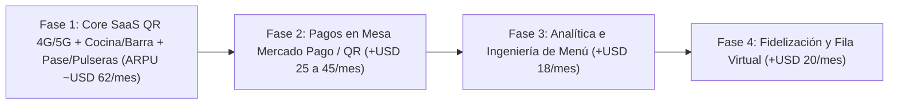

# Modelo de Negocios Integral: SaleListo

**Plataforma en la nube de pedidos autogestionados en mesa, ruteo inteligente a Cocina y Barra, y coordinación de salón sin celulares en mano (Estación de Mozos fija en el pase + opción de Pulseras Vibradoras Xiaomi Band) para gastronomía en Argentina y América Latina.**

---

## Resumen Ejecutivo

**SaleListo** es una plataforma web operativa en la nube diseñada para resolver el principal lucro cesante de restaurantes, bares, cervecerías, cafeterías y polos gastronómicos: **el tiempo muerto en la mesa y la fricción operativa entre el comensal, el mozo, la cocina y la barra**.

A diferencia de los menús digitales estáticos en PDF (que obligan a hacer zoom, quedan desactualizados ante la inflación y no permiten comprar) y a diferencia de los pesados sistemas de facturación heredados (pensados para el cajero y no para la dinámica viva del salón), SaleListo digitaliza de punta a punta la experiencia en la mesa sin exigir descargas de aplicaciones ni claves de Wi-Fi, y **sin obligar a los mozos a caminar mirando un celular frente a los clientes**:

1. **Acceso instantáneo por 4G/5G con QR de token fijo seguro**: Cada mesa cuenta con un código QR único e inalterable. El cliente escanea con la cámara de su celular usando sus propios datos móviles, visualiza la carta actualizada al segundo con fotos reales, personaliza su pedido con aclaraciones y confirma en dos toques.
2. **Diseño modular del salón y gestión anti-inflación**: El local arma su plano operativo con bloques pre-configurados (*Interior, Terraza, Exterior/Vereda, Barra, Sector 1, Sector 2, Patio y Salón VIP*), administra disponibilidad de platos en vivo y aplica **ajustes masivos porcentuales de precios por inflación** en cuestión de segundos sin reimprimir un solo código QR.
3. **Separación automática hacia Cocina y Barra en simultáneo**: Apenas el cliente envía su pedido, el sistema divide y rutea automáticamente los platos hacia el monitor de **Cocina** y las bebidas hacia **Barra**, eliminando comandas de papel extraviadas y cuellos de botella.
4. **Orquestación inteligente y potenciación del mozo**: En el mismo instante en que entra un pedido, SaleListo asigna un mozo responsable mediante esquema híbrido (pre-asignado por sector/bloque o balanceado automáticamente hacia el mozo disponible con menor carga activa). Si un mozo finaliza su turno o se da de baja en plena hora pico, **sus mesas activas se reasignan de forma automática** entre el plantel disponible para que ninguna mesa quede desatendida.
5. **Coordinación 100% sin celulares en el salón (Estación de Mozos fija de serie + Kit opcional de Pulseras Vibradoras)**:
   * **Incluida de serie desde el Plan Base (`Estación de Mozos fija /pase.html`)**: una única tablet o pantalla horizontal ubicada en el mostrador del pase o la barra, dividida en columnas en vivo por cada mozo activo y legible a 3 o 4 metros. Muestra al instante qué platos retirar en Cocina, qué tragos retirar en Barra, qué mesas llaman y qué cuentas cobrar (indicando medio de pago *Efectivo, Tarjeta, QR o Transferencia* y propina *0%, 5%, 10% o 15%*). Resuelve de raíz la objeción de imagen (*"no quiero mozos mirando el celular en el salón"*) con **costo de hardware USD 0** para SaleListo.
   * **Adicional pago para locales extensos (`Kit Pulseras Vibradoras Xiaomi Smart Band`)**: ideal para patios cerveceros, terrazas, veredas amplias o plantas altas. El teléfono queda bloqueado en el bolsillo o en un locker cercano y el mozo siente la vibración en su muñeca leyendo en medio segundo avisos ultracompactos como `🍸 T2 · Retirar Barra` o `💳 M8 · Tarjeta $34.200` (con 10 a 14 días de batería real, resistencia al agua y apenas 15 g de peso).

El modelo comercial se basa en una **suscripción SaaS B2B mensual escalonada sin comisiones sobre la venta del salón**, complementada por ingresos iniciales (*upfront*) con margen positivo y cero capital propio inmovilizado (implementación llave en mano con kits físicos de códigos QR en acrílico/PVC y **Kits de Pulseras Vibradoras SaleListo configuradas**), junto a una hoja de ruta de expansión (*upsell*) hacia cobros integrados en mesa y analítica gastronómica avanzada.

---

## 1. Propuesta de Valor Cuantificable para el Dueño Gastronómico

El dueño o encargado gastronómico no compra software por novedad tecnológica; invierte cuando percibe un impacto directo y medible en **más facturación por turno, menores pérdidas operativas y menor caos en horas pico**. SaleListo ataca cuatro palancas directas del estado de resultados del restaurante.

### 1.1. Aumento en la Rotación de Mesas (+15% a +22% en horarios pico)

En el servicio tradicional de salón existen tres tiempos muertos improductivos que alargan artificialmente la ocupación de una mesa cuando el local tiene fila en la puerta:

| Etapa del ciclo de mesa | Servicio tradicional | Con SaleListo | Tiempo recuperado |
| :--- | :---: | :---: | :---: |
| Sentarse, esperar carta física y que tomen el primer pedido | 10 a 14 min | **2 a 4 min** | **8 a 10 min** |
| Despacho interno del pedido hacia Cocina y Barra | 3 a 5 min | **Instantáneo (0 min)** | **3 a 5 min** |
| Pedir la cuenta, esperar pre-ticket, definir pago y esperar cobro | 10 a 15 min | **3 a 5 min** (ya informa medio de pago y propina) | **7 a 10 min** |
| **Tiempo muerto total eliminado por sesión de mesa** | **23 a 34 min** | **5 a 9 min** | **18 a 25 min ahorrados** |

* **Impacto real en capacidad instalada**: En un despacho nocturno de viernes o sábado (franja fuerte de 20:00 a 00:30, equivalente a 270 minutos operativos), reducir la estadía promedio de una mesa de **90 minutos a 72 minutos** permite pasar de **3,0 rotaciones a 3,75 rotaciones por mesa en la misma noche (+25% de capacidad de facturación en horas pico)**, sin pagar un peso adicional de alquiler, expensas ni habilitación municipal.

### 1.2. Incremento del Ticket Promedio (+12% a +18% por segundas rondas y compras visuales)

El mayor ingreso perdido de una cervecería, bar o restaurante ocurre después del plato principal: el cliente termina su primera bebida, mira alrededor para pedir otra pinta, una copa de vino, un postre o un café, no logra cruzar mirada con el mozo porque el salón está desbordado y desiste.

* **Segundas y terceras rondas sin fricción (+20% a +30% en despacho de Barra)**: Con el QR en la mesa funcionando sobre 4G/5G, pedir una segunda ronda toma 10 segundos y entra directo a Barra. El aviso se enciende al instante en la columna del mozo en la **Estación del Pase** (o le vibra en la muñeca con su **pulsera Xiaomi Band**) recién cuando la bebida ya está servida en el mostrador lista para llevar a la mesa, sin ningún camarero mirando un teléfono en medio del salón.
* **Venta visual con fotografías reales y destacados (+15% a +25% en entradas y postres)**: A diferencia de una lista de texto impresa, ver la fotografía real de unas rabas, un volcán de chocolate o un cóctel de autor etiquetado como *"Popular"* dispara la compra impulsiva antes y después del plato fuerte.

### 1.3. Reducción Drástica de Errores de Comanda y Mermas (-85% a -95%)

En la operación tradicional, el pedido atraviesa una cadena de "teléfono descompuesto": el cliente habla en un salón ruidoso, el mozo anota apurado en una libreta, camina hasta una terminal compartida para cargarlo o entrega un papel manchado en cocina.

* En gastronomía promedio, los platos devueltos por errores de punto de cocción, ingredientes omitidos (*"pedí sin cebolla"*, *"era sin TACC"*, *"bebida sin hielo"*) o ítems cargados a la mesa equivocada representan entre el **1,5% y el 3,0% de la facturación bruta mensual** en mercadería desperdiciada e invitaciones de cortesía para calmar al cliente.
* Con SaleListo, **el propio comensal selecciona sus ítems y redacta sus aclaraciones exactas**, el servidor valida precios del lado seguro sin posibilidad de manipulación, y cada estación (Cocina por un lado, Barra por otro) visualiza únicamente lo que debe preparar. Además, si un plato se agota en mitad del servicio, el encargado lo desactiva en un clic y desaparece al instante de todos los celulares del salón, evitando frustraciones y viajes de disculpa del mozo.

### 1.4. Optimización del Personal en Horas Pico y Cero Celulares en el Salón (+30% a +40% de productividad por mozo)

Los sectores alejados de la caja y la cocina (*Terraza, Patio, Vereda/Exterior o Salón VIP en planta alta*) suelen sufrir mala atención o exigir contratar personal eventual extra los fines de semana, mientras que en restaurantes de estética cuidada los dueños rechazan de plano ver a sus camareros caminando con el teléfono en la mano:

* Sin SaleListo, el mozo gasta cerca del **60% de su energía física en traslados mecánicos improductivos**: ir a llevar cartas, volver a preguntar si ya eligieron, caminar hasta cocina a preguntar *"¿ya sale la mesa T3?"*, ir a mesa a preguntar cómo pagan y volver a caja a buscar el posnet.
* Con SaleListo, el balanceador híbrido reparte equitativamente las mesas o respeta los sectores asignados y elimina por completo las pantallas personales en el salón mediante dos modalidades complementarias:
  1. **Estación de Mozos fija en el pase (`/pase.html`), incluida de serie en todos los planes**: una única tablet o pantalla horizontal en el mostrador de despacho o barra organiza columnas en vivo por cada mozo activo (legibles a 3 o 4 metros de distancia, con alerta sonora suave y botones táctiles grandes). Cada vez que el camarero pasa por el mostrador visualiza de un vistazo qué retirar en Cocina, qué retirar en Barra, qué mesa solicitó ayuda o qué cuenta llevar ya con medio de pago y propina definidos, e incluso puede cargar un pedido tomado en mesa en 5 segundos sin sacar jamás un celular.
  2. **Kit Pulseras Vibradoras (Xiaomi Smart Band), adicional opcional para grandes superficies**: en patios cerveceros, veredas extensas o terrazas en altura, el teléfono queda guardado y bloqueado en el bolsillo o en un locker cercano y el mozo recibe el pulso háptico directo en su muñeca (`🍸 T2 · Retirar Barra`, `💳 M8 · Tarjeta $34.200`) **únicamente cuando hay valor real que aportar**, manteniendo ambas manos libres para bandejas y la mirada puesta en la hospitalidad.
* Resultado: un equipo de 4 mozos absorbe con fluidez, presencia impecable y buen trato un volumen de despacho que antes requería 5 o 6 personas corriendo estresadas, y si un mozo falta o se retira al terminar su turno pico, el sistema **reasigna automáticamente sus mesas abiertas** sin generar baches de atención.

### 1.5. Caso Numérico de Retorno sobre la Inversión (ROI) para un Restaurante Tipo

Tomemos como referencia un restaurante o cervecería promedio en zona urbana de Argentina con **25 mesas (100 cubiertos)**, operando 26 días al mes, con una facturación mensual base de **ARS 55.125.000** (equivalente a **USD 35.000/mes**, tomando la cotización del **Dólar Oficial Venta Banco Nación de `1 USD = ARS 1.575`**, con pizarra oficial en ARS 1.525 para la compra y ARS 1.575 para la venta) y un Costo de Mercadería Vendida (CMV) del 33%:

| Palanca de valor con SaleListo | Impacto conservador estimado | Facturación / Ahorro bruto mensual (ARS) | Contribución marginal neta para el dueño (ARS / USD) |
| :--- | :--- | :---: | :---: |
| **1. Mayor rotación en turnos pico** (solo vie/sáb noche, +12% sobre ventas de horas pico = +3,5% venta total) | +3,5% ventas totales | + ARS 1.929.375 | + ARS 1.292.681 *(USD 821)* |
| **2. Suba de ticket promedio** (segundas rondas de bebida y postres en el 35% de las mesas: +5% venta total) | +5,0% ventas totales | + ARS 2.756.250 | + ARS 1.846.688 *(USD 1.173)* |
| **3. Reducción de errores de comanda y descartes** (baja del 1,5% al 0,2% de merma operativa sobre CMV) | Ahorro directo de insumos | + ARS 236.250 | + ARS 236.250 *(USD 150)* |
| **4. Ahorro en refuerzos eventuales / horas extra mal aprovechadas** (2 jornadas eventuales menos por fin de semana) | Optimización de turnos | + ARS 418.950 | + ARS 418.950 *(USD 266)* |
| **Beneficio económico mensual generado** | | **+ ARS 5.340.825 / mes** | **+ ARS 3.794.569 / mes *(+ USD 2.409/mes)*** |
| **Costo mensual Plan Salón de SaleListo** | Tarifa plana sin comisión | *- ARS 102.375 / mes* | *- ARS 102.375 / mes *(- USD 65/mes)*** |
| **Ganancia neta limpia mensual para el local** | **ROI: 37x sobre el abono** | | **+ ARS 3.692.194 / mes *(+ USD 2.344/mes)*** |

> **Conclusión comercial contundente para el dueño**: El abono mensual de SaleListo representa **menos del 0,20% de la facturación del local** y se paga solo con apenas **2 mesas adicionales o 10 pintas/postres extra en todo el mes**. Todo el resto es ganancia neta directa para el restaurante.

---

## 2. Esquema de Monetización y Planes de Precios (Argentina y LATAM)

### 2.1. Principio Rector: Suscripción Plana 0% Comisión en Salón

El empresario gastronómico argentino y latinoamericano arrastra un fuerte desgaste con las plataformas de delivery que retienen entre el **18% y el 30% + IVA** de cada pedido. Por eso, el corazón comercial de SaleListo es una **suscripción SaaS mensual fija, predecible y escalonada según el tamaño del salón, con 0% de comisión sobre las ventas generadas en las mesas**.

> *Nota monetaria*: Todos los valores se expresan en **USD de referencia comercial** y su equivalente en **Pesos Argentinos (ARS)** tomando el **Dólar Oficial Venta del Banco de la Nación Argentina (BNA) en `1 USD = ARS 1.575`** (pizarra minorista oficial vigente: Compra ARS 1.525 / Venta ARS 1.575; mayorista ~ARS 1.544; valores netos antes de impuestos). En Argentina se factura en ARS con débito automático (tarjeta corporativa, CBU o suscripción recurrente) y actualización trimestral previsible para el comercio.

### 2.2. Matriz de Planes SaaS Mensuales

| Característica | Plan Barra / Café *(Base)* | Plan Salón / Bistró *(Más elegido)* | Plan Gran Salón / Multisede *(Pro)* |
| :--- | :---: | :---: | :---: |
| **Perfil ideal de cliente** | Cafeterías de especialidad, bares chicos, heladerías, locales al paso | Restaurantes, bistrós, pizzerías y cervecerías con salón + vereda/terraza | Grandes patios cerveceros, rooftops, parrilladas (+30 mesas) y cadenas |
| **Precio mensual (USD ref.)** | **USD 35 / mes** | **USD 65 / mes** | **USD 110 / mes** *(por sucursal)* |
| **Precio mensual ref. Argentina** | **ARS 55.125 / mes** | **ARS 102.375 / mes** | **ARS 173.250 / mes** |
| **Precio anual (2 meses bonificados)** | USD 350 / año *(USD 29,1/mes)* | USD 650 / año *(USD 54,1/mes)* | USD 1.100 / año *(USD 91,6/mes)* |
| **Capacidad de mesas con QR fijo** | Hasta **12 mesas** | Hasta **30 mesas** | **Mesas ilimitadas** |
| **Sectores / Bloques del salón** | Hasta **2 bloques** *(ej. Interior + Vereda)* | Hasta **5 bloques** *(Interior, Terraza, Vereda, Barra, VIP)* | **Bloques ilimitados** y diseño multicaja |
| **Carta con fotos y platos agotados** | Ilimitada en tiempo real | Ilimitada en tiempo real | Ilimitada + sincronización entre sedes |
| **Ajuste masivo % por inflación** | Incluido (por categoría o total) | Incluido (por categoría o total) | Incluido + programación de listas horarias *(Happy Hour / Menú Ejecutivo)* |
| **Ruteo separado Cocina y Barra** | Incluido | Incluido (múltiples pantallas simultáneas) | Incluido (estaciones múltiples personalizadas) |
| **Estación de Mozos fija (`/pase.html`)** | **Incluida de serie** *(1 pantalla en pase/barra, cero celulares en salón)* | **Incluida de serie** *(pantallas ilimitadas en pase/barra + modo oscuro/claro)* | **Incluida de serie** *(múltiples estaciones de pase por planta o sector)* |
| **Mozos activos y coordinación** | Hasta **3 mozos** en turno *(Estación de Pase + PWA móvil)* | **Mozos ilimitados** + asignación híbrida, reasignación automática y **Modo Pulsera Web Push** | **Mozos ilimitados** + métricas de tiempos/propinas y **Modo Pulsera Web Push** multi-sector |
| **Kit Pulseras Vibradoras (Xiaomi Band)** | Adicional opcional *(pago único upfront)* | Adicional opcional *(Pack 3: USD 145 / Pack 5: USD 230)* | Adicional opcional *(Packs 3 o 5 + individuales a USD 48)* |
| **Cierre de sesiones y arqueo diario** | Resumen diario básico | Arqueo completo por turno, medio de pago y propinas | Reportes históricos exportables y auditoría de cancelaciones |
| **Nivel de soporte** | Lun a Sáb horario comercial (WhatsApp) | **Soporte prioritario gastronómico** (incluye vie/sáb hasta las 00:00 hs) | Ejecutivo de cuenta dedicado + capacitación continua a personal nuevo |

* **Ventaja estratégica del Plan Base sin celulares en salón**: Todos los planes incluyen de serie la **Estación de Mozos fija (`/pase.html`)**, diseñada para correr en cualquier tablet, monitor secundario o equipo all-in-one que el local ya posea sobre el mostrador del pase o la barra. Esto neutraliza de raíz la principal objeción de estética gastronómica (*"no quiero que mis camareros anden mirando el celular en el salón"*) con **costo de hardware USD 0 para SaleListo**.
* **Descuento corporativo multisede**: A partir de la 3.ª sucursal de un mismo grupo gastronómico o franquicia, se aplica un **15% de bonificación recurrente** sobre el Plan Gran Salón (**USD 93,50 / mes por local**, equivalente a **ARS 147.263 / mes**).

### 2.3. Fee de Implementación, Onboarding y Kits Iniciales Llave en Mano (Ingresos Upfront)

En el rubro gastronómico, el mayor enemigo de la activación es esperar que el dueño cargue 80 platos en su tiempo libre, busque una imprenta o configure dispositivos por su cuenta. Convertimos esa fricción en un **servicio llave en mano en 48 horas** que deja al restaurante facturando desde el primer día y financia nuestro Costo de Adquisición (CAC) sin inmovilizar capital:

1. **Onboarding Digital Express**: **USD 40 pago único** *(ARS 63.000)*.
   * Carga completa inicial del menú provisto por el local (categorías, descripciones, precios, ruteo Cocina/Barra y optimización de fotos existentes), configuración del plano de bloques/mesas, puesta a punto de la **Estación de Mozos fija (`/pase.html`)** en el mostrador/barra, entrega de archivos QR vectoriales de alta definición (SVG listos para gráfica) y sesión de puesta en marcha de 30 minutos con el encargado.
   * *Palanca comercial*: Bonificable al 50% o 100% para destrabar cierres en el acto cuando el local adhiere a débito automático en Plan Salón o Plan Gran Salón.
2. **Kit Físico QR Llave en Mano ("Listo para Operar en Salón y Vereda")**: **USD 95 a USD 160 pago único** *(ARS 149.625 a ARS 252.000 según cantidad de mesas: pack 15 mesas USD 95 / pack 30 mesas USD 135 / pack 50 mesas USD 160)*.
   * Incluye todo el Onboarding Digital Express **más** la fabricación y entrega en el local de **portamenús acrílicos tipo tent-card o placas rígidas de PVC bicapa / aluminio anodizado con protección UV y adhesivo industrial 3M** (resistentes al sol directo en vereda, lluvia, derrames de cerveza y limpieza diaria con alcohol).
   * Cada pieza lleva impreso el logo del restaurante, el código identificatorio de la mesa (*ej. Terraza T4*), el QR de token fijo seguro y una instrucción clara de conversión (*"Escaneá con tu cámara: mirá fotos, pedí directo y llamá al mozo sin pedir Wi-Fi"*), junto con una capacitación práctica de 45 minutos al plantel de mozos y cocina antes de abrir el turno.
   * **Economía del Kit Físico QR**: Costo directo de producción gráfica/acrílica y envío estimado en USD 50 a USD 85 por kit, generando un **margen bruto inmediato de USD 45 a USD 75** que reduce drásticamente el tiempo de recupero del CAC.
3. **Kit Pulseras Vibradoras SaleListo (Xiaomi Smart Band configuradas)**:
   * Pensado para locales grandes, patios cerveceros, jardines, veredas amplias o plantas altas donde los camareros recorren distancias largas lejos del mostrador del pase.
   * El teléfono queda **bloqueado en el bolsillo o en un locker cercano** recibiendo alertas Web Push nativas en segundo plano, y el mozo siente la vibración directa en su muñeca leyendo en medio segundo avisos ultracompactos como `🍸 T2 · Retirar Barra` o `💳 M8 · Tarjeta $34.200`, sin sacar el celular en ningún momento frente al comensal.
   * **Hardware probado para ritmo gastronómico**: batería real de **10 a 14 días** de autonomía continua (cero recargas a mitad del servicio), resistentes al agua y salpicaduras de barra (5 ATM) y ultralivianas (**15 g** de peso).
   * **Precios upfront con margen comercial positivo y cero capital propio inmovilizado** (se adquieren y entregan configuradas contra el cobro inicial al activar el kit, incluyendo vinculación lista en Modo Pulsera y test de vibración en vivo):
     - **Pack 3 Pulseras Configuradas**: **USD 145 pago único** *(ARS 228.375; costo directo estimado USD 95, **margen bruto USD 50**)*.
     - **Pack 5 Pulseras Configuradas**: **USD 230 pago único** *(ARS 362.250; costo directo estimado USD 155, **margen bruto USD 75**)*.
     - **Pulsera adicional individual**: **USD 48 pago único** *(ARS 75.600)*.

### 2.4. Evaluación Estratégica: ¿Suscripción Fija vs. Comisión Opcional?

| Modalidad | Cuándo aplicarla | Estructura recomendada |
| :--- | :--- | :--- |
| **Suscripción SaaS fija (90% de la cartera)** | Restaurantes, bares y cafés con operación anual estable | Planes de USD 35 / USD 65 / USD 110 mensuales con **0% de comisión** sobre platos y bebidas. Máxima aceptación comercial y retención. |
| **Esquema Variable Estacional ("Temporada / Eventos")** | Paradores de playa (Costa Atlántica, Punta del Este), centros de invierno (Bariloche, Las Leñas), patios de verano o ferias gastronómicas que abren 3 a 4 meses intensivos y reducen operación el resto del año | Base mínima de mantenimiento cloud en meses cerrados (**USD 15/mes**) y durante meses activos una comisión opcional del **1,2% sobre ventas procesadas por QR**, con un piso de USD 40/mes y un **tope máximo (*cap*) de USD 140/mes** para que el dueño nunca sienta penalizado su éxito. |
| **Take-Rate Fintech sobre Pagos Integrados (Fase 2)** | Upsell opcional cuando el cliente paga la cuenta desde el mismo QR del celular sin esperar terminal física | Comisión transaccional transparente del **0,6% al 0,9%** por pago digital conciliado en mesa (o acuerdo de *revenue-share* con el procesador de pagos / adquirente). |

### 2.5. Localización de Precios para Expansión en LATAM

La arquitectura multi-moneda comercial permite adaptar la lista de precios al poder adquisitivo y ticket gastronómico promedio de cada plaza latinoamericana:

* **Cono Sur de ticket alto en dólares (Uruguay y Chile)**: Ticket promedio por comensal elevado (USD 20 a USD 35) y altísimo costo salarial de salón. Planes posicionados en **USD 45 (Inicial) / USD 79 (Salón) / USD 129 (Gran Salón)** mensuales.
* **Mercados de gran escala y volumen (México, Colombia y Perú)**: Enormes polos gastronómicos (CDMX, Guadalajara, Monterrey, Bogotá, Medellín, Lima) con fuerte cultura de servicio en mesa y propina. Planes competitivos facturados en moneda local equivalentes a **USD 35 / USD 65 / USD 110** mensuales, priorizando volumen y alianzas con distribuidores regionales.
* **Argentina y Paraguay**: Precios competitivos de penetración rápida (**USD 35 / USD 65 / USD 110** equivalentes en moneda local), apalancando como diferencial único el **ajuste masivo porcentual de precios** y la independencia del Wi-Fi del local.

---

## 3. Estructura de Costos y Unit Economics

Una ventaja estructural decisiva de SaleListo frente a competidores sobrecargados de microservicios costosos es su **ingeniería liviana de altísima eficiencia**: motor transaccional ligero sobre SQLite en modo WAL (*Write-Ahead Logging*), sincronización instantánea mediante *Server-Sent Events (SSE)* filtrados por rol, despacho propio de notificaciones **Web Push cifradas en segundo plano (RFC 8291 / VAPID RFC 8292 en Python puro, USD 0 en pasarelas de terceros)** y generación autónoma de códigos QR en formato SVG sin depender de APIs externas pagas.

### 3.1. Costo Cloud y de Servicio por Restaurante Activo (COGS Mensual)

Analizamos el costo variable directo mensual de mantener operativo un restaurante promedio (25 mesas, ~3.500 sesiones de mesa mensuales, ~12.000 pedidos al mes entre Cocina y Barra, y 120 fotografías de carta optimizadas en formato WebP):

1. **Cómputo y memoria en servidor cloud (HTTPS + aislamiento por instancia/base)**:
   * Consumo real por local activo: ~20 MB de RAM y fracción mínima de vCPU incluso en picos de viernes/sábado por la noche. Un servidor cloud dedicado de alta disponibilidad (4 vCPU, 8 GB RAM, disco NVMe rápido, costo ~USD 28/mes) aloja con holgura y baja latencia entre **60 y 80 restaurantes activos**, arrojando un costo de cómputo de **USD 0,40 a USD 0,50 / mes por restaurante**.
2. **Almacenamiento, backups diarios automatizados y transferencia (CDN)**:
   * Base de datos transaccional (~15-30 MB anuales por local) + carpeta de fotos optimizadas (~40 MB por local) + retención de copias de seguridad diarias durante 30 días en almacenamiento de objetos redundante + CDN con caché de imágenes y SSL automático: **USD 0,45 a USD 0,70 / mes por restaurante**.
3. **Monitoreo, logs transaccionales y mensajería operativa del sistema**:
   * Alertas de salud de servidores y notificaciones administrativas: **USD 0,30 / mes por restaurante**.
   * **Subtotal Costo Cloud Puro por Restaurante Activo**: **~USD 1,15 a USD 1,50 / mes** *(aprox. ARS 2.363 / mes)*.
4. **Soporte Técnico / Customer Success prorrateado (COGS Humano de Retención)**:
   * Gracias al autoadministrador intuitivo (ajustes masivos de precios, apagado de platos agotados y QR fijo sin reimpresión), las consultas recurrentes son muy bajas. Un especialista de soporte y acompañamiento gastronómico (costo empresa ~USD 900/mes) atiende una cartera de **200 restaurantes activos**, representando **USD 4,50 / mes por restaurante**.

* **COGS Total Mensual (Cloud + Soporte Directo)**: **USD 6,00 / mes por restaurante activo** *(ARS 9.450 / mes)*.

### 3.2. Unit Economics en Estado Estable

Calculamos los indicadores unitarios sobre el mix esperado de cartera comercial (**25% Plan Barra a USD 35**, **60% Plan Salón a USD 65** y **15% Plan Gran Salón a USD 110**):

| Métrica Unitaria | Valor en USD | Equivalente ref. ARS (`1 USD = 1.575`) | Notas y supuestos operativos |
| :--- | :---: | :---: | :--- |
| **ARPU (Ingreso recurrente promedio mensual)** | **USD 62,25 / mes** | **ARS 98.044 / mes** | Sin contar futuros ingresos fintech ni upsells |
| **COGS mensual (Cloud + Soporte directo)** | **USD 6,00 / mes** | **ARS 9.450 / mes** | USD 1,50 infraestructura + USD 4,50 atención |
| **Margen Bruto Mensual en dólares / pesos** | **USD 56,25 / mes** | **ARS 88.594 / mes** | Contribución neta mensual por cada local activo |
| **Margen Bruto Porcentual (% Gross Margin)** | **90,4%** | **90,4%** | Nivel de excelencia SaaS (benchmark industria: 75%-82%) |
| **CAC Bruto (Costo de Adquisición de Cliente)** | **USD 150,00** | **ARS 236.250** | Mix: comisión closer comercial (USD 65) + prospección/ads/viáticos (USD 50) + horas de onboarding inicial (USD 35) |
| **Margen neto upfront Kits / Onboarding** | **+ USD 35,00** | **+ ARS 55.125** | Base conservadora (kits QR + onboardings); suma **+USD 50 a +USD 75 extra** al incluir Kit Pulseras Xiaomi Band |
| **CAC Neto Efectivo (descontando margen upfront)** | **USD 115,00** | **ARS 181.125** | Capital neto real a recuperar con el abono mensual |
| **Churn mensual estimado (Tasa de baja)** | **3,5% mensual** | **3,5% mensual** | ~2,3% mortalidad natural de locales gastronómicos + ~1,2% rotación voluntaria |
| **Vida media esperada del cliente (1 / Churn)** | **28,6 meses** | **28,6 meses** | ~2,4 años de permanencia promedio por alto arraigo operativo |
| **LTV (Lifetime Value sobre Margen Bruto)** | **USD 1.607** | **ARS 2.531.250** | `USD 56,25 / 0,035` |
| **Relación LTV / CAC Bruto** | **10,7x** | **10,7x** | **14,0x sobre CAC Neto** (saludable en SaaS B2B a partir de 3,0x) |
| **Payback Period (Recupero del CAC)** | **2,7 meses** *(Bruto)* / **2,0 meses** *(Neto)* | **2 a 3 meses** | Permite financiar el crecimiento con el propio flujo de caja |

#### Sensibilidad de LTV según Escenarios de Retención (Churn)

* **Escenario Conservador (Churn 4,5% mensual = 22,2 meses de vida)**: LTV = **USD 1.250** *(ARS 1.968.750)* | Ratio LTV/CAC Bruto = **8,3x** | Recupero = **2,7 meses**.
* **Escenario Base (Churn 3,5% mensual = 28,6 meses de vida)**: LTV = **USD 1.607** *(ARS 2.531.250)* | Ratio LTV/CAC Bruto = **10,7x** | Recupero = **2,7 meses**.
* **Escenario Expansión Fase 2 (Churn 2,5% mensual + Upsell Pagos/Analítica llevando ARPU a USD 80)**: LTV = **USD 2.880** *(ARS 4.536.000)* | Ratio LTV/CAC Bruto = **19,2x**.

### 3.3. Costos Fijos Operativos (OPEX) y Punto de Equilibrio (Break-Even)

Diseñamos dos escalones claros de estructura fija para evitar sobredimensionar gastos antes de validar tracción comercial:

#### Etapa 1: Operación Lean Inicial (0 a 40 restaurantes activos - Venta liderada por fundador)
* **Infraestructura base fija** (entornos de demostración, respaldos centrales, dominios y herramientas de gestión): **USD 80 / mes**.
* **Comercialización, movilidad en polos gastronómicos, kits acrílicos de muestra y pauta hiperlocal**: **USD 320 / mes**.
* **Gastos administrativos, impositivos, contables y pasarela de cobro recurrente**: **USD 220 / mes**.
* **Asistencia part-time de carga de menús / diseño de piezas QR**: **USD 280 / mes**.
* **OPEX Fijo Total Etapa 1**: **USD 900 / mes** *(ARS 1.417.500 / mes)*.
* **Punto de Equilibrio Etapa 1 (Break-Even)**: `USD 900 / USD 56,25 de margen unitario` = **16 restaurantes activos pagos**.

#### Etapa 2: Escalado Comercial Estructurado (40 a 180 restaurantes activos)
* **Infraestructura multi-nodo redundante y herramientas CRM/automatización**: **USD 220 / mes**.
* **1 Ejecutivo Comercial Gastronómico (fijo base + viáticos; comisiones ya imputadas en CAC)**: **USD 850 / mes**.
* **1 Especialista Full-Time de Onboarding, Kits Físicos y Customer Success**: **USD 850 / mes**.
* **Inversión mensual en generación de demanda (Meta Ads geolocalizados, ferias y muestras)**: **USD 500 / mes**.
* **Administración, legal, contabilidad e impuestos fijos**: **USD 350 / mes**.
* **OPEX Fijo Total Etapa 2**: **USD 2.770 / mes** *(ARS 4.362.750 / mes)*.
* **Punto de Equilibrio Etapa 2 (Break-Even con equipo dedicado)**: `USD 2.770 / USD 56,25` = **50 restaurantes activos pagos**.

### 3.4. Proyección Económica de Hitos de Escala

| Hito de cartera activa | MRR (Facturación recurrente mensual) | ARR (Anualizado) | Margen Bruto Mensual (90,4%) | OPEX Fijo + CAC de crecimiento neto | Resultado Operativo Neto Mensual (EBITDA aprox.) |
| :--- | :---: | :---: | :---: | :---: | :---: |
| **20 locales** *(Mes 3-4)* | USD 1.245 *(ARS 1,96 M)* | USD 14.940 | USD 1.125 | USD 900 + USD 345 *(3 altas/mes)* | **Equilibrio / Flujo neutro** |
| **50 locales** *(Mes 6-8)* | USD 3.112 *(ARS 4,90 M)* | USD 37.350 | USD 2.812 | USD 1.900 + USD 690 *(6 altas/mes)* | **+ USD 222 / mes** *(ARS 350 mil libres/mes)* |
| **120 locales** *(Mes 12-14)* | USD 7.470 *(ARS 11,77 M)* | USD 89.640 | USD 6.750 | USD 2.770 + USD 1.380 *(12 altas/mes)* | **+ USD 2.600 / mes** *(ARS 4,10 M libres/mes)* |
| **250 locales** *(Mes 20-24)* | USD 15.562 *(ARS 24,51 M)* | USD 186.750 | USD 14.062 | USD 4.800 + USD 2.300 *(20 altas/mes)* | **+ USD 6.962 / mes** *(ARS 10,97 M libres/mes)* |

---

## 4. Estrategia de Entrada al Mercado (Go-To-Market) y Expansión

Venderle a dueños gastronómicos exige entender su ritmo diario: nunca atenderán un llamado frío un viernes a las 21:00 hs, pero son sumamente receptivos los **martes, miércoles y jueves entre las 10:30 y las 12:00 hs o entre las 16:30 y las 18:30 hs** (los valles entre el turno mediodía y el turno noche), especialmente cuando pueden tocar y probar una demostración real en su propia mesa en menos de 3 minutos.

### 4.1. Desembarco por Densidad en Polos Gastronómicos ("Mancha de Aceite")

En vez de vender a locales aislados en distintas provincias desde el primer día, la captura inicial concentra el 100% de la energía comercial en **corredores gastronómicos de alta densidad peatonal** (por ejemplo: circuitos de 15 cuadras en Palermo, Chacarita, Villa Crespo, Colegiales, Belgrano, Las Lomitas o San Isidro; luego Güemes en Córdoba, Pichincha en Rosario y calle Arístides en Mendoza).

* **Por qué funciona**:
  1. Un vendedor camina y visita 12 locales calificados en una sola tarde con costo logístico casi nulo y lleva en la mano **un display acrílico real con un QR activo conectado a la nube** y **una Xiaomi Smart Band de muestra en la muñeca**.
  2. El dueño escanea con su propio celular usando su 4G, hace un pedido de prueba y ve en vivo cómo impacta separado entre Cocina y Barra, se enciende la columna del camarero en la **Estación de Mozos fija (`/pase.html`)** y vibra al instante la **pulsera inteligente** con el teléfono bloqueado en el bolsillo. **La demostración física en 90 segundos vence cualquier presentación teórica.**
  3. Cuando 3 o 4 cervecerías o bistrós de la misma zona adoptan SaleListo, se activa la prueba social inmediata: los dueños vecinos, encargados y mozos que rotan entre locales preguntan por el sistema.

### 4.2. Oferta de Entrada sin Fricción: "Piloto Sectorizado de 21 Días"

Cambiar de golpe toda la operatoria de un restaurante genera temor al cambio en el dueño. Para eliminar ese bloqueo, ofrecemos dos puertas de entrada de altísima conversión:

1. **Piloto Quirúrgico en el "Sector Doloroso" (21 días bonificados)**:
   * Le proponemos al dueño: *"No toquemos tu salón principal hoy. Dejame activar SaleListo gratis por 21 días únicamente en tus 8 mesas de Vereda o Terraza, que son las que más cuesta atender cuando se llena"*.
   * Colocamos QRs de prueba resistentes, cargamos su carta en 24 horas y configuramos el ruteo hacia su Barra y Cocina. Al cabo de 3 fines de semana, revisamos juntos las métricas reales de sesiones cerradas: al comprobar que la vereda facturó más bebidas sin que los mozos tuvieran que salir cada dos minutos a mirar quién levantaba la mano, el paso al **Plan Salón pago para todo el local supera el 65% de conversión**.
2. **Entrada Directa con Primer Mes Bonificado**:
   * Para locales que ya buscan arrancar en todo el salón (aperturas gastronómicas, reformas o hartazgo con su menú PDF), al abonar su **Kit Físico Acrílico Llave en Mano** reciben el **primer mes de suscripción 100% bonificado**, saliendo a pista en 48 horas sin doble desembolso inicial.

### 4.3. Motor de Referidos entre Dueños, Encargados y Chefs ("Círculo Gastronómico")

La gastronomía se mueve por recomendación entre pares. Formalizamos un programa simple y automático:

* **Beneficio Dueño a Dueño ("1x1 Recurrente")**: Por cada colega gastronómico referido que active su suscripción paga, el restaurante referente recibe **1 mes completo 100% bonificado** en su próxima factura (acumulable sin tope: si recomienda 4 colegas en el año, ahorra un tercio de su abono anual) y el local referido obtiene **Onboarding Digital sin cargo + 50% de bonificación en su primer mes pago**.
* **Incentivo para Jefes de Salón, Bartenders y Consultores Gastronómicos**: Los consultores que asesoran aperturas, armados de carta o capacitaciones de barra reciben una comisión directa de referencia equivalente al **100% del primer mes de abono** por cada local implementado que cumpla 60 días activo (o un **12% recurrente durante 12 meses** para agencias y estudios de arquitectura/branding gastronómico).

### 4.4. Alianzas Estratégicas de Canal (B2B2B)

Multiplicamos la distribución apalancando actores que ya tienen la confianza del dueño gastronómico:

1. **Bodegas, cervecerías artesanales, distribuidoras de bebidas y marcas de aperitivos**:
   * *El acuerdo ganar-ganar*: Las marcas de bebidas invierten presupuestos permanentes de *Trade Marketing* en servilleteros, pizarras y cartas para empujar rotación de sus etiquetas. Les ofrecemos producir **kits de portamenús acrílicos co-brandeados** donde la marca de bebida financia el 100% del costo físico del kit QR para sus 30 o 50 bares clientes, a cambio de presencia visual elegante en el acrílico y espacio destacado en la sección de sugerencias/maridajes del menú interactivo. **Para el restaurante el hardware entra gratis; para nosotros el CAC tiende a cero.**
2. **Gráficas, talleres de corte láser acrílico e imprentas gastronómicas**:
   * Cada vez que un local va a una gráfica cansado de gastar dinero en reimprimir cartas por inflación, la imprenta le ofrece fabricar por única vez los **displays acrílicos o grabados en madera/PVC con los códigos QR fijos de SaleListo**, cobrando su trabajo físico con excelente margen y ganando una comisión por derivarnos el alta del software.
3. **Instaladores de redes, soporte técnico gastronómico y sistemas de facturación fiscal**:
   * Técnicos independientes que mantienen comanderas térmicas, balanzas y puntos de venta visitan decenas de locales por mes. Se convierten en canal revendedor certificado con comisión por alta instalada. Con sistemas de facturación contable/AFIP regionales, impulsamos alianzas de complementariedad: ellos resuelven impuestos, sueldos y proveedores; SaleListo resuelve la experiencia viva en la mesa, Cocina, Barra, Estación de Pase y pulseras de los mozos.

### 4.5. Hoja de Ruta de Upsells Futuros (Expansión del ARPU y Retención)

Una vez instalado SaleListo como el sistema nervioso del salón y dueño del punto de contacto en cada mesa (el QR fijo), se desbloquean cuatro capas de monetización adicional sobre la misma base instalada:

1. **Upsell 1: Cobro Integrado en Mesa y División de Cuenta ("Escaneá, Dividí y Pagá")**:
   * Integración nativa con **Mercado Pago, MODO, links de pago con tarjeta de crédito/débito y QR interoperable** (más equivalentes regionales en LATAM).
   * El grupo de amigos elige si paga el total, divide en partes iguales o **cada comensal tilda exactamente lo que consumió**, suma la propina digital para su mozo asignado y paga en 10 segundos sin esperar el posnet. La sesión en SaleListo impacta como *"Pagada y verificada"* en tiempo real en Caja, en la Estación de Mozos y en la pulsera del camarero, acelerando otros 8 minutos la rotación de mesa y generando un **ingreso fintech adicional sin fricción**.
2. **Upsell 2: Módulo de Ingeniería de Menú y Analítica Inteligente (+USD 18 / mes)**:
   * Cruce de visualizaciones de carta vs. pedidos efectivos, cálculo de margen por plato (cargando receta o costo estimado), detección de platos "Estrella" (alta ganancia y alta rotación) vs. platos "Clavo", tiempos reales de demora de Cocina y Barra por franja horaria, y tablero comparativo de desempeño, velocidad de respuesta y propinas logradas por cada mozo.
3. **Upsell 3: Lista de Espera con QR en Puerta y Fidelización Automática (+USD 20 / mes)**:
   * Un QR fijo en el atril de recepción permite a quienes esperan mesa en la vereda anotarse a la fila virtual viendo el menú y pre-armando su pedido mientras reciben aviso en el celular cuando su mesa se libera; además, permite recompensar clientes frecuentes en días valle (lunes a miércoles) para levantar ocupación en turnos flojos.

---

## 5. Mapa de Objeciones Frecuentes y Argumentario Comercial

### Filosofía Central: Potenciar al Mozo, Nunca Eliminarlo

El fracaso de muchas propuestas digitales en gastronomía nació de un error conceptual grave: intentar venderle al dueño que *"con un QR ya no necesitás mozos"*. En Argentina y América Latina salir a comer o tomar algo es un ritual social donde la calidez humana define si el cliente vuelve.

**Nuestro posicionamiento es exactamente el opuesto**:
> *"SaleListo no reemplaza al mozo; le quita de encima las tareas mecánicas y frustrantes de caminar en vano, tomar dictado apurado y perseguir un posnet, para devolverle tiempo de hospitalidad real, permitirle atender más mesas sin correr y hacerle ganar más propina en cada turno."*

A continuación se detalla el manual práctico de respuesta frente a las **8 objeciones reales de salón**, estructurado para reuniones con dueños, encargados y jefes de piso.

---

### Objeción 1: *"¿Mis mozos tienen que estar con el celular en la mano? No quiero que los clientes sientan que están mirando WhatsApp en el salón."*

* **Por qué la dice el dueño**: En bistrós, restaurantes modernos y salones de categoría, la presencia visual del personal es sagrada; ver a un camarero mirando un teléfono da imagen de distracción.
* **Respuesta contundente (nuestro diferencial clave)**:
  > *"Coincido al 100%, y por eso SaleListo está diseñado para operar con **cero celulares en el salón** bajo dos modalidades según el tamaño de tu local:*
  > *1. **Estación de Mozos fija (`/pase.html`), incluida sin costo adicional desde el Plan Base**: colocás una única pantalla o tablet horizontal en el mostrador del pase o la barra, dividida en columnas por cada mozo activo y legible a 3 o 4 metros. Ningún camarero lleva teléfono encima: cada vez que pasa por el pase ve en grande qué plato o trago retirar, qué mesa pidió asistencia o qué cuenta cobrar ya con medio de pago y propina elegidos, e incluso puede cargar un pedido tradicional ahí mismo en 5 segundos.*
  > *2. **Kit Pulseras Vibradoras SaleListo (Xiaomi Smart Band), opcional para patios, terrazas o salones grandes**: si tenés terraza por escalera o patio profundo, el teléfono queda bloqueado en un locker cercano o guardado en el bolsillo y el mozo siente una vibración suave en su muñeca leyendo en medio segundo `🍸 T2 · Retirar Barra` o `💳 M8 · Tarjeta $34.200`. Cero pantallas en la mano, 15 gramos de peso y batería para 10 a 14 días."*

---

### Objeción 2: *"Mis clientes prefieren la atención humana; acá vienen a que los atiendan y asesoren, no a mirar una pantalla."*

* **Por qué la dice el dueño**: Teme enfriar la identidad cálida de su restaurante y parecer un local de comida rápida impersonal.
* **Respuesta empática y concreta**:
  > *"Nadie sale a cenar para hablar con un robot, y justamente por eso diseñamos SaleListo para potenciar a tus mozos. En un viernes lleno, lo menos humano que existe es que el cliente levante la mano durante 12 minutos intentando pedir otra copa de vino o la cuenta y nadie lo mire porque los chicos están tapados. Con SaleListo mantenés toda tu hospitalidad: el mozo recibe a la mesa con una sonrisa, cuenta la sugerencia del chef y lleva cada plato y bebida en mano. La diferencia es que cuando el cliente ya sabe qué quiere o desea pedir una segunda ronda rápido, lo manda en dos toques sin esperar, y el aviso aparece al instante en la columna de tu mozo en el pase (o le vibra en la pulsera). Además, si una mesa prefiere pedir hablando con el mozo, él lo carga en el mostrador sin ningún problema. Sumás velocidad sin quitar ni un gramo de calidez."*

---

### Objeción 3: *"Mis mozos se van a resistir, van a sentir que los queremos controlar o que van a perder propinas."*

* **Por qué la dice el dueño/encargado**: Sabe que si el plantel de salón boicotea una herramienta (tapando los QRs o diciendo *"no anda, pedime a mí"*), cualquier implementación fracasa.
* **Respuesta y cómo enamorar al mozo desde el día uno**:
  > *"Cuando le mostramos a los mozos cómo funciona su columna en la Estación del Pase o la pulsera vibradora, pasan de la desconfianza a pedirlo ellos mismos por cuatro motivos directos para su bolsillo y sus piernas:*
  > *1. **Sus mesas siguen siendo suyas**: El sistema asigna cada mesa al mozo de ese sector o balancea parejo, mostrando su nombre y color. Nadie le pisa sus mesas, y si un compañero se va antes, el sistema reasigna prolijo.*
  > *2. **Ganan entre un 20% y un 30% más de propina por noche**: La propina es un porcentaje del ticket y de la cantidad de mesas cerradas. Al entrar más segundas rondas de bebida y postres, y al rotar más rápido las mesas en hora pico, la recaudación base sobre la que reciben propina sube fuerte. Además, cuando el cliente pide la cuenta en SaleListo, **la pantalla le sugiere explícitamente dejar 10% o 15% de propina**, empujando hacia arriba el promedio frente al 'dejá el cambio'.*
  > *3. **Caminan la mitad de viajes vacíos**: Ya no tienen que asomarse cinco veces a la ventana de cocina a preguntar si salió la milanesa de la mesa 6; la Estación del Pase o la pulsera les avisa justo cuando Cocina o Barra toca 'Listo' para que vayan directo a retirarla caliente.*
  > *4. **Cero culpas por faltantes o errores**: Si se acabó el salmón, se apaga en el panel y ningún cliente se enoja con el mozo; y si el cliente pidió 'sin cebolla' desde su teléfono, queda escrito en Cocina sin discusiones."*

---

### Objeción 4: *"Ya pago un sistema gastronómico de caja / facturación y no quiero cambiar todo ni pagar dos veces."*

* **Por qué la dice el dueño**: Tiene miedo a frenar su facturación fiscal, perder su control de stock actual o reentrenar al cajero desde cero.
* **Respuesta comercial**:
  > *"Excelente que ya tengas resuelta la caja fiscal: no tenés que darla de baja ni tocar tu facturación contable. Los sistemas tradicionales nacieron de la caja hacia adentro (para facturar e imprimir tickets), pero fallan de la caja hacia el salón: no te dan pedidos por 4G sin Wi-Fi, no dividen en vivo Cocina y Barra desde la mesa ni coordinan a los mozos por columnas en el pase o pulseras vibradoras con reasignación automática, o te quieren cobrar fortunas en licencias y terminales adicionales. SaleListo funciona como tu **acelerador de salón**: coordina todas las rondas, llamados y avisos de platos listos, y cuando la mesa pide la cuenta, tu cajero ve en SaleListo el desglose exacto conciliado (subtotal, propina y medio de pago elegido) y emite el comprobante fiscal en tu caja habitual en diez segundos. Lo que SaleListo te genera en solo dos noches de viernes en segundas rondas multiplica por diez su abono mensual."*

---

### Objeción 5: *"Ya tenemos códigos QR en las mesas con el menú en PDF / Canva / Google Drive y es gratis."*

* **Por qué la dice el dueño**: Cree que "tener QR" es sinónimo de tener digitalizado el salón, sin notar el costo oculto del PDF estático.
* **Respuesta comercial**:
  > *"El QR con PDF fue un parche de pandemia, pero hoy te está haciendo perder ventas todos los días por tres razones: primero, es un folleto mudo donde el cliente tiene que pellizcar la pantalla haciendo zoom y **no puede comprar nada**, así que igual queda atrapado esperando al mozo para la primera y la segunda ronda; segundo, si a las 22:00 hs se te agota un plato, el PDF lo sigue mostrando y genera malestar; y tercero, cada vez que tenés que actualizar precios por inflación tenés que editar un diseño, exportarlo y rezar para que el link no cambie. Con SaleListo pasás de un folleto muerto a una **caja abierta en cada mesa**: cambiás todos tus precios un porcentaje exacto en 5 segundos con redondeo limpio, apagás agotados en vivo y cada antojo de bebida o postre entra directo a Barra y Cocina."*

---

### Objeción 6: *"En mi salón el Wi-Fi se colapsa cuando se llena y en las mesas de la vereda casi ni llega señal."*

* **Por qué la dice el dueño**: Sufrió experiencias previas con sistemas pesados o redes locales mal configuradas donde el cliente se quejaba de que no abría la carta.
* **Respuesta técnica traducida a beneficio**:
  > *"Justamente por eso SaleListo corre en la nube con una interfaz ultraliviana: **tus clientes no necesitan pedirte clave de Wi-Fi ni conectarse a tu red**. Escanean el QR y abre en menos de un segundo usando sus propios datos móviles 4G o 5G, pesando menos que abrir una foto de WhatsApp. Eso te resuelve dos problemas de un plumazo: la vereda y la terraza funcionan exactamente igual de rápido que adentro, y liberás el Wi-Fi interno de tu local exclusivamente para tu caja, tus pantallas de Cocina, Barra y Pase, y la música del salón."*

---

### Objeción 7: *"Al mediodía o los domingos viene gente mayor o familias tradicionales que no usan QR."*

* **Por qué la dice el dueño**: Piensa en términos de "todo o nada" y teme excluir al segmento +65 años.
* **Respuesta comercial**:
  > *"No es obligatorio que el 100% de las mesas escanee el QR para que sea un éxito rotundo. En la práctica pasa algo buenísimo: el 75% u 80% del salón (parejas jóvenes, grupos de amigos, ejecutivos apurados al mediodía, mesas en la vereda) usa el QR encantado porque valora la inmediatez. Como esas 15 o 20 mesas ya se autogestionan solas las bebidas, aclaraciones y pedidos de cuenta, **tus mozos quedan muchísimo más liberados y tranquilos para dedicarle atención presencial tradicional y paciente a las 4 o 5 mesas de personas mayores**, cargando el pedido en 5 segundos desde el botón `+ Pedido en mostrador` de la Estación del Pase para que igual entre ordenado a Cocina y Barra. Ganás en los dos mundos."*

---

### Objeción 8: *"Suena muy bien, pero vivo apagando incendios en el local; no tengo tiempo de armar planos, sacar fotos ni configurar sistemas."*

* **Por qué la dice el dueño**: Falta crónica de tiempo operativo del gastronómico.
* **Respuesta de cierre inmediato**:
  > *"No tenés que cargar absolutamente nada vos. Me pasás por WhatsApp una foto o archivo de tu carta actual y me contás cuántas mesas tenés en cada sector (por ejemplo: 12 adentro, 6 en terraza y 6 en vereda). En 48 horas te entregamos el sistema 100% configurado con tus precios, separación de Cocina y Barra lista, la Estación de Mozos lista para abrir en la pantalla del pase y los códigos QR fijos en acrílico para apoyar en las mesas. Venimos un día a las 18:30 hs antes de que abras, en 20 minutos tu equipo ya está operando sin celulares en el salón (o con el Kit de Pulseras configurado si tenés terraza grande), y si querés arrancamos probándolo 21 días solo en tu vereda o terraza para que los números hablen solos."*

### Tabla Resumen de Bolsillo para el Equipo Comercial

| Objeción rápida en salón | Frase puente de desbloqueo | Prueba inmediata en la demo |
| :--- | :--- | :--- |
| *"No quiero mozos con el celular"* | *"Operás 100% sin celulares: pantalla fija en el pase de serie o pulsera vibradora en muñeca."* | Abrir **`/pase.html`** en columnas y hacer vibrar la **Xiaomi Band** de muestra. |
| *"Prefieren trato humano"* | *"Quitamos la espera muda, no la hospitalidad del mozo."* | Mostrar botón **"Llamar al mozo"** y carga manual en mostrador. |
| *"Los mozos se van a oponer"* | *"Caminan la mitad en vano y suman +25% de propina sugerida."* | Mostrar alerta de **"Plato listo"** en su columna y selector de **propina 10%/15%**. |
| *"Ya tengo sistema de caja"* | *"Tu caja factura; SaleListo te llena la cocina y la barra de segundas rondas."* | Mostrar cierre de sesión listo en 5 seg para copiar al fiscal. |
| *"Ya tengo QR en PDF"* | *"Un PDF muestra precios viejos; SaleListo toma pedidos y actualiza por inflación."* | Ejecutar en vivo un **ajuste masivo +8%** y apagar un plato agotado. |
| *"Mal Wi-Fi en vereda"* | *"Funciona con el 4G/5G del cliente sin pedir clave de Wi-Fi."* | Apagar el Wi-Fi del celular y escanear el QR de muestra en 1 segundo. |

---

## 6. Plan de Ejecución Comercial 30 - 60 - 90 Días y Contacto

### Hoja de Ruta Operativa Inmediata

1. **Días 1 a 30 (Validación Intensiva y Casos Testigo Medidos)**:
   * Producción de 10 kits físicos de muestra en acrílico/PVC de alta calidad y preparación de entorno cloud productivo multi-restaurante con SSL y respaldos diarios automatizados.
   * Salida presencial a 2 polos gastronómicos cercanos en días martes a jueves (16:30 a 19:00 hs) con objetivo de instalar **5 a 8 restaurantes piloto activos** (priorizando cervecerías, bistrós con vereda/terraza y cafeterías de alta rotación).
   * Medición rigurosa antes/después (tiempo de rotación, cantidad de segundas rondas de Barra y testimonios reales en video corto de 1 dueño y 1 mozo).
2. **Días 31 a 60 (Conversión a MRR, Referidos y Alianzas Gráficas)**:
   * Conversión de la primera camada de pilotos a **Plan Salón / Plan Gran Salón** con débito recurrente, superando el primer hito de **16 a 25 locales pagos (Break-Even Lean)**.
   * Activación formal del programa *"1 Mes Gratis x Referido"* entre los primeros dueños satisfechos y cierre de acuerdos con **3 imprentas/talleres de acrílico** y **2 distribuidores regionales de bebidas**.
3. **Días 61 a 90 (Escala Repetible rumbo a los 50 Locales y Preparación Fintech)**:
   * Incorporación del primer perfil dedicado de soporte/onboarding + closer comercial gastronómico financiados con el propio margen bruto recurrente.
   * Desarrollo del conector de **Pagos Integrados en Mesa (Mercado Pago / QR interoperable)** para probar en los 5 clientes de mayor volumen y elevar el ARPU en el segundo trimestre.

---

### Datos de Contacto Oficiales

* **Dirección Comercial y de Producto**: Simón Martínez de Guereñu
* **Teléfono / WhatsApp**: `(+54)1138436571`
* **Correo electrónico**: `simonguerenu@gmail.com`
