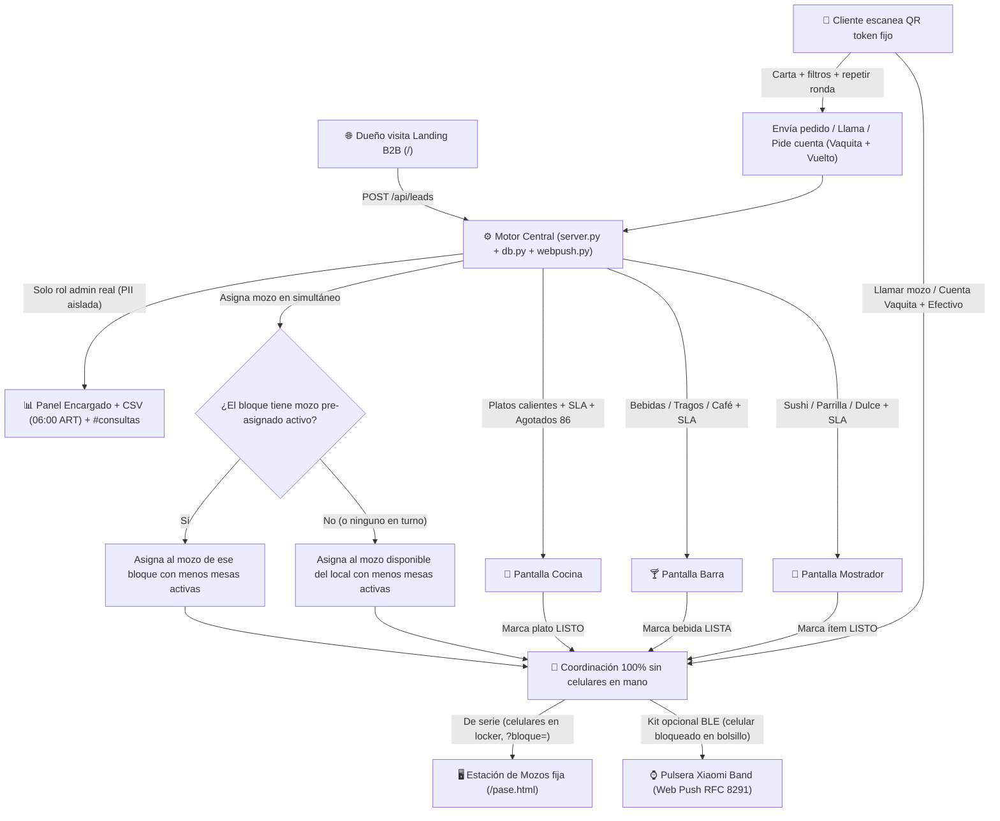

# Arquitectura y Plan de Implementación: SaleListo

Este documento describe la arquitectura funcional, de seguridad y técnica de **SaleListo** ([`../app/`](../app/)), diseñada para operar sobre HTTPS público con acceso instantáneo desde la cámara del celular (sin descargar aplicaciones ni registrarse), separar limpiamente la **Landing Comercial B2B (`/`)** del **Hub Operativo interno (`/operacion.html`)**, rutear pedidos en **hasta 3 estaciones reales en paralelo (`Cocina`, `Barra` y `Mostrador`)**, coordinar al personal **100% sin celulares en la mano** (mediante la **Estación de Mozos fija `/pase.html`** incluida en el Plan Base con celulares en locker, o el soporte nativo **PWA + Web Push Bluetooth BLE** para el **Kit de Pulseras Vibradoras Xiaomi Smart Band** con el teléfono bloqueado en el bolsillo del camarero) y consolidar todas las resoluciones de ingeniería de [`auditoria_inicial_beta.md`](./auditoria_inicial_beta.md), [`mejoras_producto_ux.md`](./mejoras_producto_ux.md) y la auditoría integral [`goldfish_review_report.md`](./goldfish_review_report.md).

---

## 1. Acceso Público HTTPS (`https://salelisto.com`), Separación Comercial / Operativa, Persistencia Cloud y Cero Dependencias

Para que cada comensal acceda al instante escaneando el QR de su mesa con la cámara y al mismo tiempo los dueños gastronómicos dispongan de una portada comercial segura (aislada de los datos reales de leads), SaleListo opera en producción 24/7 sobre [**`https://salelisto.com`**](https://salelisto.com/) (**Railway + Cloudflare SSL**, con redirección `301` de `www.salelisto.com` a `https://salelisto.com` y casillas corporativas activas en Cloudflare: `simon@salelisto.com`, `valentin@salelisto.com`, `ventas@salelisto.com` y `consultas@salelisto.com`), conservando ejecución local inmediata con Python 3.10+ estándar:

- **Rutas oficiales en producción (`https://salelisto.com`)**:
  - **Portada Comercial B2B (`https://salelisto.com/` -> `app/public/index.html`, `css/landing.css`, `js/landing.js`)**: página pública orientada a dueños y encargados gastronómicos con metadatos canónicos, Open Graph rasterizado `1200x630` (`https://salelisto.com/og-salelisto.png` compatible con WhatsApp y LinkedIn), `robots.txt` y `sitemap.xml`. Presenta hero con video en loop, reproductor del Spot Oficial, comparativa antes/después del cobro, simulador interactivo de bloques, sección oscura de operación sin celulares (con física exacta de locker vs. bolsillo BLE), explorador accesible de vistas (con ingreso directo a `restaurante.html?demo=1` bajo rol aislado `demo_admin`), calculadora interactiva de ROI sincronizada con el switch `ARS/USD` y enlaces compartibles (`?mesas=&ticket=&turnos=#roi`), matriz transparente de planes y formulario de piloto de 14 días conectado a `POST /api/leads` con botón directo `wa.me` al `(+54)1138436571` y contacto directo a `ventas@salelisto.com` y `consultas@salelisto.com`.
  - **Demo Interactiva Multipantalla (`https://salelisto.com/demo.html`)**: simulador de Hora Pico en 1 clic paso a paso sincronizando celular del comensal, mozo y pantallas del salón.
  - **Hub Operativo del Restaurante (`https://salelisto.com/operacion.html`)**: tablero interno de acceso por rol para el equipo del salón con enlaces directos a **Panel del Encargado (`https://salelisto.com/restaurante.html`)**, **Estación de Mozos fija (`https://salelisto.com/pase.html`)**, **Comandera 3 Estaciones (`https://salelisto.com/cocina.html` · `Todo` / `Cocina` / `Barra` / `Mostrador`)**, **Estudio de Impresión QR (`https://salelisto.com/qr.html`)**, **PWA Mozo BLE (`https://salelisto.com/mozo.html`)** y **Carta Cliente QR (`https://salelisto.com/q/<token>` / `cliente.html?t=<token>`)**.
- **En computadora local (con túnel HTTPS público integrado en [`app/tunnel.py`](../app/tunnel.py))**: se inicia con `python app/server.py` (LAN) o `python app/server.py --tunnel` / `SALELISTO_TUNNEL=1` (túnel rápido HTTPS en 1 paso o Túnel Permanente mediante `CLOUDFLARE_TUNNEL_TOKEN` + `PUBLIC_URL`), además de controles de 1 clic en `restaurante.html` y `qr.html` (`GET /api/tunnel/status` para `admin`/`demo_admin` sin exponer detalles internos a `demo_admin`, y `POST /api/tunnel/start` / `POST /api/tunnel/stop` + descarga verificada de `cloudflared` en `DATA_DIR/bin/` estrictamente exclusivos del rol `admin` con PIN real), manteniendo **cero paquetes externos (`pip`)**.
- **Rutas cortas `/q/<qr_token>` y precedencia determinística de URL pública**: `GET /q/<qr_token>` sirve directamente `cliente.html` (con `<base href="/">` y resolución automática de token en `store.js`/`cliente.js`), reduciendo la densidad de módulos QR para lectura instantánea con cámara en ambientes tenues, manteniendo 100% compatibilidad con `/cliente.html?t=<token>` y `?mesa=`. `_effective_base_url()` aplica precedencia estricta: `restaurant.public_url` -> `PUBLIC_URL` -> túnel `cloudflared` activo -> cabeceras `X-Forwarded-*` (solo proxy confiable) -> `http://<lan_ip>:<PORT>`.
- **Hardening específico para redes públicas y proxy HTTPS (NAT de operadoras y reverse proxy)**:
  - **IP real por cliente (`_client_ip()`)**: cuando la conexión proviene de loopback (`cloudflared`) o de un proxy confiable (`TRUST_PROXY=1`, `RENDER`, `FLY_APP_NAME`, `RAILWAY_ENVIRONMENT`), toma la IP real desde `CF-Connecting-IP` o `X-Forwarded-For` para aislar el rate-limiting de `/api/auth/*` y `/api/leads` por usuario móvil; ante conexiones directas LAN sin `TRUST_PROXY`, ignora cabeceras reenviadas para evitar spoofing.
  - **Compresión HTTP Gzip (`Accept-Encoding: gzip`)**: comprime respuestas JSON, HTML, CSS, JS, SVG y CSV `>= 512 B` con `Vary: Accept-Encoding`, sin tocar `/api/events` (SSE) ni rangos `206` de `/media/*`.
  - **SSE resistente a NAT móvil**: cabeceras `Cache-Control: no-cache, no-transform`, `X-Accel-Buffering: no`, `retry: 3000`, keepalive `: ping\n\n` cada 15 s y resincronización automática en `store.js` al reconectar `EventSource`, recuperar conectividad (`online`) o desbloquear el celular (`visibilitychange`).
  - **Idempotencia transaccional de pedidos (`POST /api/orders` y `order.create`)**: tabla `order_requests` en SQLite indexada por `(table_id, client_request_id)` para que un reintento tras un microcorte de red devuelva exactamente las mismas comandas (`deduplicated: true`) sin duplicar platos en Cocina ni Barra.
- **En producción en la nube (`render.yaml` + `app/render.yaml` + `Procfile`)**: configura automáticamente disco persistente NVMe montado en `/var/data` (`1 GB`), `DATA_DIR=/var/data`, zona horaria `TZ=America/Argentina/Buenos_Aires` y soporte opcional para claves de entorno `VAPID_PUBLIC_KEY` y `VAPID_PRIVATE_KEY`, además del endpoint de monitoreo `GET /api/health`.
- **Base de datos transaccional persistente (`SQLite` en modo WAL) y supervivencia a reinicios**:
  - Gestionada por [`app/db.py`](../app/db.py) con migraciones `ALTER TABLE` idempotentes.
  - **Versión monotónica persistida (`seqs` -> `state_ver`)**, **secreto de firma persistente (`DATA_DIR/server_secret.key`)** y **tabla de sesiones `staff_sessions` en SQLite** (TTL de 24 h con revocación inmediata al eliminar un mozo o rotar su PIN), garantizando que ningún cliente SSE ni sesión activa de salón se congele o caiga ante un reinicio o despliegue del servidor.
  - **Corte de turno gastronómico argentino (`06:00 AM ART`, `UTC-3` en stdlib pura)**: implementado mediante `AR_TZ = timezone(timedelta(hours=-3), name='ART')` compatible con Windows y Linux sin requerir `tzdata`, de modo que la facturación nocturna entre las `00:00` y las `05:59` permanezca íntegra dentro del mismo turno operativo.

---

## 2. Flujo Operativo y Comercial en Tiempo Real (3 Estaciones + Scopes SSE Segregados)

---

## 3. Módulos, Seguridad y Reglas de Negocio

### Módulo A: Constructor del Salón, Integridad Contable y QRs Vectoriales hasta Versión 10
En [`restaurante.html`](../app/public/restaurante.html) y [`qr.html`](../app/public/qr.html):

1. **Catálogo de Bloques y Grilla de Mesas**:
   - Plantillas listas para usar (*Interior, Exterior/Vereda, Terraza, Barra, Sector 1, Sector 2, Patio y Salón VIP*) y alta individual o por lote con capacidad y estado activo/inactivo.
2. **Integridad Contable ante Baja de Mesas o Bloques (`archived = 1`)**:
   - La tabla `table_sessions` conserva `closed_table_code` y `closed_block_name` al cerrar cada cuenta. Si el encargado elimina una mesa o bloque estacional que posee sesiones históricas cerradas, el motor ejecuta **baja lógica (`active = 0, archived = 1`)** liberando el código visual para futuras mesas sin destruir jamás el historial de caja ni los arqueos CSV.
3. **QR SVG Propio hasta Versión 10 (`app/qrgen.py`) y Protección de Tokens (`GET /api/qrs`)**:
   - Generador ISO/IEC 18004 en Python puro ampliado hasta **Versión 10 (`271` bytes)** con bloques Reed-Solomon multi-grupo e información de versión Golay de 18 bits para soportar URLs largas de producción sin errores.
   - En producción (`demoMode = False`), `GET /api/qrs` exige autenticación de personal (`admin`, `waiter` o `kitchen`), devolviendo `401` a clientes anónimos para impedir enumeración remota de tokens de mesa; `qr.html` presenta modal de PIN cuando el modo demo está apagado.

### Módulo B: Gestión de Mozos, Seguridad de PINs y Asignación Híbrida
1. **Preservación y Validación Segura de PINs**:
   - Editar el nombre o color de un mozo con campo PIN vacío conserva intacto su PIN actual (solo se limpia enviando explícitamente `clearPin: true`), y cualquier cambio de PIN o baja revoca sus `staff_sessions` activas.
   - En producción (`demoMode = False`), `verify_waiter_login` valida el PIN individual con `hmac.compare_digest` y, si un mozo no tiene PIN propio configurado, exige el `admin_pin` del local (impidiendo accesos remotos con PIN vacío).
2. **Asignación Híbrida, Desasignación Limpia y Reasignación Automática**:
   - Soporta modo pre-asignado por bloque, modo balanceado automático por menor carga activa, opción explícita `-- Sin mozo asignado --` (`session.reassign` con `waiterId: ""`) y redistribución automática inmediata cuando un mozo sale de turno.

### Módulo C: Ruteo en 3 Estaciones (`Cocina`, `Barra`, `Mostrador`), Estación de Pase en 1 Toque y Semáforo SLA
1. **Tres Estaciones Reales en Paralelo (`STATIONS = {'cocina', 'barra', 'mostrador'}`)**:
   - Cada categoría e ítem (`station_override`) puede apuntar a **Cocina** (`cocina`), **Barra** (`barra`) o **Mostrador** (`mostrador`, ideal para barra fría de sushi/omakase, parrilla exterior o vitrina de boulangerie/pastelería).
2. **Comandera Digital KDS ([`cocina.html`](../app/public/cocina.html)) con Cajón de Agotados (86) y Wake Lock**:
   - Pestañas dedicadas (**Todo**, **Cocina**, **Barra**, **Mostrador**), botones táctiles grandes (`>= 44 px`), bloqueo automático de suspensión de pantalla (`navigator.wakeLock`), modal propio de PIN, control real de silencio sonoro y cajón rápido **`🚫 Agotados`** (`item.toggle` habilitado para rol `kitchen` únicamente sobre disponibilidad, nunca sobre precios ni borrado).
3. **Estación de Mozos Fija ([`pase.html`](../app/public/pase.html)) con Confirmación en 1 Toque, Filtro por Sector y Compactación**:
   - Permite que **todos los celulares del personal queden guardados en el locker o en caja**.
   - **Filtro por sector (`?bloque=...` + pastillas en cabecera)** para dedicar una tablet exclusivamente a *Terraza*, *Patio* o *Vereda*, y **compactación automática** de camareros al día (`0` pendientes) cuando hay 4 o más mozos en turno para mantener legibilidad a 4 metros sin scroll horizontal.
   - **Confirmación directa de llamados en 1 toque**: cada tarjeta `🙋 MESA LLAMA` presenta el motivo declarado y un único botón directo **`✔ Atendido`** (`call.attend` -> `atendida`), sin estados intermedios.
   - **Cobro en 1 viaje con detalle completo visible**: cada tarjeta `💳 CUENTA PEDIDA` muestra desde el primer instante **medio de pago, porcentaje de propina (default `0%` si no fue elegida), división *Vaquita*, total exacto y vuelto exacto a entregar** (`💵 Abona con $50.000 -> Llevar $15.800 de vuelto`) junto a un único botón directo **`✔ Cobrar y cerrar`**.
   - **Actualización SLA no destructiva (`tickSla()`)** cada 15 s in-place y *Screen Wake Lock* activo.

### Módulo D: PWA + Web Push RFC 8291/8292 endurecido y Física Bluetooth BLE para Pulseras Xiaomi Band
1. **Física Operativa Bluetooth Low Energy (BLE)**:
   - A diferencia de la Estación fija del Pase (donde los teléfonos quedan en el locker), en **Modo Pulsera Vibradora** el enlace Bluetooth BLE entre teléfono y Xiaomi Smart Band requiere proximidad corporal (~8 a 10 m sin muros). Por eso el teléfono del mozo va **guardado y con pantalla bloqueada en su bolsillo** (jamás se saca en el salón), recibiendo `PushEvent` nativos desde `sw.js` que hacen vibrar la muñeca al instante en cualquiera de los 3 planes comerciales.
2. **Endurecimiento Criptográfico y Anti-SSRF en [`app/webpush.py`](../app/webpush.py)**:
   - Implementación 100% stdlib de NIST P-256 ECDH, ECDSA ES256 (VAPID RFC 8292) y AES-128-GCM (RFC 8291).
   - Despacho acotado mediante `ThreadPoolExecutor(max_workers=4)`, validación estricta Anti-Blind-SSRF (exige esquema `https://`, resuelve DNS verificando IPs públicas globales y bloquea `localhost`, loopback, link-local, redes privadas y redirecciones HTTP `3xx`), autenticación obligatoria en `POST /api/push/unsubscribe` y re-suscripción automática en el cliente si rotó `applicationServerKey`.
   - Íconos PWA raster oficiales (`icon-180.png`, `icon-192.png`, `icon-512.png`) generados desde Propuesta 01 `mark.svg` para compatibilidad total en Android e iOS, incluyendo avisos ultracompactos con vuelto calculado en muñeca.

### Módulo E: Carta Cliente TRIZ ("Vaquita" + Vuelto + Repetir), Anti-Inflación Reversible y Arqueo CSV
1. **Experiencia TRIZ en Carta QR ([`cliente.html`](../app/public/cliente.html))**:
   - Preservación total del formulario abierto ante eventos SSE en vivo.
   - **Calculadora "Vaquita"** integrada en *Pedir la cuenta* (`÷ Dividir entre [-][N][+] personas`) mostrando el monto exacto por comensal con propina incluida.
   - **Declaración de efectivo y cálculo de vuelto**: chips rápidos (`Importe justo`, `$20.000`, `$50.000` o campo numérico) que envían `cashAmount` y `splitWays` en `call.create`, exponiendo `changeAmount` al personal.
   - Botón **`🔄 Repetir`** en pedidos ya entregados para disparar otra ronda idéntica en 1 toque y campo de detalle corto al elegir `💬 Otro` en *Llamar al mozo*.
2. **Ajuste Masivo por Inflación con Vista Previa y Deshacer**:
   - En `restaurante.html`, el ajuste porcentual muestra una **comparativa Antes / Después** antes de confirmar y habilita **`↩ Deshacer último ajuste`** (`price.undo` / `menu.undo_prices`, respaldado por `restaurant.canUndoPrices`).
3. **Exportación Contable CSV (`GET /api/export/sessions.csv`)**:
   - Formato **UTF-8 con BOM (`\ufeff`)** y separador **`;`** para apertura directa en Excel Argentina, filtrado en SQL `WHERE` por rango de fechas usando zona horaria `AR_TZ` y corte de turno `06:00 AM ART`, con protección contra inyección de fórmulas.

### Módulo F: Aislamiento PII de Leads (`admin` vs. `demo_admin`), Hardening HTTP y Streaming `206`
1. **Privacidad Estricta de Consultas Comerciales (`leads`) y Rol `demo_admin`**:
   - Cuando un visitante ingresa a `restaurante.html?demo=1` desde la Landing pública, `POST /api/auth/admin` (`{"demo": true}`) emite un token con alcance **`demo_admin`** (nunca el rol `admin` real).
   - `demo_admin` puede probar libremente el salón demo, pero tiene bloqueado modificar `adminPin`, `demoMode` o `publicUrl`, y **jamás recibe filas reales de la tabla `leads`**: tanto `get_staff_state('demo_admin')` como `GET /api/leads` y el scope SSE `demo_admin` devuelven únicamente 2 consultas ficticias ilustrativas en memoria (`DEMO-L1`, `DEMO-L2`), reservando los leads reales exclusivamente al rol `admin` autenticado con PIN real.
2. **Hardening HTTP y Control Anti-Abuso (`app/server.py`)**:
   - Rechazo inmediato de `Content-Length < 0` (`400`), `Handler.timeout = 30`, colas SSE acotadas (`maxsize=24`) con descarte del evento más antiguo ante clientes lentos, *rate-limiting* anti fuerza bruta en `/api/auth/*` (máx. 10 fallos / 5 min por IP), respuestas semánticas `401` (sin sesión) vs. `403` (rol insuficiente) y consulta batch `WHERE order_id IN (...)` sin N+1 en `get_client_state()`.
3. **Streaming Multimedia (`/media/*`)**:
   - Soporte completo `HTTP 206 Partial Content`, `ETag`, `304 Not Modified`, `HEAD` y bloqueo estricto contra *path traversal*.

---

## 4. Mapa Técnico de Archivos del Ecosistema

- [`app/server.py`](../app/server.py): Servidor HTTP endurecido para Internet pública, rutas cortas `/q/<qr_token>`, compresión Gzip, `_client_ip()` tras proxy confiable, `POST /api/orders` idempotente, endpoints `/api/tunnel/*`, scopes SSE segregados (`admin`, `demo_admin`, `staff`, `client`) con `no-transform`/keepalive, auth persistente, `/api/health`, `/api/leads`, `/api/export/sessions.csv`, `/media/*` Range 206 y `/api/push/*`.
- [`app/tunnel.py`](../app/tunnel.py): Gestor stdlib de túnel HTTPS Cloudflare (`cloudflared`) con Quick Tunnel (`https://*.trycloudflare.com`), túnel permanente por `CLOUDFLARE_TUNNEL_TOKEN`, descubrimiento/descarga verificada en `DATA_DIR/bin/` y broadcast SSE al cambiar estado.
- [`app/db.py`](../app/db.py): Motor SQLite (`WAL`), `AR_TZ` (`06:00 AM ART`), `state_ver` monotónica, `staff_sessions`, idempotencia `order_requests` (`clientRequestId`), baja lógica contable (`archived`), 3 estaciones (`cocina`, `barra`, `mostrador`), *Vaquita*/vuelto (`cash_amount`, `split_ways`), reversión de precios (`price.undo`), `data.clear_open_turn` y aislamiento PII de leads.
- [`app/webpush.py`](../app/webpush.py): Web Push RFC 8291 + VAPID RFC 8292 en stdlib pura, soporte env `VAPID_*`, `ThreadPoolExecutor` y validación Anti-Blind-SSRF.
- [`app/qrgen.py`](../app/qrgen.py): Codificador QR vectorial SVG en Python puro desde Versión 1 hasta Versión 10 (`271` bytes).
- [`app/tests_e2e.py`](../app/tests_e2e.py): Suite automatizada integral E2E sobre base temporal aislada cubriendo criptografía, aislamiento `demo_admin`/leads, PINs, integridad contable, corte `06:00 ART`, 3 estaciones, vuelto/Vaquita, 86 por cocina, `/api/health`, rutas cortas `/q/<qr_token>`, Gzip, `_client_ip()` proxy vs LAN directa, idempotencia `clientRequestId`, precedencia `PUBLIC_URL`/túnel y `/api/tunnel/*`.
- [`app/public/`](../app/public/): Landing B2B (`index.html`), Hub Operativo (`operacion.html`), Demo Hora Pico (`demo.html`), Estación de Pase por bloques (`pase.html`), Comandera 3 estaciones + 86 (`cocina.html`), Carta QR con *Vaquita* y vuelto (`cliente.html`), PWA Mozo BLE (`mozo.html`), Panel Encargado (`restaurante.html`), Estudio QR A4 (`qr.html`), imagen Open Graph `1200x630` (`og-salelisto.png` + `og-salelisto.svg`), SEO (`robots.txt` + `sitemap.xml`) e íconos PWA (`icon-180.png`, `icon-192.png`, `icon-512.png`).
- [`comercial/`](../comercial/): Deck Comercial Interactivo de 10 láminas con notas del orador `[N]` y simuladores en vivo (`presentacion_interactiva.html`), Dossier Ejecutivo 2 páginas A4 (`SaleListo_Dossier_Comercial.pdf` + `brochure_b2b.html`), Acuerdo de Piloto 14 días 1 página A4 (`SaleListo_Acuerdo_Piloto_14d.pdf` + `acuerdo_piloto_14_dias.md`), planilla de onboarding (`plantilla_carga_carta.csv`), `modelo_de_negocios.md`, `propuestas_restaurantes.md`, mensajes hechos a medida 1 a 1 (`mensajes_personalizados_26_locales.md`) y `prospectos_restaurantes.csv`.
- [`marketing/`](../marketing/) y [`video-ad/`](../video-ad/): Fábrica audiovisual y gráfica B2B compuesta por el Spot Oficial v5 (`SaleListo_Ad.mp4`) + pipeline open-ended `generar_ad_omni.py` (Gemini Omni 1.2 Flash), **5 Reels verticales MP4 60 fps**, **3 carruseles (15 PNGs + 3 PDFs nativos para LinkedIn)**, **4 posts individuales**, **6 Historias verticales (`1080x1920`)**, **8 banners multicanal** (**33 PNGs gráficos totales**), `guiones_reels.md` y `calendario_redes_30dias.md`.
- [`docs/goldfish_review_report.md`](./goldfish_review_report.md): Informe oficial de auditoría independiente **Elephant-Goldfish Model (EGM)** y detalle de resoluciones en Backend, UX/TRIZ, Comercial, Marketing y Pipeline Audiovisual.
- **Dominio y canales oficiales en producción**: **`https://salelisto.com`** (`www.salelisto.com` -> `301` -> `https://salelisto.com`), teléfono único `(+54)1138436571` y casillas corporativas activas en Cloudflare: `simon@salelisto.com`, `valentin@salelisto.com`, `ventas@salelisto.com` y `consultas@salelisto.com`.
