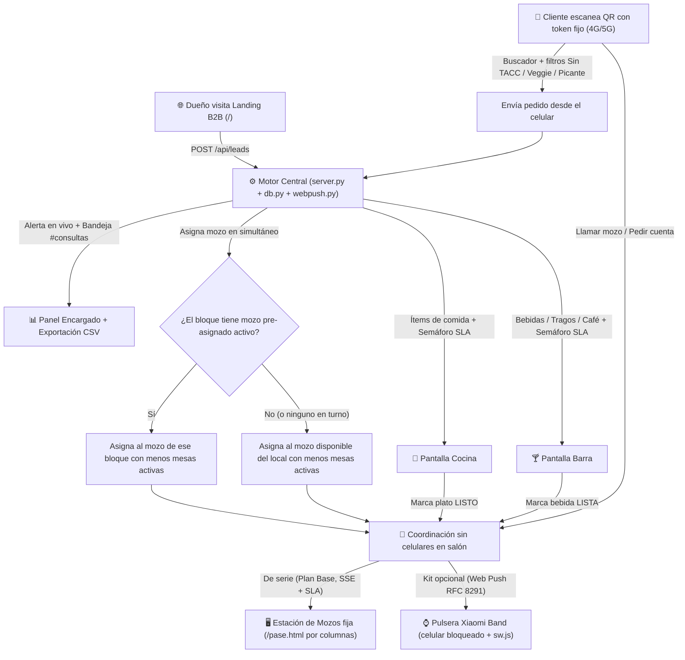

# Arquitectura y Plan de Implementación: SaleListo

Este documento describe la arquitectura funcional y técnica de **SaleListo** ([`../app/`](../app/)), diseñada para operar sobre datos móviles 4G/5G sin requerir Wi-Fi en el salón, separar limpiamente la **Landing Comercial B2B (`/`)** del **Hub Operativo interno (`/operacion.html`)**, coordinar al personal **100% sin celulares en la mano** (mediante la **Estación de Mozos fija `/pase.html`** incluida en el Plan Base y el soporte nativo **PWA + Web Push en segundo plano** para el **Kit de Pulseras Vibradoras Xiaomi Smart Band**) y resolver de raíz tanto los 10 errores estructurales de [`auditoria_inicial_beta.md`](./auditoria_inicial_beta.md) como las mejoras operativas y de conversión documentadas en [`mejoras_producto_ux.md`](./mejoras_producto_ux.md).

---

## 1. Operación 4G/5G, Separación Comercial / Operativa y Cero Dependencias

Para que ningún comensal tenga que pedir la clave del Wi-Fi y al mismo tiempo los dueños gastronómicos dispongan de una portada comercial dedicada, SaleListo está preparado para ejecutarse en **una dirección pública con HTTPS** (por ejemplo, `https://<tu-servicio>.onrender.com`), conservando la ejecución local inmediata en cualquier computadora con Python 3.10+ estándar:

- **Separación entre Portada Comercial (`/`) y Hub Operativo (`/operacion.html`)**:
  - **Portada Comercial B2B (`/` -> `app/public/index.html`, `css/landing.css`, `js/landing.js`)**: página pública orientada a dueños y encargados gastronómicos. Presenta hero con video en loop y reproductor del Spot Oficial, comparativa antes/después del cobro, simulador interactivo de balanceo de bloques, sección oscura de operación sin celulares, explorador accesible de 5 vistas, calculadora interactiva de ROI (8 a 80 mesas, ticket promedio y turnos), matriz de planes con conmutador ARS/USD y formulario de piloto conectado a `POST /api/leads`. Los videos emplean carga diferida con `IntersectionObserver` y respetan `prefers-reduced-motion`.
  - **Hub Operativo del Restaurante (`/operacion.html`)**: tablero interno desacoplado para el equipo del salón. Muestra indicadores en vivo (mesas ocupadas, comandas en preparación y demoradas, retiros listos en el pase, cobrado del día y leads comerciales nuevos), checklist diario de apertura de turno persistido en el dispositivo, código QR dinámico para abrir el tablero en la TV/tablet del mostrador y accesos directos a `pase.html`, `cocina.html` (Todo / Solo Cocina / Solo Barra), `restaurante.html`, `mozo.html`, `cliente.html`, `qr.html` y `demo.html`.
- **En computadora local**: se inicia con `python app/server.py` o `app\iniciar.bat`, sin instalar paquetes externos (`pip`) ni motores de base de datos adicionales.
- **En producción en la nube**: la raíz del repositorio incluye [`render.yaml`](../render.yaml) y [`Procfile`](../Procfile) listos para publicar el servicio con HTTPS (`buildCommand: ""`). De este modo, el celular del cliente ingresa con su propio 4G/5G al escanear el QR, igual que la pantalla fija del Pase, Cocina/Barra, Caja y las notificaciones Web Push en segundo plano hacia las pulseras de los mozos.
- **Base de datos transaccional integrada (`SQLite` en modo WAL)**: gestionada por [`app/db.py`](../app/db.py), almacena bloques, mesas con tokens seguros, carta con etiquetas dietarias (`items.tags`), turnos de mozos, suscripciones Web Push, pedidos, sesiones de mesa, arqueo de caja y consultas comerciales (`leads`) sin corrupción por concurrencia, con migraciones `ALTER TABLE` idempotentes al iniciar.
- **Criptografía, gráficos y streaming autónomos en Python puro**: el generador vectorial de códigos QR ([`app/qrgen.py`](../app/qrgen.py)), el motor criptográfico Web Push RFC 8291/8292 ([`app/webpush.py`](../app/webpush.py)), el servidor de video con soporte `HTTP 206 Partial Content` y el exportador contable CSV están construidos íntegramente sobre la biblioteca estándar de Python.

---

## 2. Flujo Operativo y Comercial en Tiempo Real

---

## 3. Módulos y Reglas de Negocio

### Módulo A: Constructor del Salón por Bloques Pre-armados y QRs con Token Fijo
En [`restaurante.html`](../app/public/restaurante.html) se reemplaza el límite rígido de mesas por un **Constructor Visual de Salón**:

1. **Catálogo de Bloques en 1 clic**:
   - Plantillas listas para usar: **Interior**, **Exterior / Vereda**, **Terraza**, **Barra**, **Sector 1**, **Sector 2**, **Patio** y **Salón VIP**, con nombre, ícono, columnas y orden editables.
2. **Grilla de Mesas por Bloque**:
   - Alta individual o por lote dentro de cada bloque (por ejemplo, `Terraza`: mesas `T1` a `T4`; `Barra`: posiciones `B1` a `B4`; `Interior`: mesas `1` a `6`), indicando capacidad de cubiertos y estado activo/inactivo.
3. **QR SVG Propio con Token Fijo Anti-Spoofing**:
   - Al crear una mesa se genera un **token aleatorio único y persistente** (`cliente.html?t=...`).
   - El cartel impreso sirve de forma permanente en el acrílico de la mesa, impidiendo que alguien adivine URLs correlativas (`?mesa=5`) para cargar pedidos falsos en otra mesa. Incluye acción de regeneración manual de token cuando el encargado lo requiera.
   - La generación gráfica de códigos QR se resuelve íntegramente en el backend con [`app/qrgen.py`](../app/qrgen.py) (SVG puro ISO/IEC 18004 sin depender de CDNs externos).

### Módulo B: Gestión de Mozos en Vivo y Asignación Híbrida Inteligente
Pestaña dedicada de **Mozos** integrada con los bloques y las sesiones de mesa:

1. **Alta, Baja y Disponibilidad Instantánea**:
   - Creación y baja de mozos en cualquier momento del turno, con color identificador y PIN opcional de 4 dígitos.
   - Interruptor rápido **Disponible / Fuera de turno**.
2. **Dos Modos Combinables de Asignación**:
   - **Pre-asignado por Bloque**: permite asignar uno o varios mozos titulares a cada sector (por ejemplo, *Terraza -> Sofía*, *Interior -> Lucas y Martín*), eligiendo dentro del bloque al titular activo con menor carga.
   - **Automático Balanceado**: reparte cada nueva sesión de mesa al mozo disponible del salón con **menor cantidad de mesas abiertas en ese instante**.
   - **Respaldo Inteligente y Continuidad**: si los mozos titulares de un bloque están fuera de turno, el motor deriva automáticamente a otro mozo activo del local; una vez asignado el mozo en el primer evento de la mesa, se mantiene fijo durante toda la sesión salvo reasignación expresa.
3. **Reasignación Automática ante Salida de Turno**:
   - Si un mozo pasa a no disponible o se da de baja teniendo mesas abiertas, el motor **redistribuye automáticamente sus mesas activas** hacia los compañeros disponibles con menor carga (priorizando su mismo bloque), actualiza el encabezado del cliente y notifica al instante tanto en la columna del nuevo responsable en `pase.html` como por Web Push en su pulsera.

### Módulo C: Separación Cocina / Barra, Estación de Mozos Fija (`pase.html`) y Semáforo SLA
1. **Ruteo Directo por Estación**:
   - Cada categoría de la carta define su estación de preparación: **Cocina** (`cocina`) o **Barra** (`barra`), con opción de `station_override` por plato.
   - Al confirmar un pedido mixto, las bebidas impactan de inmediato en **Barra** y los platos en **Cocina** en paralelo, sin que una bebida rápida quede retenida detrás de la cocción de un plato principal.
2. **Comandera Digital KDS ([`cocina.html`](../app/public/cocina.html))**:
   - Vista dedicada para monitor o tablet con filtro instantáneo (**Cocina** | **Barra** | **Ambos**), cronómetro de espera por comanda y posibilidad de avanzar o retroceder estados ante toques accidentales.
3. **Estación de Mozos Fija por Columnas ([`pase.html`](../app/public/pase.html), [`css/pase.css`](../app/public/css/pase.css), [`js/pase.js`](../app/public/js/pase.js))**:
   - Incluida de serie en el **Plan Base** para resolver al 100% la operación **sin celulares en el salón** utilizando una única tablet o monitor horizontal en el mostrador del pase o la barra, legible a **3 o 4 metros de distancia**.
   - **Interfaz de alto contraste**: inicia en **Modo Pase Oscuro (`#1C1917`)** con cambio en 1 clic a **Modo Claro (`#FAF7F2`)**, botón de **Pantalla Completa**, reloj en vivo y toggle de **Sonido (`🔔 Activo`)** que dispara un aviso acústico (`ding()`) cada vez que ingresa un retiro listo o llamado nuevo. Usa autenticación de equipo (`POST /api/auth/kitchen`) y streaming SSE en tiempo real (`scope=staff`).
   - **Grilla dinámica de columnas por mozo activo**: renderiza una columna identificada por color y nombre para cada camarero disponible en turno (`waiters.filter(w => w.available)`), más una columna automática **"Apoyo / Sin asignar"** solo cuando existan eventos pendientes sin mozo en turno asignado.
   - **Tarjetas priorizadas con botones táctiles grandes (`>= 54 px`)**:
     - **🍳 RETIRAR EN COCINA** (`#D97706`) y **🍸 RETIRAR EN BARRA** (`#6D28D9`): comandas en estado `listo` con código gigante de mesa, espera total de la mesa + tiempo en pase, ítems/notas y botón **`✔ Ya lo llevé`** (`order.status -> entregado`).
     - **💳 CUENTA PEDIDA** (`#2F8A57`): solicitudes de cuenta pendientes mostrando medio de pago elegido (`Tarjeta`, `Efectivo`, `QR`, `Transferencia`), porcentaje de propina y total exacto calculado de la sesión abierta, con botón **`✔ Llevando cobro`** (`call.attend`).
     - **🙋 MESA LLAMA** (`#D9412B`): llamados de asistencia en mesa con su motivo y botón **`✔ Voy`** (`call.attend`).
   - **Carga rápida sin celulares (`+ Pedido en mostrador`)**: modal ágil en cabecera que permite al mozo cargar en segundos un pedido tomado conversando en la mesa (`order.create` con `source: 'mozo'`) directamente sobre la pantalla fija del pase.
4. **Semáforo SLA Unificado de Demora (Cocina/Barra, Estación de Pase y Panel)**:
   - Todos los indicadores críticos combinan **color + etiqueta textual + minutos transcurridos** (nunca solo color, garantizando lectura en pantallas lavadas por luz ambiental y accesibilidad):
     - **Comandas** (`cocina.html`, retiros en `pase.html` y pestaña Comandas en `restaurante.html`), medidas desde `orders.created_at` (instante en que la mesa envió el pedido):
       - `🟢 En tiempo · X min`: menos de `8 min`.
       - `🟠 Atención · X min`: entre `8` y `14 min` (contorno ámbar).
       - `🔴 Demorado · X min`: `15 min` o más (contorno coral, fondo destacado, pulso suave respetando `prefers-reduced-motion` y campana sonora única en `cocina.html` cuando una comanda cruza el umbral de 15 minutos).
     - **Llamados y cuentas pedidas en `pase.html`** (umbrales abreviados porque la mesa aguarda atención presencial):
       - `🟢 En tiempo`: menos de `3 min` · `🟠 Atención`: `3 a 5 min` · `🔴 Demorado`: `6 min` o más.
   - **Refresco liviano cada `15 s`**: actualiza en el cliente los chips SLA y los contadores de cabecera (`🟢/🟠/🔴` en Cocina y `🔴 N demorados` en Pase) sin reconstruir el tablero ni interrumpir interacciones táctiles.

### Módulo D: PWA + Service Worker + Web Push RFC 8291/8292 para Kit Pulseras Vibradoras (Xiaomi Band)
Pensado para patios cerveceros, terrazas por escalera, jardines o veredas amplias donde el camarero se encuentra lejos de la pantalla del pase:

1. **Problema técnico resuelto (Pantalla bloqueada en bolsillo o locker)**:
   - Cuando el teléfono del mozo apaga su pantalla y queda guardado en el bolsillo o en un locker cercano, el sistema operativo móvil congela las pestañas del navegador (suspendiendo SSE y `new Notification()` en página).
   - Para que la app oficial *Mi Fitness* haga vibrar por Bluetooth una **Xiaomi Smart Band** en tiempo real, el aviso debe llegar como **notificación nativa del sistema operativo emitida desde un Service Worker (`PushEvent` -> `self.registration.showNotification`)**.
2. **Motor Criptográfico Web Push en Python Puro ([`app/webpush.py`](../app/webpush.py))**:
   - Construido al 100% con módulos estándar de Python (`hashlib`, `hmac`, `secrets`, `struct`, `base64`, `json`, `urllib.request`), manteniendo cero dependencias externas:
     - **Curva elíptica NIST P-256 (`secp256r1`)**: generación y persistencia automática del par de claves del servidor en `app/data/vapid_keys.json`, acuerdo de claves efímero **ECDH** y firma **ECDSA SHA-256 (`ES256`, `r || s` de 64 bytes)** para encabezados **VAPID (RFC 8292)**.
     - **Cifrado de carga útil RFC 8291 (`Content-Encoding: aes128gcm`)**: derivación **HKDF-SHA256** e implementación pura de **AES-128-GCM** (cifrador Rijndael de 128 bits + autenticación polinómica GHASH en `GF(2^128)`).
     - **Despacho asíncrono no bloqueante**: envíos HTTP `POST` en hilos daemon (`TTL: 120`, `Urgency: high`) hacia FCM, Mozilla Autopush o Apple Web Push, eliminando automáticamente suscripciones expiradas (`HTTP 404` / `410`).
     - **Autoverificación criptográfica integrada**: ejecutando `python app/webpush.py` se corre `self_test()`, que verifica vectores NIST de AES-128-GCM, firmas ECDSA P-256 y un ciclo completo de cifrado/descifrado RFC 8291.
3. **Suscripciones, Textos Ultracompactos para Muñeca y API Push (`app/db.py` + `app/server.py`)**:
   - Tabla `push_subscriptions` vinculada a `waiters(id)` con soporte para múltiples dispositivos y flag `wristband_mode`.
   - Cada evento operativo genera además de la notificación completa una dupla ultracompacta diseñada para el ancho de lectura de medio segundo de una Xiaomi Smart Band (`shortTitle <= 26` caracteres y `shortBody <= 48` caracteres), por ejemplo:
     - `🍸 T2 · Retirar Barra` / `2x Gin Tonic`
     - `🍳 M4 · Retirar Cocina` / `2x Burger`
     - `💳 M8 · Tarjeta` / `$34.200 (Propina 10%)`
     - `🙋 M2 · Llama` / `Agua y hielo`
   - Rutas dedicadas en `app/server.py`: `GET /api/push/vapid-public-key`, `POST /api/push/subscribe`, `POST /api/push/unsubscribe` y `POST /api/push/test` (envía al instante `⌚ Pulsera SaleListo OK` para validar la vibración con pantalla bloqueada en 1 toque).
4. **PWA Instalable y Modo Pulsera ([`manifest.json`](../app/public/manifest.json), [`sw.js`](../app/public/sw.js), [`mozo.html`](../app/public/mozo.html))**:
   - `manifest.json` habilita la instalación como aplicación nativa en Android e iOS con los tokens visuales oficiales (`#FAF7F2` / `#D9412B` y `mark.svg`).
   - `sw.js` en la raíz pública procesa eventos `push` mostrando notificaciones con patrón de vibración reforzado (`[220, 90, 220, 90, 320]`, `renotify: true`) y abre o enfoca `/mozo.html` al tocar la alerta. Desde `mozo.html` el camarero activa con un interruptor el **Modo Pulsera (Xiaomi Band)** y ejecuta el botón de prueba directa.

### Módulo E: Carta con Etiquetas Dietarias (`items.tags`), Exportación Contable CSV y Seguridad
1. **Gestión Integral de Carta y Etiquetas Dietarias (`items.tags`)**:
   - ABM completo de categorías con ordenamiento, ícono y estación de destino (`Cocina` / `Barra`), subida de **fotografías reales** en `app/data/uploads/`, control instantáneo de agotados y **actualización masiva porcentual de precios (`+%`)** con redondeo limpio.
   - **Columna `items.tags TEXT NOT NULL DEFAULT ''`**: incorporada con migración `ALTER TABLE` segura sobre bases previas (etiquetando automáticamente solo los platos clásicos sin modificar platos personalizados del local). Lista blanca validada en `db.normalize_tags()`: `sin_tacc`, `veggie`, `vegano`, `picante` y `sin_alcohol` (donde `vegano` implica automáticamente `veggie` para garantizar consistencia en filtros).
   - **Buscador y filtros rápidos en `cliente.html`**: barra superior fija con búsqueda instantánea insensible a mayúsculas y tildes sobre nombre, descripción, categoría y etiquetas (`font-size: 16px` para evitar zoom automático en iOS), combinable con chips de un toque (`⭐ Populares`, `🌾 Sin TACC`, `🌱 Veggie`, `🌶️ Picante`), pastillas visuales en cada plato y estado vacío con acción rápida de limpieza.
2. **Arqueo de Caja y Exportación Contable CSV (`GET /api/export/sessions.csv`)**:
   - Arqueo real sobre sesiones cerradas (`table_sessions` con índice `idx_sessions_status_closed`), con desglose por medio de pago y sumatoria de propinas por mozo.
   - **Endpoint `GET /api/export/sessions.csv`**: requiere autorización de encargado (`X-Auth-Token` o `?token=` con rol `admin`, o `demoMode` activo) y admite filtro opcional por rango de fechas `?desde=AAAA-MM-DD&hasta=AAAA-MM-DD`.
   - **Compatibilidad directa con Excel en Argentina y seguridad**: genera el archivo en **UTF-8 con BOM (`\ufeff`)** y delimitador **punto y coma (`;`)** con fin de línea `CRLF`, exportando las 13 columnas contables (`Fecha apertura`, `Hora apertura`, `Fecha cierre`, `Hora cierre`, `Mesa`, `Bloque`, `Mozo`, `Medio de pago`, `Subtotal`, `% Propina`, `Monto propina`, `Total`, `ID sesión`) y neutralizando inyección de fórmulas en celdas de texto que comiencen con `=`, `+`, `-`, `@`, `\t` o `\r`.
   - En `restaurante.html#caja`: botones **`📥 Descargar Arqueo CSV`** y **`📅 CSV de hoy`**, más recordatorio preventivo de exportación antes de limpiar el historial de pedidos.
3. **Seguridad y Robustez Operativa**:
   - Autenticación por PIN para encargado (`restaurante.html`), cocina/pase (`cocina.html`, `pase.html`) y mozos (`mozo.html`), más canales SSE segregados por alcance (`staff` vs. `client` acotado únicamente a la mesa del token consultado).
   - Preservación de ediciones en curso en el formulario de Configuración frente a eventos SSE en vivo, limpieza automática del carrito del cliente si un plato se agota, preservación del precio histórico de cada ronda y bloqueo preventivo al intentar cerrar mesas con comandas aún en preparación.

### Módulo F: Captura de Leads B2B (`leads`) y Servicio Multimedia `HTTP Range 206` (`/media/*`)
1. **Tabla `leads` y Flujo Comercial Integrado (`POST/GET /api/leads` + `lead.status`)**:
   - **Esquema SQLite (`leads`)**: `id TEXT PRIMARY KEY`, `name TEXT`, `restaurant_name TEXT`, `zone TEXT`, `tables_count TEXT`, `contact TEXT`, `plan_interest TEXT`, `message TEXT`, `status TEXT NOT NULL DEFAULT 'nuevo'`, `created_at INTEGER NOT NULL`, indexada por `idx_leads_created ON leads(created_at DESC)`. La acción `demo.reset` preserva intacta la tabla `leads` para no perder contactos reales durante demostraciones.
   - **`POST /api/leads` (público)**: recibe el formulario de la Landing Page B2B, exige `name` o `restaurantName` más `contact`, sanea caracteres de control y acota longitudes máximas, aplica *rate-limiting* anti-spam en memoria por IP (**máximo 6 envíos cada 10 minutos**, respondiendo `HTTP 429` al superarse), persiste el registro y dispara `broadcast_updates()` para notificar en tiempo real al Panel.
   - **`GET /api/leads` y `lead.status`**: lectura protegida para rol `admin` (o `demoMode`), entrega de los últimos 50 leads dentro de `get_staff_state()` y cambio de estado mediante `POST /api/action` (`type: 'lead.status'`, valores válidos: `nuevo`, `contactado`, `piloto`, `descartado`).
   - **Bandeja `📨 Consultas` en `restaurante.html#consultas`**: contador de leads nuevos en barra lateral, alerta sonora y notificación visual al ingresar una consulta, filtros por etapa y botones de contacto inmediato por WhatsApp (normalizando números móviles argentinos al prefijo internacional y pasando automáticamente el estado a `contactado`) o correo electrónico.
2. **Streaming Multimedia Optimizado (`/media/*` con `HTTP Range 206`)**:
   - En `app/server.py` (`_serve_media` y `do_HEAD`), los videos y posters de `app/public/media/` (`hero-salon-loop.mp4`, `terraza-qr-loop.mp4`, `cocina-barra-loop.mp4`, `sin-celulares-loop.mp4`, `spot-salelisto.mp4` y sus respectivos posters `.jpg`) se entregan con:
     - Soporte completo de solicitudes parciales **`Range: bytes=start-end`** y rangos de sufijo (`bytes=-N`), devolviendo **`206 Partial Content`** con `Accept-Ranges: bytes` y `Content-Range` (o `416 Range Not Satisfiable` si el rango es inválido) y transmitiendo en fragmentos de `256 KB` para inicio instantáneo y adelanto fluido del Spot sin descargar el archivo entero.
     - Cabeceras de caché pública (`Cache-Control: public, max-age=86400`), `ETag`, `Last-Modified`, validación condicional `304 Not Modified`, soporte `HEAD` y protección estricta contra *path traversal* (`404` ante cualquier ruta fuera de `app/public/media/`).

---

## 4. Mapa Técnico de Archivos del Ecosistema

- [`app/server.py`](../app/server.py): Servidor HTTP multihilo, autenticación HMAC/sesión por rol, API REST (`/api/info`, `/api/qrs`, `/api/client-state`, `/api/staff-state`, `/api/action`), endpoints comerciales y contables (`POST/GET /api/leads`, `GET /api/export/sessions.csv`), servidor `/media/*` con `HTTP Range 206`, endpoints Web Push (`/api/push/*`) y streaming SSE (`/api/events`).
- [`app/db.py`](../app/db.py): Motor transaccional SQLite (`WAL`), migraciones automáticas, semillas de demostración, etiquetas dietarias (`items.tags`), tabla `leads`, balanceador híbrido de mozos, reasignación automática, tabla `push_subscriptions`, textos compactos para smartband y arqueo de caja.
- [`app/webpush.py`](../app/webpush.py): Implementación criptográfica pura en Python estándar de Web Push RFC 8291 (`aes128gcm`, P-256 ECDH, HKDF-SHA256, AES-128-GCM) y VAPID RFC 8292 (`ES256`), con `self_test()` integrado.
- [`app/qrgen.py`](../app/qrgen.py): Codificador QR ISO/IEC 18004 en Python puro con salida vectorial SVG sin dependencias externas.
- [`app/public/index.html`](../app/public/index.html) + [`css/landing.css`](../app/public/css/landing.css) + [`js/landing.js`](../app/public/js/landing.js) + [`media/`](../app/public/media/): Landing Page Comercial B2B con loops H.264 `faststart`, reproductor del Spot Oficial, calculadora de ROI, planes ARS/USD y captura de leads.
- [`app/public/operacion.html`](../app/public/operacion.html) y [`app/public/demo.html`](../app/public/demo.html): Hub Operativo interno del restaurante (con KPIs en vivo, checklist de apertura y QR para TV) y simulador interactivo multipantalla en tiempo real.
- [`app/public/pase.html`](../app/public/pase.html) + [`css/pase.css`](../app/public/css/pase.css) + [`js/pase.js`](../app/public/js/pase.js): Estación de Mozos fija por columnas con semáforo SLA para mostrador/barra (operación 100% sin celulares en salón).
- [`app/public/manifest.json`](../app/public/manifest.json), [`app/public/sw.js`](../app/public/sw.js) y [`app/public/mozo.html`](../app/public/mozo.html) + [`js/mozo.js`](../app/public/js/mozo.js): PWA instalable, Service Worker Web Push en segundo plano y configuración en 1 toque del **Modo Pulsera (Xiaomi Band)**.
- [`app/public/cliente.html`](../app/public/cliente.html) + [`css/cliente.css`](../app/public/css/cliente.css) + [`js/cliente.js`](../app/public/js/cliente.js): Carta QR móvil sobre 4G/5G con buscador instantáneo tolerante a tildes y filtros dietarios combinables.
- [`app/public/cocina.html`](../app/public/cocina.html) + [`css/cocina.css`](../app/public/css/cocina.css) + [`js/cocina.js`](../app/public/js/cocina.js): Comandera digital KDS para Cocina y Barra con semáforo SLA visual y sonoro.
- [`app/public/restaurante.html`](../app/public/restaurante.html) + [`css/restaurante.css`](../app/public/css/restaurante.css) + [`js/restaurante.js`](../app/public/js/restaurante.js): Panel integral del encargado (constructor de salón, mozos, carta con tags, comandas con SLA, exportación CSV y bandeja `#consultas`).
- [`app/public/qr.html`](../app/public/qr.html): Generador de planchas de códigos QR vectoriales listas para imprimir por bloque.
- [`marketing/`](../marketing/README.md) y [`video-ad/`](../video-ad/README.md): Kit integral de comunicación B2B (3 Reels `1080x1920` a `60 fps`, 2 carruseles, 4 posts, 8 banners, plantillas `src_grafica/`, guiones y calendario de 30 días) junto con el Spot Oficial [`SaleListo_Ad.mp4`](../video-ad/SaleListo_Ad.mp4).
- [`render.yaml`](../render.yaml), [`Procfile`](../Procfile) y [`app/PUBLICAR_EN_INTERNET.md`](../app/PUBLICAR_EN_INTERNET.md): Configuración lista para despliegue cloud con acceso 4G/5G y HTTPS requerido por Web Push.
