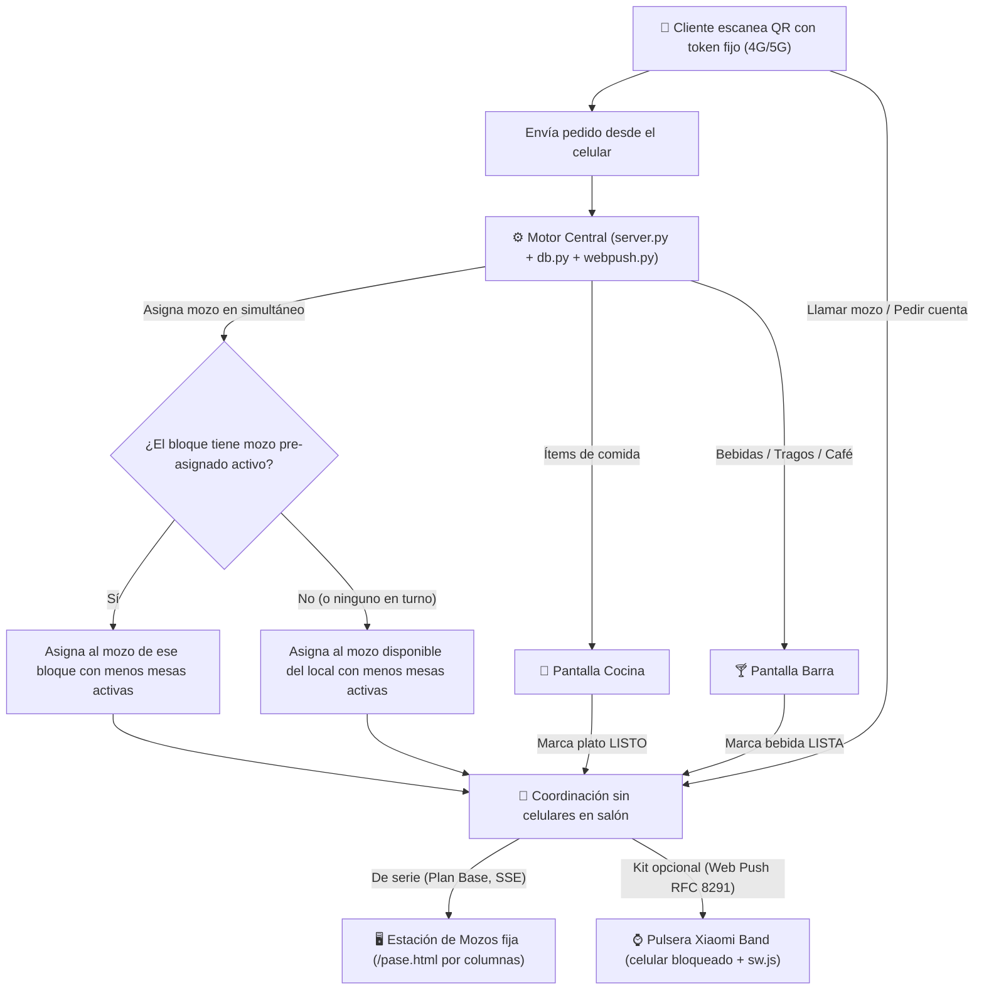

# Arquitectura y Plan de Implementación: SaleListo

Este documento describe la arquitectura funcional y técnica de **SaleListo** ([`../app/`](../app/)), diseñada para operar sobre datos móviles 4G/5G sin requerir Wi-Fi en el salón, coordinar al personal **100% sin celulares en la mano** (mediante la **Estación de Mozos fija `/pase.html`** incluida en el Plan Base y el soporte nativo **PWA + Web Push en segundo plano** para el **Kit de Pulseras Vibradoras Xiaomi Smart Band**) y resolver de raíz los 10 errores estructurales relevados en [`auditoria_inicial_beta.md`](./auditoria_inicial_beta.md).

---

## 1. Operación 4G/5G en la Nube y Modo Local Sin Dependencias

Para que ningún comensal tenga que pedir la clave del Wi-Fi, SaleListo está preparado para ejecutarse en **una dirección pública con HTTPS** (por ejemplo, `https://<tu-servicio>.onrender.com`), conservando al mismo tiempo la ejecución local inmediata en cualquier computadora con Python 3.10+ estándar:

- **En computadora local**: se inicia con `python app/server.py` o `app\iniciar.bat`, sin instalar paquetes externos (`pip`) ni motores de base de datos adicionales.
- **En producción en la nube**: la raíz del repositorio incluye [`render.yaml`](../render.yaml) y [`Procfile`](../Procfile) listos para publicar el servicio con HTTPS (`buildCommand: ""`). De este modo, el celular del cliente ingresa con su propio 4G/5G al escanear el QR, igual que la pantalla fija del Pase, Cocina/Barra, Caja y las notificaciones Web Push en segundo plano hacia las pulseras de los mozos.
- **Base de datos transaccional integrada (`SQLite` en modo WAL)**: reemplaza el antiguo archivo plano `data/state.json` mediante [`app/db.py`](../app/db.py), almacenando bloques, mesas con tokens seguros, turnos de mozos, suscripciones Web Push, pedidos, sesiones de mesa e historial de caja sin corrupción por concurrencia.
- **Criptografía y gráficos autónomos en Python puro**: tanto el generador vectorial de códigos QR ([`app/qrgen.py`](../app/qrgen.py)) como el motor criptográfico Web Push RFC 8291/8292 ([`app/webpush.py`](../app/webpush.py)) están implementados íntegramente sobre la biblioteca estándar de Python.

---

## 2. Flujo Operativo Completo en Tiempo Real

---

## 3. Módulos y Reglas de Negocio

### Módulo A: Constructor del Salón por Bloques Pre-armados y QRs con Token Fijo
En [`restaurante.html`](../app/public/restaurante.html) se reemplaza el límite rígido de mesas por un **Constructor Visual de Salón**:

1. **Catálogo de Bloques en 1 clic**:
   - Plantillas listas para usar: **Interior**, **Exterior / Vereda**, **Terraza**, **Barra**, **Sector 1**, **Sector 2**, **Patio** y **Salón VIP**, con nombre, ícono, columnas y orden editables.
2. **Grilla de Mesas por Bloque**:
   - Alta individual o por lote dentro de cada bloque (por ejemplo, `Terraza`: mesas `T1` a `T4`; `Barra`: posiciones `B1` a `B4`; `Interior`: mesas `1` a `6`), indicando capacidad de cubiertos y estado activo/inactivo.
3. **QR SVG Propio con Token Fijo Anti-Spoofing**:
   - Al crear una mesa se genera un **token aleatorio único y persistente** (`cliente.html?t=...`).
   - El cartel impreso sirve de forma permanente en el acrílico de la mesa, impidiendo que alguien adivine URLs correlativas (`?mesa=5`) para cargar pedidos falsos en otra mesa. Incluye acción de regeneración manual de token cuando el encargado lo requiera.
   - La generación gráfica de códigos QR se resuelve íntegramente en el backend con [`app/qrgen.py`](../app/qrgen.py) (SVG puro ISO/IEC 18004 sin depender de CDNs externos).

### Módulo B: Gestión de Mozos en Vivo y Asignación Híbrida Inteligente
Pestaña dedicada de **Mozos** integrada con los bloques y las sesiones de mesa:

1. **Alta, Baja y Disponibilidad Instantánea**:
   - Creación y baja de mozos en cualquier momento del turno, con color identificador y PIN opcional de 4 dígitos.
   - Interruptor rápido **Disponible / Fuera de turno**.
2. **Dos Modos Combinables de Asignación**:
   - **Pre-asignado por Bloque**: permite asignar uno o varios mozos titulares a cada sector (por ejemplo, *Terraza -> Sofía*, *Interior -> Lucas y Martín*), eligiendo dentro del bloque al titular activo con menor carga.
   - **Automático Balanceado**: reparte cada nueva sesión de mesa al mozo disponible del salón con **menor cantidad de mesas abiertas en ese instante**.
   - **Respaldo Inteligente y Continuidad**: si los mozos titulares de un bloque están fuera de turno, el motor deriva automáticamente a otro mozo activo del local; una vez asignado el mozo en el primer evento de la mesa, se mantiene fijo durante toda la sesión salvo reasignación expresa.
3. **Reasignación Automática ante Salida de Turno**:
   - Si un mozo pasa a no disponible o se da de baja teniendo mesas abiertas, el motor **redistribuye automáticamente sus mesas activas** hacia los compañeros disponibles con menor carga (priorizando su mismo bloque), actualiza el encabezado del cliente y notifica al instante tanto en la columna del nuevo responsable en `pase.html` como por Web Push en su pulsera.

### Módulo C: Separación Cocina / Barra y Estación de Mozos Fija (`pase.html`)
1. **Ruteo Directo por Estación**:
   - Cada categoría de la carta define su estación de preparación: **Cocina** (`cocina`) o **Barra** (`barra`).
   - Al confirmar un pedido mixto, las bebidas impactan de inmediato en **Barra** y los platos en **Cocina** en paralelo, sin que una bebida rápida quede retenida detrás de la cocción de un plato principal.
2. **Comandera Digital KDS ([`cocina.html`](../app/public/cocina.html))**:
   - Vista dedicada para monitor o tablet con filtro instantáneo (**Cocina** | **Barra** | **Ambos**), cronómetro de espera por comanda y posibilidad de avanzar o retroceder estados ante toques accidentales.
3. **Estación de Mozos Fija por Columnas ([`pase.html`](../app/public/pase.html), [`css/pase.css`](../app/public/css/pase.css), [`js/pase.js`](../app/public/js/pase.js))**:
   - Incluida de serie en el **Plan Base** para resolver al 100% la operación **sin celulares en el salón** utilizando una única tablet o monitor horizontal en el mostrador del pase o la barra, legible a **3 o 4 metros de distancia**.
   - **Interfaz de alto contraste**: inicia en **Modo Pase Oscuro (`#1C1917`)** con cambio en 1 clic a **Modo Claro (`#FAF7F2`)**, botón de **Pantalla Completa**, reloj en vivo y toggle de **Sonido (`🔔 Activo`)** que dispara un aviso acústico (`ding()`) cada vez que ingresa un retiro listo o llamado nuevo. Usa autenticación de equipo (`POST /api/auth/kitchen`) y streaming SSE en tiempo real (`scope=staff`).
   - **Grilla dinámica de columnas por mozo activo**: renderiza una columna identificada por color y nombre para cada camarero disponible en turno (`waiters.filter(w => w.available)`), más una columna automática **"Apoyo / Sin asignar"** solo cuando existan eventos pendientes sin mozo en turno asignado.
   - **Tarjetas priorizadas con botones táctiles grandes (`>= 54 px`)**:
     - **🍳 RETIRAR EN COCINA** (`#D97706`) y **🍸 RETIRAR EN BARRA** (`#6D28D9`): comandas en estado `listo` con código gigante de mesa, minutos de espera, ítems/notas y botón **`✔ Ya lo llevé`** (`order.status -> entregado`).
     - **💳 CUENTA PEDIDA** (`#2F8A57`): solicitudes de cuenta pendientes mostrando medio de pago elegido (`Tarjeta`, `Efectivo`, `QR`, `Transferencia`), porcentaje de propina y total exacto calculado de la sesión abierta, con botón **`✔ Llevando cobro`** (`call.attend`).
     - **🙋 MESA LLAMA** (`#D9412B`): llamados de asistencia en mesa con su motivo y botón **`✔ Voy`** (`call.attend`).
   - **Carga rápida sin celulares (`+ Pedido en mostrador`)**: modal ágil en cabecera que permite al mozo cargar en 5 segundos un pedido tomado conversando en la mesa (`order.create` con `source: 'mozo'`) directamente sobre la pantalla fija del pase.

### Módulo D: PWA + Service Worker + Web Push RFC 8291/8292 para Kit Pulseras Vibradoras (Xiaomi Band)
Pensado para patios cerveceros, terrazas por escalera, jardines o veredas amplias donde el camarero se encuentra lejos de la pantalla del pase:

1. **Problema técnico resuelto (Pantalla bloqueada en bolsillo o locker)**:
   - Cuando el teléfono del mozo apaga su pantalla y queda guardado en el bolsillo o en un locker cercano, el sistema operativo móvil congela las pestañas del navegador (suspendiendo SSE y `new Notification()` en página).
   - Para que la app oficial *Mi Fitness* haga vibrar por Bluetooth una **Xiaomi Smart Band** en tiempo real, el aviso debe llegar como **notificación nativa del sistema operativo emitida desde un Service Worker (`PushEvent` -> `self.registration.showNotification`)**.
2. **Motor Criptográfico Web Push en Python Puro ([`app/webpush.py`](../app/webpush.py))**:
   - Construido al 100% con módulos estándar de Python (`hashlib`, `hmac`, `secrets`, `struct`, `base64`, `json`, `urllib.request`), manteniendo cero dependencias externas:
     - **Curva elíptica NIST P-256 (`secp256r1`)**: generación y persistencia automática del par de claves del servidor en `app/data/vapid_keys.json`, acuerdo de claves efímero **ECDH** y firma **ECDSA SHA-256 (`ES256`, `r || s` de 64 bytes)** para encabezados **VAPID (RFC 8292)**.
     - **Cifrado de carga útil RFC 8291 (`Content-Encoding: aes128gcm`)**: derivación **HKDF-SHA256** e implementación pura de **AES-128-GCM** (cifrador Rijndael de 128 bits + autenticación polinómica GHASH en `GF(2^128)`).
     - **Despacho asíncrono no bloqueante**: envíos HTTP `POST` en hilos daemon (`TTL: 120`, `Urgency: high`) hacia FCM, Mozilla Autopush o Apple Web Push, eliminando automáticamente suscripciones expiradas (`HTTP 404` / `410`).
     - **Autoverificación criptográfica integrada**: ejecutando `python app/webpush.py` se corre `self_test()`, que verifica vectores NIST de AES-128-GCM, firmas ECDSA P-256 y un ciclo completo de cifrado/descifrado RFC 8291.
3. **Suscripciones, Textos Ultracompactos para Muñeca y API Push (`app/db.py` + `app/server.py`)**:
   - Tabla `push_subscriptions` vinculada a `waiters(id)` con soporte para múltiples dispositivos y flag `wristband_mode`.
   - Cada evento operativo genera además de la notificación completa una dupla ultracompacta diseñada para el ancho de lectura de medio segundo de una Xiaomi Smart Band (`shortTitle <= 26` caracteres y `shortBody <= 48` caracteres), por ejemplo:
     - `🍸 T2 · Retirar Barra` / `2x Gin Tonic`
     - `🍳 M4 · Retirar Cocina` / `2x Burger`
     - `💳 M8 · Tarjeta` / `$34.200 (Propina 10%)`
     - `🙋 M2 · Llama` / `Agua y hielo`
   - Rutas dedicadas en `app/server.py`: `GET /api/push/vapid-public-key`, `POST /api/push/subscribe`, `POST /api/push/unsubscribe` y `POST /api/push/test` (envía al instante `⌚ Pulsera SaleListo OK` para validar la vibración con pantalla bloqueada en 1 toque).
4. **PWA Instalable y Modo Pulsera ([`manifest.json`](../app/public/manifest.json), [`sw.js`](../app/public/sw.js), [`mozo.html`](../app/public/mozo.html))**:
   - `manifest.json` habilita la instalación como aplicación nativa en Android e iOS con los tokens visuales oficiales (`#FAF7F2` / `#D9412B` y `mark.svg`).
   - `sw.js` en la raíz pública procesa eventos `push` mostrando notificaciones con patrón de vibración reforzado (`[220, 90, 220, 90, 320]`, `renotify: true`) y abre o enfoca `/mozo.html` al tocar la alerta. Desde `mozo.html` el camarero activa con un interruptor el **Modo Pulsera (Xiaomi Band)** y ejecuta el botón de prueba directa.

### Módulo E: Carta Completa, Seguridad por Rol y Caja Real
1. **Gestión Integral de Carta**:
   - ABM completo de categorías con ordenamiento, ícono y estación de destino (`Cocina` / `Barra`).
   - Platos con subida de **fotografías reales** almacenadas en `app/data/uploads/` (además de emojis), control instantáneo de agotados y herramienta de **actualización masiva porcentual de precios (`+%`)** por categoría o sobre toda la carta con redondeo limpio.
2. **Seguridad y Resolución de los 10 Bugs de la Beta**:
   - Autenticación por PIN para encargado (`restaurante.html`), cocina/pase (`cocina.html`, `pase.html`) y mozos (`mozo.html`), más canales SSE segregados por alcance (`staff` vs. `client` acotado únicamente a la mesa del token consultado).
   - Limpieza automática del carrito del cliente con aviso visual si un ítem se agota o elimina.
   - Recálculo dinámico de cuenta si se agregan consumos posteriores y preservación del precio histórico de cada ronda.
   - Anulación individual de pedidos equivocados sin afectar la carta, bloqueo preventivo al cerrar mesas con comandas pendientes en preparación y arqueo real de sesiones cerradas (`table_sessions`) con desglose por medio de pago y propinas por mozo.

---

## 4. Mapa Técnico de Archivos de la Aplicación y Pieza Audiovisual

- [`app/server.py`](../app/server.py): Servidor HTTP multihilo, autenticación ligera por tokens HMAC/sesión, endpoints REST (`/api/info`, `/api/qrs`, `/api/client-state`, `/api/staff-state`, `/api/action`), endpoints Web Push (`/api/push/*`) y streaming SSE filtrado por rol (`/api/events`).
- [`app/db.py`](../app/db.py): Esquema y motor transaccional SQLite (`WAL`), semillas de demostración, balanceador híbrido de mozos, reasignación automática, tabla `push_subscriptions`, textos compactos para smartband y arqueo de caja.
- [`app/webpush.py`](../app/webpush.py): Implementación criptográfica pura en Python estándar de Web Push RFC 8291 (`aes128gcm`, P-256 ECDH, HKDF-SHA256, AES-128-GCM) y VAPID RFC 8292 (`ES256`), con `self_test()` integrado.
- [`app/qrgen.py`](../app/qrgen.py): Codificador QR ISO/IEC 18004 en Python puro con salida vectorial SVG sin dependencias externas.
- [`app/public/index.html`](../app/public/index.html) y [`app/public/demo.html`](../app/public/demo.html): Portada de acceso rápido y simulador interactivo multipantalla en vivo (incluyendo Cliente, Estación de Mozos `pase.html`, Cocina/Barra, Mozo y Admin).
- [`app/public/pase.html`](../app/public/pase.html) + [`css/pase.css`](../app/public/css/pase.css) + [`js/pase.js`](../app/public/js/pase.js): Estación de Mozos fija por columnas para mostrador/barra (operación 100% sin celulares en salón).
- [`app/public/manifest.json`](../app/public/manifest.json) y [`app/public/sw.js`](../app/public/sw.js): Manifiesto PWA instalable y Service Worker de notificaciones nativas Web Push en segundo plano.
- [`app/public/mozo.html`](../app/public/mozo.html) + [`js/mozo.js`](../app/public/js/mozo.js): PWA móvil operativa del mozo con configuración en 1 toque del **Modo Pulsera (Xiaomi Band)**, test de vibración y carga manual.
- [`app/public/cliente.html`](../app/public/cliente.html) + [`js/cliente.js`](../app/public/js/cliente.js): Experiencia móvil del comensal por token QR sobre 4G/5G.
- [`app/public/cocina.html`](../app/public/cocina.html) + [`js/cocina.js`](../app/public/js/cocina.js): Pantalla KDS para Cocina y Barra.
- [`app/public/restaurante.html`](../app/public/restaurante.html) + [`js/restaurante.js`](../app/public/js/restaurante.js): Panel integral del encargado, constructor de salón, mozos, carta, acceso rápido al Pase y caja.
- [`app/public/qr.html`](../app/public/qr.html): Generador de planchas de códigos QR listas para imprimir por bloque.
- [`video-ad/SaleListo_Ad.mp4`](../video-ad/SaleListo_Ad.mp4) y [`video-ad/guion.md`](../video-ad/guion.md): Spot comercial vertical actualizado (`1080x1920`, `60 fps`, `-14 LUFS`), compuesto programáticamente sobre el sistema de diseño unificado (Propuesta 01 · Pase Limpio, máximo 5 palabras en pantalla por escena, Escena 5 dedicada a **`Sin celulares`: `Pase` + `Pulsera`** y placa de cierre con `0% comisión`, `(+54)1138436571` y `ventas@salelisto.com`).
- [`render.yaml`](../render.yaml), [`Procfile`](../Procfile) y [`app/PUBLICAR_EN_INTERNET.md`](../app/PUBLICAR_EN_INTERNET.md): Configuración lista para despliegue cloud con acceso 4G/5G y HTTPS requerido por Web Push.
