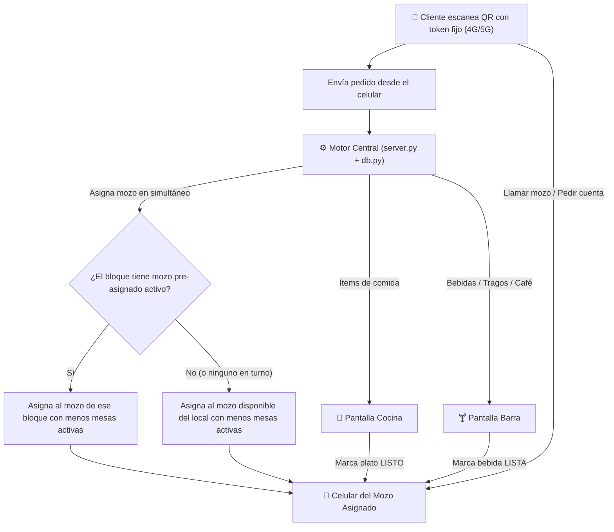

# Arquitectura y Plan de Implementación: SaleListo

Este documento describe la arquitectura funcional y técnica de **SaleListo** ([`../app/`](../app/)), diseñada para operar sobre datos móviles 4G/5G sin requerir Wi-Fi en el salón, coordinar en vivo a los mozos y corregir los 10 errores estructurales relevados en [`auditoria_inicial_beta.md`](./auditoria_inicial_beta.md).

---

## 1. Operación 4G/5G en la Nube y Modo Local Sin Dependencias

Para que ningún comensal tenga que pedir la clave del Wi-Fi, SaleListo está preparado para ejecutarse en **una dirección pública con HTTPS** (por ejemplo, `https://<tu-servicio>.onrender.com`), conservando al mismo tiempo la ejecución local inmediata en cualquier computadora con Python 3.10+ estándar:

- **En computadora local**: se inicia con `python app/server.py` o `app\iniciar.bat`, sin instalar paquetes externos ni motores de base de datos adicionales.
- **En producción en la nube**: la raíz del repositorio incluye [`render.yaml`](../render.yaml) y [`Procfile`](../Procfile) listos para publicar el servicio con HTTPS. De este modo, el celular del cliente ingresa con su propio 4G/5G al escanear el QR, igual que los teléfonos de los mozos, la pantalla de Cocina/Barra y la Caja.
- **Base de datos transaccional integrada (`SQLite` en modo WAL)**: reemplaza el antiguo archivo plano `data/state.json` mediante [`app/db.py`](../app/db.py), almacenando bloques, mesas con tokens seguros, turnos de mozos, pedidos, sesiones de mesa e historial de caja sin corrupción por concurrencia.

---

## 2. Flujo Operativo Completo en Tiempo Real

---

## 3. Módulos y Reglas de Negocio

### Módulo A: Constructor del Salón por Bloques Pre-armados y QRs con Token Fijo
En [`restaurante.html`](../app/public/restaurante.html) se reemplaza el límite rígido de mesas por un **Constructor Visual de Salón**:

1. **Catálogo de Bloques en 1 clic**:
   - Plantillas listas para usar: **Interior**, **Exterior / Vereda**, **Terraza**, **Barra**, **Sector 1**, **Sector 2**, **Patio** y **Salón VIP**, con nombre, ícono, columnas y orden editables.
2. **Grilla de Mesas por Bloque**:
   - Alta individual o por lote dentro de cada bloque (por ejemplo, `Terraza`: mesas `T1` a `T4`; `Barra`: posiciones `B1` a `B4`; `Interior`: mesas `1` a `6`), indicando capacidad de cubiertos y estado activo/inactivo.
3. **QR SVG Propio con Token Fijo Anti-Spoofing**:
   - Al crear una mesa se genera un **token aleatorio único y persistente** (`cliente.html?t=...`).
   - El cartel impreso sirve de forma permanente en el acrílico de la mesa, impidiendo que alguien adivine URLs correlativas (`?mesa=5`) para cargar pedidos falsos en otra mesa. Incluye acción de regeneración manual de token cuando el encargado lo requiera.
   - La generación gráfica de códigos QR se resuelve íntegramente en el backend con [`app/qrgen.py`](../app/qrgen.py) (SVG puro ISO/IEC 18004 sin depender de CDNs externos).

### Módulo B: Gestión de Mozos en Vivo y Asignación Híbrida Inteligente
Pestaña dedicada de **Mozos** integrada con los bloques y las sesiones de mesa:

1. **Alta, Baja y Disponibilidad Instantánea**:
   - Creación y baja de mozos en cualquier momento del turno, con color identificador y PIN opcional de 4 dígitos.
   - Interruptor rápido **Disponible / Fuera de turno**.
2. **Dos Modos Combinables de Asignación**:
   - **Pre-asignado por Bloque**: permite asignar uno o varios mozos titulares a cada sector (por ejemplo, *Terraza -> Sofía*, *Interior -> Lucas y Martín*), eligiendo dentro del bloque al titular activo con menor carga.
   - **Automático Balanceado**: reparte cada nueva sesión de mesa al mozo disponible del salón con **menor cantidad de mesas abiertas en ese instante**.
   - **Respaldo Inteligente y Continuidad**: si los mozos titulares de un bloque están fuera de turno, el motor deriva automáticamente a otro mozo activo del local; una vez asignado el mozo en el primer evento de la mesa, se mantiene fijo durante toda la sesión salvo reasignación expresa.
3. **Reasignación Automática ante Salida de Turno**:
   - Si un mozo pasa a no disponible o se da de baja teniendo mesas abiertas, el motor **redistribuye automáticamente sus mesas activas** hacia los compañeros disponibles con menor carga (priorizando su mismo bloque), actualiza el encabezado del cliente y notifica al instante al celular del nuevo mozo responsable.

### Módulo C: Separación Simultánea Cocina / Barra y App Móvil del Mozo
1. **Ruteo Directo por Estación**:
   - Cada categoría de la carta define su estación de preparación: **Cocina** (`cocina`) o **Barra** (`barra`).
   - Al confirmar un pedido mixto, las bebidas impactan de inmediato en **Barra** y los platos en **Cocina** en paralelo, sin que una bebida rápida quede retenida detrás de la cocción de un plato principal.
2. **App Móvil del Mozo ([`mozo.html`](../app/public/mozo.html))**:
   - Diseñada para llevar en el bolsillo con alertas sonoras desbloqueadas y vibración háptica (`navigator.vibrate`) filtradas para sus propias mesas:
     - **Nuevo pedido ingresado** en una de sus mesas.
     - **Listo para retirar en Cocina o Barra**, con detalle exacto de estación, mesa e ítems y botón de entrega en un toque.
     - **Llamado de asistencia en mesa** con motivo y confirmación de recepción.
     - **Solicitud de cuenta** con total recalculado al instante, porcentaje de propina elegido (`0%`, `5%`, `10%`, `15%`) y medio de pago (`Efectivo`, `Tarjeta`, `QR`, `Transferencia`).
   - **Toma de pedido manual**: permite al mozo abrir cualquiera de sus mesas y cargar productos directamente desde su teléfono.
3. **Comandera Digital KDS ([`cocina.html`](../app/public/cocina.html))**:
   - Vista dedicada para monitor o tablet con filtro instantáneo (**Cocina** | **Barra** | **Ambos**), cronómetro de espera por comanda y posibilidad de avanzar o retroceder estados ante toques accidentales.

### Módulo D: Carta Completa, Seguridad por Rol y Caja Real
1. **Gestión Integral de Carta**:
   - ABM completo de categorías con ordenamiento, ícono y estación de destino (`Cocina` / `Barra`).
   - Platos con subida de **fotografías reales** almacenadas en `app/data/uploads/` (además de emojis), control instantáneo de agotados y herramienta de **actualización masiva porcentual de precios (`+%`)** por categoría o sobre toda la carta con redondeo limpio.
2. **Seguridad y Resolución de los 10 Bugs de la Beta**:
   - Autenticación por PIN para encargado (`restaurante.html`), cocina (`cocina.html`) y mozos (`mozo.html`), más canales SSE segregados por alcance (`staff` vs. `client` acotado únicamente a la mesa del token consultado).
   - Limpieza automática del carrito del cliente con aviso visual si un ítem se agota o elimina.
   - Recálculo dinámico de cuenta si se agregan consumos posteriores y preservación del precio histórico de cada ronda.
   - Anulación individual de pedidos equivocados sin afectar la carta, bloqueo preventivo al cerrar mesas con comandas pendientes en preparación y arqueo real de sesiones cerradas (`table_sessions`) con desglose por medio de pago y propinas por mozo.

---

## 4. Mapa Técnico de Archivos de la Aplicación

- [`app/server.py`](../app/server.py): Servidor HTTP multihilo, autenticación ligera por tokens HMAC/sesión, endpoints REST (`/api/info`, `/api/qrs`, `/api/client-state`, `/api/staff-state`, `/api/action`) y streaming SSE filtrado por rol (`/api/events`).
- [`app/db.py`](../app/db.py): Esquema y motor transaccional SQLite, semillas de demostración, balanceador híbrido de mozos, reasignación automática y arqueo de caja.
- [`app/qrgen.py`](../app/qrgen.py): Codificador QR ISO/IEC 18004 en Python puro con salida vectorial SVG sin dependencias externas.
- [`app/public/index.html`](../app/public/index.html) y [`app/public/demo.html`](../app/public/demo.html): Portada de acceso rápido y simulador interactivo de 4 pantallas en simultáneo (Cliente + Mozo + Cocina/Barra + Admin).
- [`app/public/cliente.html`](../app/public/cliente.html) + [`js/cliente.js`](../app/public/js/cliente.js): Experiencia móvil del comensal por token QR.
- [`app/public/mozo.html`](../app/public/mozo.html) + [`js/mozo.js`](../app/public/js/mozo.js): Aplicación móvil operativa del mozo.
- [`app/public/cocina.html`](../app/public/cocina.html) + [`js/cocina.js`](../app/public/js/cocina.js): Pantalla KDS para Cocina y Barra.
- [`app/public/restaurante.html`](../app/public/restaurante.html) + [`js/restaurante.js`](../app/public/js/restaurante.js): Panel integral del encargado, constructor de salón, mozos, carta y caja.
- [`app/public/qr.html`](../app/public/qr.html): Generador de planchas de códigos QR listas para imprimir por bloque.
- [`render.yaml`](../render.yaml), [`Procfile`](../Procfile) y [`app/PUBLICAR_EN_INTERNET.md`](../app/PUBLICAR_EN_INTERNET.md): Configuración lista para despliegue cloud con acceso 4G/5G.
