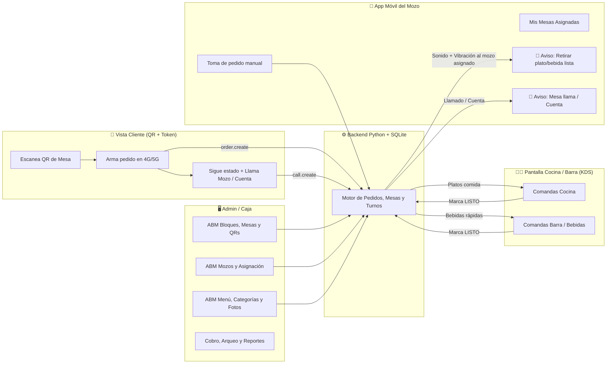

# Auditoría Inicial de la Beta: Prototipo "Pedio"

*Documento histórico de diagnóstico técnico previo a la construcción de **SaleListo** ([`../app/`](../app/)). Todos los errores, brechas de seguridad y módulos faltantes relevados aquí fueron resueltos en la arquitectura actual documentada en [`arquitectura_salelisto.md`](./arquitectura_salelisto.md).*

---

## 1. Radiografía General del Prototipo Inicial

La beta original (internamente llamada **Pedio**, evolucionada luego en [`app/`](../app/README.md)) partía de un prototipo funcional monolítico diseñado para correr únicamente en red local (LAN) sin dependencias externas:

- **Backend ([`server.py`](../app/server.py))**: En su versión inicial consistía en un servidor HTTP multihilo en Python puro (`ThreadingHTTPServer`, 371 líneas), con persistencia en un único archivo plano `data/state.json` y comunicación en tiempo real mediante **Server-Sent Events (SSE)** en `/api/events`.
- **Frontend ([`public/`](../app/public/))**: HTML + CSS + Vanilla JS sin frameworks, dividido originalmente en:
  - [`cliente.html`](../app/public/cliente.html) + [`cliente.js`](../app/public/js/cliente.js): App móvil para el comensal.
  - [`restaurante.html`](../app/public/restaurante.html) + [`restaurante.js`](../app/public/js/restaurante.js): Panel único del restaurante.
  - [`qr.html`](../app/public/qr.html) y [`demo.html`](../app/public/demo.html): Generador de QRs imprimibles y vista de pantalla dividida para presentaciones.

> [!IMPORTANT]
> **Diagnóstico ejecutivo inicial:** La beta original resolvía bien la **demostración visual del flujo cliente-cocina**, pero cubría apenas el **45% de la visión de negocio**. Faltaban por completo dos pilares centrales (**configuración dinámica de mesas por sectores** y **gestión/asignación de mozos con notificaciones dirigidas**), además de presentar **10 bugs concretos en el código** y vulnerabilidades que impedían operarla en un salón real.

---

## 2. Matriz Comparativa: Visión Objetivo vs. Estado Inicial de la Beta

| Requisito de negocio | Estado en la beta inicial | Qué faltaba implementar |
| :--- | :---: | :--- |
| **Restaurante carga menú con precios** | 🟡 **Parcial** | Permitía crear, editar, agotar y borrar platos en [`server.py`](../app/server.py), pero **no dejaba crear/editar categorías** (estaban fijas en comida japonesa), ni admitía fotos reales (solo 24 emojis fijos) ni ajustes masivos de precios. |
| **Restaurante carga las mesas** | 🔴 **No implementado** | El número `12` estaba fijo en [`server.py`](../app/server.py) y [`demo.html`](../app/public/demo.html). No existía pantalla ni endpoint para agregar/quitar mesas, nombrarlas (`Terraza 2`, `Barra 1`), definir capacidad o agrupar por sectores. |
| **Restaurante asigna mozos** | 🔴 **No implementado** | No existía la entidad `mozo` en el estado, ni ABM de personal, ni asignación de mesas o bloques a mozos. |
| **Cliente escanea QR y pide comida** | 🟢 **Funcionaba (solo LAN)** | Funcionaba en red Wi-Fi local: carrito por mesa, aclaraciones por plato, validación de precios en servidor y seguimiento en vivo de 4 etapas. |
| **Se carga directo en sistema** | 🟢 **Funcionaba** | Impactaba al instante por SSE en el tablero Kanban (`Nuevos` -> `En cocina` -> `Listos` -> `Entregados`) y sobrevivía a reinicios del servidor. |
| **Avisa a los mozos correspondientes** | 🔴 **Muy incompleto** | Solo disparaba un `ding` global en la PC del mostrador ([`restaurante.js`](../app/public/js/restaurante.js)). **No existía vista móvil para el mozo**, no filtraba avisos según quién atendía cada mesa, y cuando cocina marcaba un plato `"Listo"` le avisaba al cliente pero **no al mozo** que debía llevarlo. |

---

## 3. Aciertos de la Beta Conservados en SaleListo

1. **Precios y totales calculados en servidor**: En [`server.py`](../app/server.py) y [`db.py`](../app/db.py), el backend ignora cualquier monto enviado por el cliente y recalcula precios y propinas contra el catálogo oficial.
2. **Transaccionalidad limpia**: El motor valida cada acción de forma atómica antes de persistir cambios y notificar a los suscriptores.
3. **Tiempo real liviano con SSE**: El uso de `EventSource` ([`store.js`](../app/public/js/store.js)) con *keep-alive* cada 15 segundos ([`server.py`](../app/server.py)) actualiza instantáneamente platos agotados, estados de pedidos y cierres de mesa con reconexión automática.
4. **Diseño UI/UX del lado cliente**: La interfaz móvil ([`cliente.css`](../app/public/css/cliente.css)) es limpia, rápida, intuitiva y usa *bottom sheets* cómodos para operar con una sola mano.

---

## 4. Los 10 Bugs Concretos Detectados en la Beta (Resueltos en SaleListo)

### Bug 1: Caída de la app del cliente al eliminar un plato que estaba en su carrito
- **Dónde ocurría**: [`cliente.js`](../app/public/js/cliente.js).
- **Qué pasaba**: Al abrir la página, `loadCart()` leía `localStorage` **antes** de limpiar ítems inexistentes. Si el restaurante había eliminado un plato del menú (`item.delete`), la barra inferior mostraba `"1 · Ver mi pedido · $0"` y al tocarla `openCartSheet()` ejecutaba `const it = itemById(l.itemId)` (`undefined`) y accedía a `it.emoji`, lanzando un `TypeError` que rompía el carrito. Además, cuando un plato pasaba a agotado, se borraba del array en memoria sin actualizar `localStorage` ni avisar al comensal con un `toast`.

### Bug 2: Desfase de dinero al pedir la cuenta y agregar otro consumo después
- **Dónde ocurría**: [`server.py`](../app/server.py) y [`restaurante.js`](../app/public/js/restaurante.js).
- **Qué pasaba**: Al crear una llamada de tipo `cuenta`, el servidor calculaba `total` y lo congelaba en el objeto `call`. Si otro comensal de la mesa pedía una bebida adicional, la columna de solicitudes y el cálculo de propina seguían mostrando el importe viejo, induciendo a cobrar de menos.

### Bug 3: Error matemático en el desglose de mesa si cambiaba un precio durante la sesión
- **Dónde ocurría**: [`restaurante.js`](../app/public/js/restaurante.js).
- **Qué pasaba**: `openTableModal(n)` agrupaba los platos consumidos por nombre y calculaba `i.price * i.qty` usando el precio del **primer pedido**. Si el restaurante actualizaba el precio de ese plato entre la primera y la segunda ronda, la suma de los renglones no coincidía con el total real a cobrar.

### Bug 4: El cliente podía abrir mesas inexistentes (`?mesa=999`) o caer por defecto en la Mesa 4
- **Dónde ocurría**: [`cliente.js`](../app/public/js/cliente.js).
- **Qué pasaba**: `Math.max(1, parseInt(params.get('mesa'), 10) || 4)` asignaba silenciosamente la **Mesa 4** si faltaba el parámetro y no validaba contra el padrón real de mesas hasta el intento de envío a cocina.

### Bug 5: Cerrar una mesa marcaba pedidos sin cocinar como "Entregados" sin advertencia
- **Dónde ocurría**: [`server.py`](../app/server.py).
- **Qué pasaba**: La acción `table.close` pasaba forzosamente **todos** los pedidos de la mesa a `entregado`, incluso si había comandas en `nuevo` o `cocina`, ocultándolas de cocina sin avisar al cajero.

### Bug 6: El sonido de alerta (`ding`) no sonaba al abrir el panel (Autoplay Policy)
- **Dónde ocurría**: [`ui.js`](../app/public/js/ui.js).
- **Qué pasaba**: Los navegadores modernos bloquean `AudioContext` en estado `suspended` hasta que exista una interacción previa (`click`/`keydown`) en la pestaña, sin invocarse `audioCtx.resume()` ni ofrecer un indicador de activación sonora.

### Bug 7: Imposibilidad de anular pedidos, cancelar ítems o retroceder estados equivocados
- **Dónde ocurría**: [`server.py`](../app/server.py) y [`restaurante.js`](../app/public/js/restaurante.js).
- **Qué pasaba**: El flujo `nuevo -> cocina -> listo -> entregado` era irreversible y no existía acción `order.cancel`. El único botón disponible era **"Reiniciar datos"**, que destruía también todos los platos cargados por el restaurante.

### Bug 8: KPIs engañosos ("Ventas del día" y "Ticket promedio")
- **Dónde ocurría**: [`restaurante.js`](../app/public/js/restaurante.js).
- **Qué pasaba**: `"Ventas del día"` sumaba todos los pedidos históricos (incluyendo días previos y mesas aún no cobradas), y `"Ticket promedio"` dividía las ventas por cantidad de comandas sueltas en lugar de sesiones de mesa cerradas.

### Bug 9: Re-render destructivo del DOM cada 30 segundos y en cada evento SSE
- **Dónde ocurría**: [`restaurante.js`](../app/public/js/restaurante.js).
- **Qué pasaba**: `renderAll()` sobrescribía `innerHTML` completo cada 30 segundos, cerrando secciones desplegables y dejando desactualizados los modales abiertos.

### Bug 10: Doble actualización de estado y condición de carrera entre `POST` y `SSE`
- **Dónde ocurría**: [`store.js`](../app/public/js/store.js).
- **Qué pasaba**: Cada acción disparaba `broadcast` por SSE y además devolvía `snapshot` en la respuesta HTTP sin control de versión monotónica, permitiendo que una respuesta HTTP lenta pisara en pantalla un estado más reciente recibido por SSE.

---

## 5. Riesgos Críticos de Seguridad, Red y Escalabilidad Detectados

> [!WARNING]
> **Riesgos de la beta inicial que motivaron el rediseño hacia SaleListo:**
> 1. **Panel del restaurante abierto sin autenticación:** Cualquier usuario en la red podía abrir `/restaurante.html`, alterar precios, cerrar su propia mesa o reiniciar la base.
> 2. **Pedidos falsos entre mesas (QR secuencial predecible):** Cambiando `?mesa=4` a `?mesa=8` en la URL, cualquiera podía cargar pedidos o pedir la cuenta en otra mesa.
> 3. **Exposición global de estado por SSE:** `/api/events` enviaba el estado íntegro del local a todos los navegadores conectados.
> 4. **Dependencia del Wi-Fi local y de CDNs externos:** Con datos móviles 4G/5G la IP local `192.168.x.x` no era accesible; a la inversa, sin salida a internet [`qr.html`](../app/public/qr.html) fallaba porque descargaba `qrcode.min.js` desde un CDN externo (reemplazado en SaleListo por [`qrgen.py`](../app/qrgen.py) en Python puro).

---

## 6. Arquitectura Objetivo Implementada en SaleListo

Para cubrir de punta a punta la operación gastronómica real, la aplicación se estructuró en **4 vistas especializadas por rol** conectadas al mismo motor transaccional SQLite en tiempo real:

El detalle completo de cómo quedó construido cada módulo puede consultarse en [`arquitectura_salelisto.md`](./arquitectura_salelisto.md).
