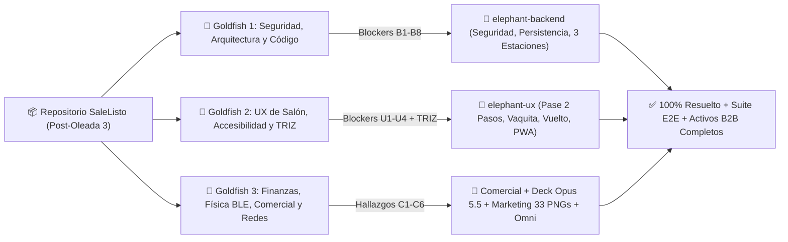

# Informe Oficial de Auditoría y Resolución: Metodología Elephant-Goldfish Model (EGM)

**Proyecto:** SaleListo (Plataforma B2B/B2C de pedidos QR sobre 4G/5G, 3 estaciones en tiempo real y coordinación de salón sin celulares)  
**Fase:** Oleadas 4, 5 y 6 · Auditoría Independiente EGM, Cierre Comercial/Redes y Pipeline Audiovisual Omni  
**Contacto del proyecto:** Simón Martínez de Guereñu · `(+54)1138436571` · `ventas@salelisto.com` · `simonguerenu@gmail.com`

---

## 1. Resumen Ejecutivo y Metodología Elephant-Goldfish (EGM)

Tras completar las primeras tres oleadas de construcción (motor transaccional SQLite WAL, Web Push RFC 8291/8292 en Python puro, Estación de Mozos fija `/pase.html`, Landing Comercial B2B, Estudio QR A4, fábrica de contenidos de marketing y Dossier Comercial), el repositorio completo fue sometido a una auditoría bajo el paradigma **Elephant-Goldfish Model (EGM)** y consolidado con los cierres creativos y audiovisuales de las Oleadas 5 y 6:

1. **Auditores "Goldfish" (Contexto Fresco Cero Sesgo)**: Tres revisores independientes sin memoria del proceso previo inspeccionaron el sistema desde cero simulando a un atacante en red 4G, a un jefe de salón y un comensal en un viernes lleno en Buenos Aires, y a un dueño gastronómico revisando números con calculadora en mano.
2. **Ingenieros "Elephant" (Ejecución Quirúrgica con Contexto Completo)**: Tres especialistas dedicados (`elephant-backend`, `elephant-ux` y `elephant-comercial`) resolvieron el **100% de los hallazgos críticos, mayores y menores**, preservando las invariantes centrales del proyecto (**cero dependencias externas de `pip`**, identidad vectorial oficial *Propuesta 01 · Pase Limpio* y reglas editoriales estrictas).

---

## 2. Eje 1: Auditoría `Goldfish Design / Codebase` (Seguridad, Persistencia y Backend)

El primer auditor evaluó vectores de exposición en modo producción (`demoMode = False`), aislamiento de datos personales (`PII`), supervivencia ante reinicios en la nube, integridad contable y huso horario operativo argentino.

### 2.1 Matriz de Hallazgos y Resoluciones (`elephant-backend`)

| ID | Severidad | Hallazgo detectado por Goldfish (`Design/Codebase`) | Resolución quirúrgica implementada | Archivos intervenidos |
| :--- | :---: | :--- | :--- | :--- |
| **B1** | Crítica | `GET /api/qrs` devolvía todos los `qrToken` sin exigir sesión aún con `demoMode = False`, permitiendo enumerar mesas remotamente; `qrgen.py` fallaba ante URLs largas de producción. | Cuando `not db.is_demo_mode()`, `GET /api/qrs` exige rol autenticado (`admin`, `waiter` o `kitchen`) y responde `401` a anónimos. `qrgen.py` fue ampliado hasta **Versión 10 (`271` bytes)** con indicador de 16 bits, Reed-Solomon multi-bloque e información Golay de 18 bits. | `app/server.py`, `app/qrgen.py`, `app/public/qr.html` |
| **B2** | Crítica | Abrir `restaurante.html?demo=1` emitía el mismo token `admin` real, exponiendo filas reales de la tabla `leads` (PII comercial) y permitiendo alterar PIN o configuración desde la demo pública. | Creación del rol segregado **`demo_admin`** para ingresos `{"demo": true}`: bloquea cambios en `adminPin`, `demoMode` y `publicUrl`, separa `Subscriber` SSE en scopes `admin` / `demo_admin` / `staff` / `client`, y entrega en `demo_admin` únicamente 2 consultas ficticias en memoria (`DEMO-L1`, `DEMO-L2`), reservando la tabla `leads` real en exclusiva al rol `admin`. | `app/server.py`, `app/db.py` |
| **B3** | Alta | Editar un mozo dejando el campo PIN en blanco sobrescribía silenciosamente su PIN previo con `""`, y en producción un mozo sin PIN podía autenticarse enviando PIN vacío desde 4G. | `act_waiter_save` preserva `old['pin']` cuando `pin == ""` salvo envío explícito de `clearPin: true`. En `demoMode = False`, `verify_waiter_login` usa `hmac.compare_digest` y exige `admin_pin` a cualquier mozo sin PIN individual configurado. | `app/db.py`, `app/public/js/restaurante.js` |
| **B4** | Alta | `render.yaml` carecía de disco persistente montado (perdiendo SQLite y fotos al redesplegar) y `webpush.py` no leía claves VAPID desde variables de entorno. | Configuración en `render.yaml` y `app/render.yaml` de disco persistente `salelisto-data` (`1 GB` en `/var/data`), `DATA_DIR=/var/data` y `TZ=America/Argentina/Buenos_Aires`. Soporte prioritario para `VAPID_PUBLIC_KEY` / `VAPID_PRIVATE_KEY` en entorno y exclusión de `app/data/server_secret.key` en `.gitignore`. | `render.yaml`, `app/render.yaml`, `app/webpush.py`, `.gitignore` |
| **B5** | Crítica | `table_sessions` tenía relación `ON DELETE CASCADE` hacia `tables(id)`: borrar una mesa cerrada o un bloque de verano destruía ventas históricas del arqueo CSV. | Incorporación de `closed_table_code` y `closed_block_name` en `table_sessions` (con backfill automático y guardado en `act_table_close`) más columna `archived` en `tables` y `blocks`. Si existen sesiones históricas, `table.delete` y `block.delete` realizan **baja lógica (`active = 0, archived = 1`)**, preservando el 100% del historial contable y liberando el código visual. | `app/db.py` |
| **B6** | Alta | Reiniciar `server.py` volvía `db.version` a `1` (congelando clientes SSE conectados) e invalidaba todos los tokens en memoria; faltas de sesión en `/api/action` respondían `400` en vez de `401`. | Persistencia monotónica de `db.version` en SQLite (`seqs` -> `state_ver`), clave persistente en `DATA_DIR/server_secret.key`, sesiones en tabla `staff_sessions` con TTL de 24 h y revocación inmediata al borrar mozo o cambiar su PIN, y códigos HTTP exactos (`401` sin sesión, `403` rol insuficiente). | `app/db.py`, `app/server.py`, `app/public/js/store.js` |
| **B7** | Alta | `start_of_today_ms()` usaba medianoche local/UTC del servidor: en servidores cloud UTC cortaba la caja a las `21:00 ART` y en local escondía las ventas de `00:00` a `03:00 AM` en pleno servicio nocturno; además `ZoneInfo` falla en Windows sin `tzdata`. | Definición de `AR_TZ = timezone(timedelta(hours=-3), name='ART')` en stdlib pura (100% compatible Windows + Linux) y **corte operativo gastronómico a las `06:00 AM ART`** tanto en KPIs diarios como en `GET /api/export/sessions.csv` (con filtros `desde`/`hasta` en SQL `WHERE`). | `app/db.py`, `app/server.py` |
| **B8** | Media / Habilitadora | Potencial Blind-SSRF o hilos sin tope en envíos Web Push, N+1 en `get_client_state()`, falta de `/api/health` y necesidad de contratos backend para 3 estaciones, agotados desde cocina, *Vaquita* y vuelto. | Rechazo de `Content-Length < 0`, `Handler.timeout = 30`, cola SSE `maxsize=24`, rate-limit en `/api/auth/*` (10 fallos / 5 min), `ThreadPoolExecutor(max_workers=4)` y bloqueo Anti-Blind-SSRF en `webpush.py` (solo `https://` hacia IPs globales públicas sin `3xx`), `GET /api/health`, eliminación de N+1, `STATIONS = {'cocina', 'barra', 'mostrador'}`, `item.toggle` para `kitchen`, `cashAmount`/`splitWays`/`changeAmount` en `calls`, `data.clear_open_turn` y `price.undo`. | `app/server.py`, `app/db.py`, `app/webpush.py`, `app/tests_e2e.py` |

---

## 3. Eje 2: Auditoría `Goldfish UX / TRIZ Catalyst` (Operación en Salón, Accesibilidad y Conversión)

El segundo auditor recorrió la experiencia bajo principios **TRIZ** (eliminación de contradicciones operativas sin agregar complejidad visual), detectando fricciones táctiles en hora pico y oportunidades concretas para destrabar mesas grupales porteñas.

### 3.1 Matriz de Hallazgos y Resoluciones (`elephant-ux`)

| ID | Severidad | Hallazgo detectado por Goldfish (`UX/TRIZ`) | Resolución aplicada en Frontend y PWA | Archivos intervenidos |
| :--- | :---: | :--- | :--- | :--- |
| **U1** | Crítica | En `pase.html`, tocar *"Llevando cobro"* ocultaba la tarjeta antes de cerrar la mesa (haciendo olvidar al mozo medio de pago, propina y monto), tocar *"Voy"* no daba feedback al cliente y `setInterval(renderBoard, 15000)` reconstruía el DOM cortando toques. | **Flujo en dos pasos**: `✔ Voy` envía `status: 'en_camino'` (mostrando en el celular del comensal *"🏃 Tu mozo ya va camino a tu mesa"*) y deja botón `✔ Atendido`; `✔ Llevando cobro` mantiene visible una tarjeta compacta con **medio de pago, propina, total y vuelto exacto** hasta cerrar la sesión. Se reemplazó el re-render por `tickSla()` in-place, se sumó **filtro por bloque (`?bloque=`)**, auto-compactación de mozos al día con `>= 4` columnas y *Screen Wake Lock*. | `app/public/pase.html`, `js/pase.js`, `css/pase.css` |
| **U2** | Alta | En `index.html`, los enlaces a `restaurante.html` pedían PIN al prospecto; el diagrama de pulsera sugería guardar el celular en un locker; `window.open` asíncrono podía bloquearse en iOS/Android al enviar el formulario; la calculadora ROI no sincronizaba el switch `ARS/USD`. | Enlaces actualizados a `restaurante.html?demo=1`, texto exacto *"pide y solicita la cuenta desde el QR"*, corrección visual del diagrama BLE (*celular bloqueado en el bolsillo*), matriz con 3 estaciones y etiqueta honesta *(Próximamente)*, calculadora ROI sincronizada en moneda con **deep-links compartibles (`?mesas=&ticket=&turnos=#roi`)**, botón directo `<a href="https://wa.me/541138436571...">` en confirmación, manejo de `429` y foco accesible en `#nav-burger`. | `app/public/index.html`, `js/landing.js`, `css/landing.css` |
| **U3** | Alta | En `cliente.html`, un evento SSE entrante pisaba la selección abierta en *Pedir la cuenta*; además faltaba resolver la división grupal ("vaquita"), el aviso de cambio en efectivo y la repetición rápida de bebidas. | Preservación de estado abierto ante SSE, integración de **Calculadora "Vaquita"** (`÷ Dividir entre [-][N][+] personas`), **chips de declaración de efectivo** (`Importe justo`, `$20.000`, `$50.000` o monto exacto) calculando el vuelto en vivo, campo de motivo libre en `💬 Otro` y botón **`🔄 Repetir`** en rondas entregadas. | `app/public/cliente.html`, `js/cliente.js`, `css/cliente.css` |
| **U4** | Media | Faltaba 3.ª estación (`Mostrador`) y botón de agotados (*86*) directo en `cocina.html`; los botones de sonido no permitían silenciar/reactivar; la propina no solicitada pre-marcaba `10%` en cierres manuales; el ajuste por inflación no tenía vista previa ni deshacer; faltaban íconos PNG raster para iOS/Android. | Pestaña **`🍣 Mostrador`** + cajón **`🚫 Agotados`** + modal propio de PIN + *Wake Lock* en `cocina.*`; `toggleSoundMute()` global y chequeo de rotación VAPID en `ui.js`; aviso de sesión expirada en `store.js`; propina no solicitada en **`0%`** por defecto en `mozo.js`, `pase.js` y `restaurante.js`; **Vista Previa Antes/Después + `↩ Deshacer`** en ajuste por inflación; SSE vivo en `operacion.html`; `data.clear_open_turn` en `demo.html`; e íconos raster `icon-180.png`, `icon-192.png` e `icon-512.png`. | `cocina.*`, `mozo.*`, `restaurante.*`, `ui.js`, `store.js`, `operacion.html`, `demo.html`, `manifest.json`, `sw.js` |

---

## 4. Eje 3: Auditoría `Goldfish Commercial / Marketing` (Matemática Financiera, Física BLE y Go-To-Market)

El tercer auditor contrastó línea por línea `modelo_de_negocios.md`, `brochure_b2b.html`, `propuestas_restaurantes.md`, `prospectos_restaurantes.csv` y `sistema_de_marca.md` desde la óptica escéptica de un propietario gastronómico argentino y de un analista financiero SaaS.

### 4.1 Matriz de Hallazgos y Resoluciones (`elephant-comercial`)

| ID | Severidad | Hallazgo detectado por Goldfish (`Commercial/Marketing`) | Resolución quirúrgica aplicada | Archivos intervenidos |
| :--- | :---: | :--- | :--- | :--- |
| **C1** | Alta | Coexistían distintas promesas de prueba y puesta en marcha (`21 días` / `3 fines de semana` en `modelo_de_negocios.md`, `7 días` / `una semana` / `20 minutos` en `propuestas_restaurantes.md` frente a `14 días` / `48 horas` en Reels, Landing y Dossier). | **Unificación canónica al 100%**: eliminada toda mención residual a `21 días`, `3 fines de semana`, `7 días`, `una semana` o `20 minutos`. Única promesa en todo el ecosistema: **Piloto sin riesgo de 14 días (2 fines de semana completos) en 1 sector crítico, activado llave en mano en 48 horas**. | `comercial/modelo_de_negocios.md`, `comercial/propuestas_restaurantes.md`, `comercial/brochure_b2b.html` |
| **C2** | Crítica | Varios textos decían que con la pulsera Xiaomi Band el teléfono podía quedar *"en un locker"*, lo cual viola el alcance físico de **Bluetooth Low Energy (BLE)** (~8 a 10 m sin muros) en patios o terrazas; además quedaban frases viejas (*"avisando al celular del mozo"*) en `prospectos_restaurantes.csv` y `sistema_de_marca.md`. | Precisión física y comercial en todos los documentos: con **Estación de Mozos fija (`/pase.html`)** los celulares sí quedan guardados en **locker o caja**; en **Modo Pulsera (Bluetooth BLE)** el teléfono va **guardado y bloqueado en el bolsillo del mozo** (jamás se saca en el salón) y es compatible con los **3 planes** (`Barra/Café`, `Salón` y `Gran Salón`). Actualizados los 26 prospectos del CSV y `sistema_de_marca.md`. | `modelo_de_negocios.md`, `propuestas_restaurantes.md`, `brochure_b2b.html`, `prospectos_restaurantes.csv`, `branding/sistema_de_marca.md`, `README.md` |
| **C3** | Crítica | En la tabla ROI de 25 mesas: las 4 filas en USD sumaban `821 + 1.173 + 150 + 266 = 2.410` pero el total decía `2.409` (`2.344` neto); `brochure_b2b.html` mostraba un híbrido `+ ARS 5.238.450` en la celda bruta final; la glosa de merma (`1,3% s/CMV`) daba `236.486` en vez de `236.250`; la frase *"se paga con 10 pintas o 2 mesas"* subestimaba costos; la 4.ª palanca hablaba de recortar eventuales (generando rechazo en encargados); y en `3.3`/`3.4` había salto de OPEX no documentado (`USD 1.900`, `USD 4.800`) y `20 locales` figuraba *"Equilibrio"* cuando `1.125 - 900 - 345 = -USD 120`. | Cierre aritmético exacto al peso y al dólar: subtotal **`+ ARS 3.794.569 (USD 2.410)`** menos `USD 65` = **`+ ARS 3.692.194/mes (USD 2.345)`**; celda bruta vacía en la fila neta del Dossier; merma expresada con exactitud matemática (`30 platos/bebidas rehechos menos x ARS 7.875 [USD 5] = ARS 236.250 / USD 150`); frase real defendible (**"menos del 0,20% de tu venta: se paga solo con 3 a 4 mesas extra o ~25 pintas adicionales en todo el mes"**); 4.ª palanca **100% pro-equipo** (*absorber picos vie/sáb sin desborde ni recargos*); 4 escalones OPEX (`900 / 1.900 / 2.770 / 4.800`) alineados al dólar exacto con nota de altas brutas vs. reposición de churn `3,5%`; `ARCA (ex AFIP)` y checklist de registros `MX` en `salelisto.com`. | `comercial/modelo_de_negocios.md`, `comercial/brochure_b2b.html` |
| **C4** | Alta | En la matriz de planes figuraban como incluidas funciones aún no programadas (*Listas horarias*, *Sincronización multisede*), faltaban respuestas a objeciones porteñas clave (pedidos falsos/"paga Dios" en vereda, vaquita/cambio, convivencia con Maxirest/Fudo/Bistrosoft, permanencia/IPC), los primeros DMs de Instagram superaban las 90 palabras y faltaba protocolo Inbound de WhatsApp. | Cero vapourware: **3 estaciones reales**, *Vaquita*, vuelto y Pase por bloque destacados como activos hoy, y *Listas horarias*, *Sync multisede* y *Cobro QR* etiquetados como **`Roadmap Fase 2 / Próximamente`**. Sumadas las 4 objeciones porteñas, acortados los **8 `Mensaje 1` de Instagram DM a `<= 35 palabras`** (`32 a 34` palabras verificadas) e incorporado el **"Guion de Respuesta y Calificación Inbound en WhatsApp (SLA < 15 min)"**. | `comercial/modelo_de_negocios.md`, `comercial/propuestas_restaurantes.md`, `comercial/brochure_b2b.html` |
| **C5** | Media | Faltaban herramientas operativas concretas para cerrar y ejecutar el piloto en el momento de la visita comercial (deck interactivo con simulador en vivo, mensajes hechos 1 a 1, acuerdo simple de 1 carilla con comodato de pulseras y planilla modelo de carga de carta en 48 h). | Creación de [`presentacion_interactiva.html`](../comercial/presentacion_interactiva.html) (Deck comercial de 10 láminas `1280x720` con panel de notas del orador `[N]`, simuladores en vivo de *Vaquita* y ROI, y toggle `ARS/USD`), [`mensajes_personalizados_26_locales.md`](../comercial/mensajes_personalizados_26_locales.md) (prospección personalizada 1 a 1 para los 26 locales reales con DM `<= 35` palabras y deep-links `#roi`), [`acuerdo_piloto_14_dias.md`](../comercial/acuerdo_piloto_14_dias.md), [`SaleListo_Acuerdo_Piloto_14d.pdf`](../comercial/SaleListo_Acuerdo_Piloto_14d.pdf) (**1 página A4 exacta**), [`SaleListo_Dossier_Comercial.pdf`](../comercial/SaleListo_Dossier_Comercial.pdf) (**2 páginas A4 exactas**) y [`plantilla_carga_carta.csv`](../comercial/plantilla_carga_carta.csv). | `comercial/presentacion_interactiva.html`, `comercial/mensajes_personalizados_26_locales.md`, `comercial/acuerdo_piloto_14_dias.md`, `comercial/SaleListo_Acuerdo_Piloto_14d.pdf`, `comercial/SaleListo_Dossier_Comercial.pdf`, `comercial/plantilla_carga_carta.csv` |
| **C6** | Media | En `marketing/`, `post_04` mostraba precios sin redondeo gastronómico (`$5.616`), dos piezas decían `24 h` en lugar de `48 h`, faltaban PDFs multipágina para subir carruseles en LinkedIn y formatos de Historias verticales (`1080x1920`), los copys `#17-#20` estaban desordenados en el calendario y faltaba el pipeline open-ended hacia Gemini Omni 1.2 Flash. | Actualización de `post_04_precios_anti_inflacion.png` a **redondeo limpio a `$100`** (`+8%`: `$14.500 -> $15.700`), unificación a **`48 h`** y `+USD 2.410 / +USD 2.345`, exportación de **3 PDFs nativos para LinkedIn** (`5 pág. 1080x1350` c/u) y **6 Historias verticales (`1080x1920`)** en `marketing/stories/` (**33 PNGs gráficos totales**), reordenamiento cronológico de `Copy #01` a `Copy #20` + campaña consolidada Meta Ads en `calendario_redes_30dias.md`, e integración del script open-ended [`video-ad/generar_ad_omni.py`](../video-ad/generar_ad_omni.py) para **Gemini Omni 1.2 Flash**. | `marketing/src_grafica/*`, `marketing/posts/*`, `marketing/stories/*`, `marketing/banners/*`, `marketing/calendario_redes_30dias.md`, `marketing/guiones_reels.md`, `video-ad/generar_ad_omni.py` |

---

## 5. Estado Final de Verificación Cruzada e Inventario Definitivo

- **Seguridad y Arquitectura Backend (`app/tests_e2e.py`)**: `100% TESTS E2E APROBADOS` en biblioteca estándar pura de Python, validando aislamiento `demo_admin` (leads reales protegidos), `/api/qrs` autenticado en prod, `qrgen.py` Versión 10 (`271` bytes), persistencia monotónica `db.version` + `SERVER_SECRET` + `staff_sessions` en SQLite, baja lógica contable (`archived = 1`) al borrar mesas/bloques con historial, corte de turno gastronómico `06:00 ART` (`UTC-3`), disco persistente en `render.yaml`, bloqueo Anti-Blind-SSRF en `webpush.py` y `/api/health`.
- **UX Operativa y Mejoras TRIZ (`app/public/`)**: **3 estaciones reales (`Cocina`, `Barra`, `Mostrador`)**, **Calculadora grupal "Vaquita" + declaración de vuelto en efectivo** en el QR y en el Pase, flujo en 2 pasos `Voy -> En camino -> Atendido`, `tickSla()` no destructivo, filtro `?bloque=` y compactación de mozos al día en `pase.html`, cajón **`🚫 Agotados`** en 1 toque desde `cocina.html`, **Vista Previa Antes/Después + Deshacer** en ajuste masivo de precios, *Screen Wake Lock*, íconos PWA raster (`180/192/512`) y deep-links personalizados `#roi` en Landing.
- **Ecosistema Comercial (`comercial/`)**: `modelo_de_negocios.md`, `propuestas_restaurantes.md`, `mensajes_personalizados_26_locales.md`, `presentacion_interactiva.html` (Deck 10 láminas + notas `[N]` + simuladores), `SaleListo_Dossier_Comercial.pdf` (**2 páginas A4 exactas**), `SaleListo_Acuerdo_Piloto_14d.pdf` (**1 página A4 exacta**), `acuerdo_piloto_14_dias.md`, `plantilla_carga_carta.csv` y `prospectos_restaurantes.csv`.
- **Fábrica de Marketing y Video (`marketing/` + `video-ad/`)**: Spot Oficial v5 `SaleListo_Ad.mp4` + script `generar_ad_omni.py` (Omni 1.2 Flash), **5 Reels verticales MP4 60 fps**, **3 carruseles (15 PNGs + 3 PDFs nativos para LinkedIn)**, **4 posts individuales**, **6 Historias verticales (`1080x1920`)**, **8 banners multicanal** (**33 PNGs gráficos totales**), `guiones_reels.md` y `calendario_redes_30dias.md`.
- **Higiene Editorial e Invariantes del Proyecto**: `0` ocurrencias de raya larga (`U+2014`), único número telefónico `(+54)1138436571`, correos oficiales `ventas@salelisto.com` y `simonguerenu@gmail.com`, `0` frases prohibidas, `0` enlaces ficticios y directorios temporales eliminados.
